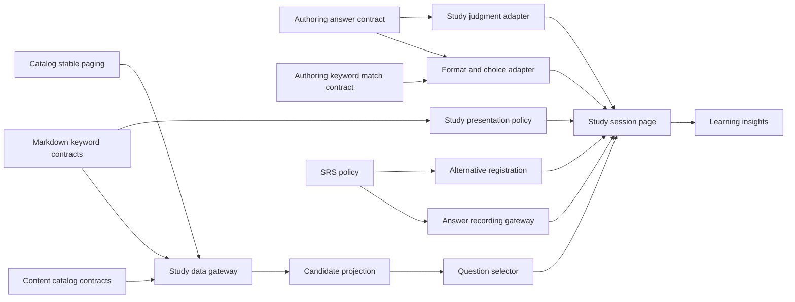
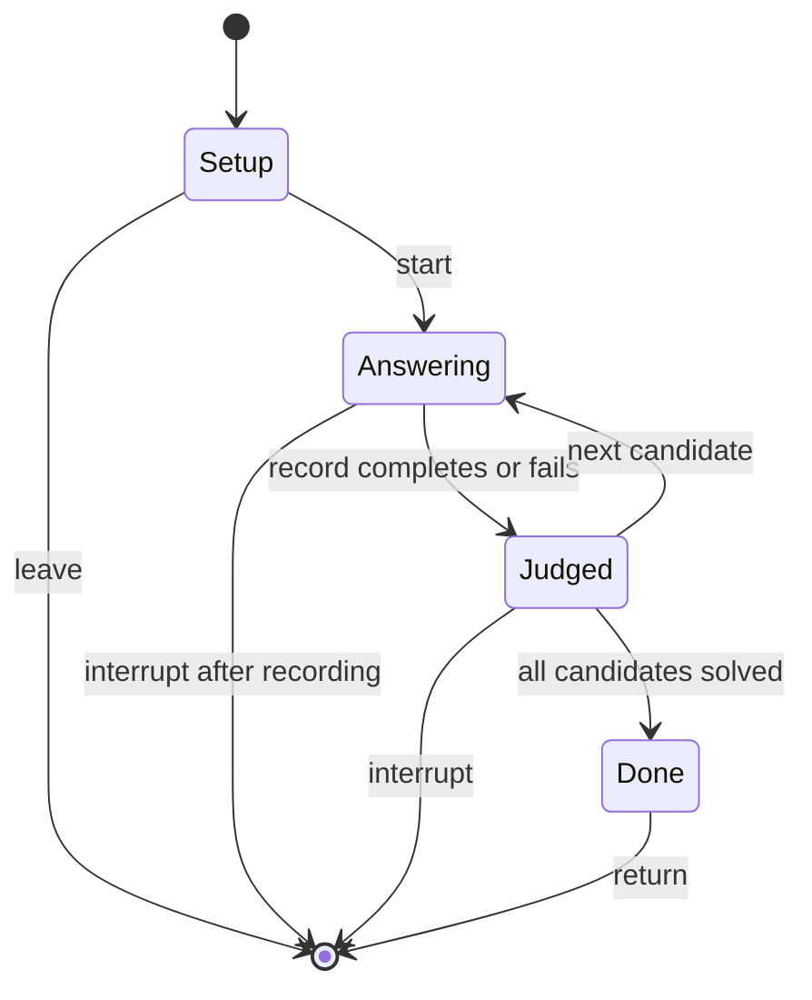
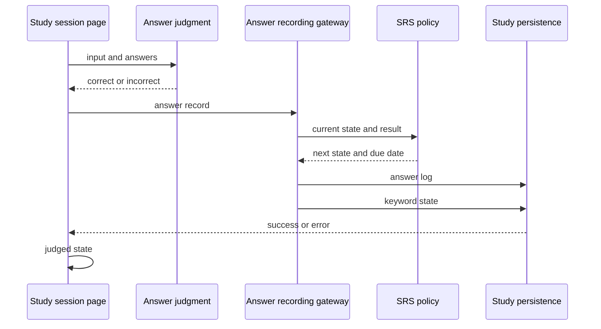

# 技術設計書

## Overview

**Purpose**: 本機能は、個人学習者へ教材文脈付きの穴埋め学習を提供し、範囲設定、次問選定、解答、判定、記録、SRS 更新、終了または中断までを一貫して扱う。
**Users**: 認証済みの個人学習者が、科目または教材から学習を開始し、PC とスマートフォンで反復する。
**Impact**: 現行の feature-first 実装、共有契約、DB schema、決定表 12〜18、unit／E2E を将来変更の基準として固定する。ベースライン化そのものはアプリケーションコードを変更しない。

### Goals

- 1問の選定から記録、再出題、終了までの状態遷移を安定契約にする。
- 順序、形式、選択肢、表示、判定、成績、SRS の純粋ポリシーを明確にする。
- 上流の章／Markdown／キーワード契約と、下流の学習集計との所有境界を固定する。
- 実装済みの回帰証拠と、未充足または未検証のギャップを分離する。

### Non-Goals

- 科目、教材、章の CRUD、移動、削除、本文編集
- キーワード記法、通常保存、活性同期、衝突解決の再定義
- 履歴／統計ダッシュボード、通知、ランキング、AI 採点
- 既存 UI のリデザイン、既存 schema の破壊的変更

## Boundary Commitments

### This Spec Owns

- 科目または教材を入口とする学習 read model と、選択章／本文出現／活性状態からの候補射影
- 自動順／出現順、直近回避、正解済み除外による次問選定
- 自動／選択肢／記述の形式決定、誤答候補構成、固定の「わからない」
- 学習中の表示範囲、伏せ字、判定後の色分け、および学習画面固有の状態遷移
- authoring 所有の正答判定を学習問題へ適用する adapter、問題別成績、解答履歴、キーワード別学習状態、SRS の意味
- 不正解の記述入力を別解へ登録し、直前の判定と SRS だけを訂正する study 固有操作

### Out of Boundary

- `Subject`、`Material`、`ChapterRow` の作成・更新・削除・順序保存
- 章本文とキーワード記法の通常編集、ID 採番、保存時の活性同期
- 共通 Markdown parser、`src/lib/answer.ts` の正答正規化／完全一致、`src/lib/keywordMatch.ts` の overlap／duplicate／`Plan`／`Conflict`、共通 shell／theme／navigation の所有
- 学習履歴を使うダッシュボード集計と表示
- RLS、認証セッション、DB ロール権限の横断設計

### Allowed Dependencies

- `learning-content-catalog`: `Subject.id`、`Material.id`、`ChapterRow`、保存済み章順、同一 owner／material の DB 整合性、`src/lib/paged.ts` の安定した全件取得、削除後のキーワード活性状態
- `markdown-keyword-authoring`: 文書内 ID、`answers`、`tags`、`wrongChoices`、`isActive`、キーワード token、Markdown 空欄描画、`src/lib/answer.ts`、`src/lib/keywordMatch.ts`
- `identity-and-access`: 認証済み利用者、所有者分離済み Supabase client、RLS
- `app-shell-and-responsive-experience`: study route、パンくず、下部ナビゲーション、共通 token と警告表示
- PostgreSQL の `keywords`、`keyword_stats`、`answer_logs` と既存制約／索引

### Revalidation Triggers

- 科目／教材／章 ID、`ChapterRow`、章順、親子関係、章本文、削除規則の変更
- 文書内 ID、キーワード記法、`answers`、`tags`、`wrongChoices`、`isActive` の意味変更
- answer normalization、`KeywordMatchPlanner` の overlap／duplicate 定義、Markdown の位置情報、`MarkdownView.renderBlank` の変更
- 定着閾値、直近回避件数、選択肢数、固定ラベル、SRS 定数または式の変更
- `answer_logs`／`keyword_stats` schema、所有関係、catalog の複合参照制約、RLS、記録トランザクションの変更
- 下流 `learning-insights` が読む正答数、出題数、期限、拡張フラグ、解答時刻の定義変更

これらの変更では、上流の該当 spec、本仕様、`learning-insights` を依存順に再検証する。

## Architecture

### Existing Architecture Analysis

- `StudyPage` が setup／answering／judged／done の画面状態とセッション内集計を統合する。
- `order.ts`、`question.ts`、`range.ts`、`score.ts`、`alt.ts`、`srs.ts` は副作用のないポリシーであり、列番号付き unit test を持つ。
- `api.ts` が Supabase 行を camelCase read model へ変換し、記録操作を隠蔽する。Page と純粋ポリシーは DB 行を直接扱わない。
- `ChapterRow`／`buildTree`／`flatten`、keyword token、Markdown renderer、answer normalization は上流または共有契約を再利用する。
- 現行の記録は複数 Data API 要求に分かれ、全スコープ行の全件取得と同一セッションの SRS 状態反映にギャップがある。本設計はギャップを未完了タスクとして隔離する。

### Architecture Pattern & Boundary Map



- **Selected pattern**: feature-first の Page coordinator＋pure policy＋Data API gateway。
- **Dependency direction**: `Catalog／Authoring shared contracts → Study adapters and pure policies → Study gateway／projection → StudySessionPage → downstream read consumers`。study から共有契約の型や照合規則を再定義せず、共有層または上流から study Page への逆依存を作らない。
- **Existing patterns preserved**: strict TypeScript、named export、camelCase 変換、日本語 `Error`、`fetchAll`、決定表列番号による回帰追跡。
- **New runtime components**: なし。以下のコンポーネント名は既存ファイルの責務を示す。

### Technology Stack

| Layer | Choice / Version | Role in Feature | Notes |
|---|---|---|---|
| Frontend | React 19、React Router 7、TypeScript 5.9 | セッション状態、study route、学習 UI | `strict`、`any` 不使用 |
| Presentation | Tailwind CSS 4、共有 MarkdownView | レスポンシブ表示、空欄、Markdown 文脈 | 共通 token を利用 |
| Client data | Supabase JS 2、共通 paging | read model、履歴／状態／別解更新 | DB 行は API 境界で変換 |
| Data | PostgreSQL 17、PostgREST、RLS | キーワード、SRS、解答履歴 | 将来の原子化は RPC を使用 |
| Validation | Vitest 3、Playwright 1.56 | 純粋ポリシー、利用者経路、DB副作用 | E2E はローカル DB で直列 |

## File Structure Plan

### Directory Structure

```text
src/
├── features/study/
│   ├── StudyPage.tsx          # StudySessionPage と CandidateProjection の状態統合・表示
│   ├── api.ts                 # StudyDataGateway、AnswerRecordingGateway、AlternativeRegistration
│   ├── order.ts               # QuestionSelector
│   ├── order.test.ts          # 出題順と直近回避の回帰
│   ├── question.ts            # FormatAndChoicePolicy
│   ├── question.test.ts       # 形式・選択肢・固定選択の回帰
│   ├── range.ts               # StudyPresentationPolicy
│   ├── range.test.ts          # 空欄色・伏せ字・範囲拡張の回帰
│   ├── score.ts               # ScoreProjection
│   ├── score.test.ts          # 今回を含む問題別成績の回帰
│   ├── alt.ts                 # AlternativeAnswerPolicy
│   ├── alt.test.ts            # 導線・追加・重複排除の回帰
│   ├── srs.ts                 # SrsPolicy
│   └── srs.test.ts            # 間隔・EF・期限の回帰
├── lib/
│   ├── answer.ts              # authoring 所有。study は正規化・完全一致を消費
│   ├── keywordMatch.ts        # authoring 所有。study は overlap／duplicate を消費
│   ├── keyword.ts             # 上流所有の keyword token 契約
│   ├── markdown.ts            # 上流所有の Markdown AST 契約
│   └── paged.ts               # catalog 所有。study gateway が安定順で消費
├── components/
│   └── MarkdownView.tsx       # 上流所有の Markdown／空欄描画
└── features/chapters/
    └── tree.ts                # 上流所有の ChapterRow と保存順 flatten

supabase/migrations/
├── 20260829000000_init.sql                # keywords、keyword_stats、answer_logs、index、RLS
├── 20261010030000_record_study_answer.sql # 未完了: 解答記録の原子的 RPC
└── 20261010040000_register_study_alternative.sql # 未完了: 別解登録の原子的 RPC

supabase/tests/database/
└── adaptive_study_session.test.sql         # 未完了: transaction 内の段階別失敗と rollback の DB 統合回帰

e2e/
└── study.spec.ts              # setup、解答、表示、記録、別解、1,001件の統合回帰

spec/tables/
└── 12-order.jsonl ... 18-srs.jsonl # 詳細な既存回帰ケース
```

### Modified Files

- ベースライン仕様の作成時点ではアプリケーションファイルを変更しない。
- 未完了ギャップを実装する場合だけ、責務に対応する `api.ts`、`StudyPage.tsx`、新しい migration、unit／E2E、決定表を同じ変更で更新する。
- 適用済み migration は変更せず、原子化が必要な場合は新しい timestamp migration を追加する。

### Component to File Mapping

| Component | Files |
|---|---|
| StudyDataGateway | `src/features/study/api.ts` |
| CandidateProjection | `src/features/study/StudyPage.tsx`、`src/features/study/api.ts` |
| QuestionSelector | `src/features/study/order.ts` |
| FormatAndChoicePolicy | `src/features/study/question.ts` |
| StudyPresentationPolicy | `src/features/study/range.ts` |
| AuthoringAnswerContract | `src/lib/answer.ts`、`src/lib/keywordMatch.ts`（上流所有） |
| StudyJudgmentAdapter | `src/features/study/question.ts`、`src/features/study/alt.ts` |
| ScoreProjection | `src/features/study/score.ts` |
| AlternativeAnswerPolicy | `src/features/study/alt.ts` |
| SrsPolicy | `src/features/study/srs.ts` |
| AnswerRecordingGateway | `src/features/study/api.ts`、`supabase/migrations/20260829000000_init.sql` |
| AnswerRecordingTransaction | `supabase/migrations/20261010030000_record_study_answer.sql` |
| AlternativeRegistration | `src/features/study/api.ts`、`supabase/migrations/20260829000000_init.sql` |
| AlternativeRegistrationTransaction | `supabase/migrations/20261010040000_register_study_alternative.sql` |
| StudySessionPage | `src/features/study/StudyPage.tsx` |

## System Flows

### 出題から次問まで



### 1問の記録



## Requirements Traceability

| Requirement | Summary | Components | Interfaces / Flows |
|---|---|---|---|
| 1.1, 1.2, 1.3, 1.4, 1.5, 1.6, 1.7, 1.8, 1.9 | 範囲と本文出現による候補集合 | StudyDataGateway、CandidateProjection、StudySessionPage | `loadStudyData`、`docIdsInBody`、catalog paging |
| 2.1, 2.2, 2.3, 2.4, 2.5, 2.6, 2.7, 2.8, 2.9, 2.10 | 次問と一周 | QuestionSelector、StudySessionPage | `pickNext`、session state flow |
| 3.1, 3.2, 3.3, 3.4, 3.5 | 形式決定 | FormatAndChoicePolicy、StudySessionPage | `decideFormat` |
| 4.1, 4.2, 4.3, 4.4, 4.5, 4.6, 4.7, 4.8 | 選択肢 | FormatAndChoicePolicy、StudyJudgmentAdapter、AuthoringAnswerContract | `buildChoices`、`judgeChoice`、`hasAnswerOverlap` |
| 5.1, 5.2, 5.3, 5.4, 5.5, 5.6, 5.7, 5.8, 5.9, 5.10 | 文脈と空欄 | StudyPresentationPolicy、StudySessionPage | `viewOfBlank`、`expandRange`、MarkdownView |
| 6.1, 6.2, 6.3, 6.4, 6.5, 6.6, 6.7, 6.8 | 判定と成績 | AuthoringAnswerContract、StudyJudgmentAdapter、ScoreProjection、StudySessionPage | `normalizeAnswer`、`judge`、`keywordScore`、answer flow |
| 7.1, 7.2, 7.3, 7.4, 7.5, 7.6 | 記録 | AnswerRecordingGateway、SrsPolicy、StudySessionPage | `recordAnswer`、recording promise |
| 8.1, 8.2, 8.3, 8.4, 8.5, 8.6, 8.7, 8.8, 8.9, 8.10 | 別解 | AuthoringAnswerContract、AlternativeAnswerPolicy、AlternativeRegistration、SrsPolicy | `canRegisterAlt`、`addAlternative`、`registerAlternative` |
| 9.1, 9.2, 9.3, 9.4, 9.5, 9.6, 9.7, 9.8, 9.9 | SRS | SrsPolicy、AnswerRecordingGateway、AlternativeRegistration | `updateSrs`、record flow |
| 10.1, 10.2, 10.3, 10.4, 10.5 | study UI | StudySessionPage | setup tree、responsive layout、progress state |

## Components and Interfaces

| Component | Domain / Layer | Intent | Req Coverage | Key Dependencies | Contracts |
|---|---|---|---|---|---|
| StudyDataGateway | Data access | catalog 所有 paging を使い範囲の read model を取得する | 1.1, 1.2, 1.8 | Catalog P0、Authoring P0、Supabase P0 | Service |
| CandidateProjection | Application | `chapter_id` ではなく本文出現と選択章から候補を作る | 1.3, 1.4, 1.5, 1.6, 1.7, 1.9 | StudyDataGateway P0、Chapter tree P0 | Service、State |
| QuestionSelector | Domain | 次の候補を順序付ける | 2.1, 2.2, 2.3, 2.4, 2.5, 2.6 | CandidateProjection P0 | Service |
| FormatAndChoicePolicy | Domain | 形式と選択肢を決め、authoring の overlap 契約で重複を除く | 3.1, 3.2, 3.3, 3.4, 3.5, 4.1, 4.2, 4.3, 4.4, 4.5, 4.6, 4.7 | AuthoringAnswerContract P0 | Service |
| StudyPresentationPolicy | Domain | 表示範囲と空欄表示を決める | 5.1, 5.2, 5.3, 5.4, 5.5, 5.6, 5.7, 5.8, 5.9, 5.10 | Markdown contract P0、AuthoringAnswerContract P1 | Service |
| AuthoringAnswerContract | Upstream shared | 正規化、完全一致、overlap、duplicate の意味を提供する | 4.3, 6.1, 6.2, 6.3, 6.4, 8.4, 8.10 | markdown-keyword-authoring P0 | Service |
| StudyJudgmentAdapter | Domain adapter | 共有判定と固定の「わからない」を学習操作へ適用する | 4.8, 6.1, 6.2, 6.3, 6.4, 6.5 | AuthoringAnswerContract P0 | Service |
| ScoreProjection | Domain | 今回を含む問題別成績を算出する | 6.7, 6.8 | Study state P0 | Service |
| AlternativeAnswerPolicy | Domain | 共有 duplicate 判定を使い、study 固有の別解登録導線と追加を決める | 8.1, 8.2, 8.3, 8.4, 8.10 | AuthoringAnswerContract P0 | Service |
| SrsPolicy | Domain | 次の反復状態と期限を計算する | 9.1, 9.2, 9.3, 9.4, 9.5, 9.6, 9.7, 9.8, 9.9 | Clock input P1 | Service |
| AnswerRecordingGateway | Data access | 履歴と学習状態を記録する | 7.1, 7.2, 7.3, 7.4, 7.5, 7.6 | SrsPolicy P0、RLS P0 | Service、State |
| AnswerRecordingTransaction | Data | 履歴と学習状態を原子的に更新する | 7.1, 7.2, 7.3, 7.5, 7.6 | PostgreSQL P0、RLS P0 | API |
| AlternativeRegistration | Data access | 正答、直前履歴、SRSを訂正する | 8.5, 8.6, 8.7, 8.8, 8.9, 9.9 | AlternativeAnswerPolicy P0、SrsPolicy P0 | Service、State |
| AlternativeRegistrationTransaction | Data | 別解、直前履歴、SRSを原子的に訂正する | 8.5, 8.6, 8.9, 9.9 | PostgreSQL P0、RLS P0 | API |
| StudySessionPage | UI / Application | setupから終了までを統合する | 2.7, 2.8, 2.9, 2.10, 6.6, 10.1, 10.2, 10.3, 10.4, 10.5 | 全 study component P0、App shell P1 | State |

### Data Access

#### StudyDataGateway

```typescript
type StudyChapter = ChapterRow & {
  materialId: string;
  body: string;
};

type StudyKeyword = {
  id: string;
  docId: string;
  materialId: string;
  chapterId: string | null; // provenance hint only
  answers: string[];
  tags: string[];
  wrongChoices: string[];
  isActive: boolean;
  stats: (SrsState & {
    totalCount: number;
    correctCount: number;
    dueAt: Date | null;
  }) | null;
};

type StudyData = {
  title: string;
  subjectId: string;
  chapters: StudyChapter[];
  keywords: StudyKeyword[];
};

function loadStudyData(scope: { kind: 'subject' | 'material'; id: string }): Promise<StudyData>;
function docIdsInBody(body: string): string[];
```

- `subjectId` は中断／終了時の戻り先に使う。
- キーワードは `(materialId, docId)` で各章本文の token 出現へ対応させる。`chapterId` は provenance hint として read model に残せるが、候補所属や選択章判定には使わない。
- `keywords` は現行で全ページ取得済みで返す。全候補保証には catalog 所有の StablePagedReader を materials、chapters、chapter bodies にも適用する必要があり、これは未完了の feature adapter 作業である。study は `src/lib/paged.ts` 自体を変更しない。

#### AnswerRecordingGateway

```typescript
type RecordAnswerInput = {
  keywordId: string;
  format: 'choice' | 'text';
  input: string;
  correct: boolean;
  expanded: boolean;
  stats: StudyKeyword['stats'];
  now?: Date;
};

function recordAnswer(input: RecordAnswerInput): Promise<SrsResult>;
```

- 認証利用者がない場合は `ログインしていません` で失敗する。
- 成功後は履歴と学習状態の双方が今回を反映していることを postcondition とする。
- 現行は分割書込みであり、途中失敗時は警告し、判定を保って次の操作を継続する。

#### AnswerRecordingTransaction

- 未完了の DB 境界であり、認証利用者、キーワード、解答 payload、現在時刻を受け取る。
- transaction 内で現在の学習状態を読み、その snapshot を履歴へ保持したうえで履歴1件と学習状態1件を更新し、保存済みの累積数と SRS 全状態を返す。
- 履歴 insert、学習状態 upsert、返却値の読取りを1つの DB transaction で確定し、途中失敗ではその要求内の全変更を rollback する。
- ブラウザの既存 `isRecording` 制御が同じ画面操作の二重送信を抑止する。
- 解答前 snapshot は `answer_logs` の nullable な `prior_total_count`、`prior_correct_count`、`prior_repetition`、`prior_ease_factor`、`prior_interval_days` へ保存する。初回解答では全項目を null とし、既存履歴は移行時に補完しない。

**API contract**:

```text
record_study_answer(
  p_keyword_id uuid,
  p_format text,
  p_input text,
  p_is_correct boolean,
  p_expanded boolean,
  p_answered_at timestamptz
) -> total_count, correct_count, repetition, ease_factor, interval_days, due_at
```

- migration は `20261010030000_record_study_answer.sql` に限定し、identity 所有の `RpcSecurityMatrix` で authenticated owner 成功、cross-owner 分離、anon 拒否、service role の準備／事後確認限定を同じゲートで検証する。

#### AlternativeRegistration

```typescript
type RegisterAlternativeInput = {
  keywordId: string;
  answers: string[];
  stats: StudyKeyword['stats']; // 直前の誤答を記録する前に current が保持していた snapshot
  now?: Date;
};

function registerAlternative(input: RegisterAlternativeInput): Promise<void>;
```

- 対象 keyword の正答、利用者が直前に残した当該 keyword の履歴、学習状態だけを変更する。
- 以前の履歴は不変である。
- 3更新の部分成功を防ぐ原子性は未完了である。
- 上記 `stats` は現行分割書込みが使うブラウザ snapshot である。`AlternativeRegistrationTransaction` へ切り替えた後の gateway は `{ keywordId, answers, now? }` だけを受け取り、学習状態をクライアントから渡さない。

#### AlternativeRegistrationTransaction

- 未完了の DB 境界であり、認証利用者、対象キーワード、確定済み answers、現在時刻を受け取る。
- transaction 内で正答、直前の該当履歴、学習状態を更新し、どの段階の失敗でも全更新を rollback する。
- 直前より前の履歴と別キーワードの履歴は変更しない。
- RPC は所有者の最新履歴を行ロックし、不正解であることと、解答記録時に保存した誤答前 snapshot を DB 内で読む。既出題 snapshot では現在の `total_count = prior_total_count + 1` かつ `correct_count = prior_correct_count`、初回解答の全 null snapshot では現在の `total_count = 1` かつ `correct_count = 0` を検証する。不一致なら全変更を行わず失敗する。

**API contract**:

```text
register_study_alternative(
  p_keyword_id uuid,
  p_answers text[],
  p_registered_at timestamptz
) -> total_count, correct_count, repetition, ease_factor, interval_days, due_at
```

- migration は `20261010040000_register_study_alternative.sql` に限定し、identity 所有の `RpcSecurityMatrix` で authenticated owner 成功、cross-owner 分離、anon 拒否、service role の準備／事後確認限定を同じゲートで検証する。

### Pure Study Policies

#### QuestionSelector

```typescript
type Candidate = { keywordId: string; position: number; dueAt: Date | null };
type PickOptions = {
  order: 'auto' | 'sequential';
  recent: readonly string[];
  now: Date;
  random?: () => number;
};

const RECENT_LIMIT = 10;
function pickNext(candidates: readonly Candidate[], options: PickOptions): Candidate | null;
```

#### FormatAndChoicePolicy

```typescript
type AnswerFormat = 'choice' | 'text';
type FormatSetting = 'auto' | 'choice' | 'text';
type ChoiceSelection = { value: string; unknown: boolean };
type FormatInput = { totalCount: number; correctCount: number; wrongCount: number };
type ChoiceSource = {
  keywordId: string;
  answers: string[];
  tags: string[];
  distance: number;
  isActive: boolean;
};
type Question = {
  keywordId?: string;
  answers: string[];
  tags: string[];
  wrongChoices: string[];
};
type BuiltChoices = {
  correct: string;
  choices: string[];
  format: AnswerFormat;
};

const SETTLED_COUNT = 3;
const SETTLED_RATE = 0.9;
const CHOICE_COUNT = 4;
const UNKNOWN_CHOICE_LABEL = 'わからない';

function decideFormat(setting: FormatSetting, input: FormatInput): AnswerFormat;
function buildChoices(question: Question, sources: readonly ChoiceSource[], random?: () => number): BuiltChoices;
function sameTag(a: readonly string[], b: readonly string[]): boolean;
function judgeChoice(selection: ChoiceSelection, answers: readonly string[]): boolean;
```

#### StudyPresentationPolicy

```typescript
type BlankColor = 'yellow' | 'gray' | 'orange' | 'none';
type BlankView = { display: 'input' | 'text'; text: string; color: BlankColor };
type ViewContext = {
  phase: 'answering' | 'judged';
  currentDocId: string;
  keywords: ReadonlyMap<string, { answers: string[]; tags: string[] }>;
  correct?: boolean;
  input?: string;
};

function viewOfBlank(docId: string, context: ViewContext): BlankView;
function defaultRange(): number;
function expandRange(level: number, maxLevel: number): number;
function canExpandRange(level: number, maxLevel: number): boolean;
```

#### AuthoringAnswerContract、StudyJudgmentAdapter and ScoreProjection

```typescript
function normalizeAnswer(value: string): string;
function isAnswerable(input: string): boolean;
function judge(input: string, answers: readonly string[]): boolean;
function hasAnswerOverlap(left: readonly string[], right: readonly string[]): boolean;
function isDuplicateKeyword(left: KeywordFields, right: KeywordFields): boolean;

type Score = { correctCount: number; totalCount: number; rate: number };
function keywordScore(stats: { totalCount: number; correctCount: number } | null | undefined, correct: boolean): Score;
```

- `normalizeAnswer`、`judge`、`hasAnswerOverlap`、`isDuplicateKeyword` の意味と共有型は `markdown-keyword-authoring` が所有する。study は `question.ts`、`range.ts`、`alt.ts` の adapter から呼び出し、同じ正規化や duplicate ロジックを作らない。
- 固定の「わからない」を常に不正解とする選択操作と、不正解入力を別解登録へ渡す状態遷移は study が所有する。

#### AlternativeAnswerPolicy and SrsPolicy

```typescript
function canRegisterAlt(state: { correct: boolean; format: AnswerFormat; input: string }): boolean;
function addAlternative(answers: readonly string[], input: string): string[];

type SrsState = { repetition: number; interval: number; easeFactor: number };
type SrsResult = SrsState & { dueAt: Date };
function updateSrs(current: SrsState | null, answer: { correct: boolean; now: Date; expanded?: boolean; dueAt?: Date }): SrsResult;
```

### UI and Session State

#### StudySessionPage

- 状態は `setup | answering | judged | done` の4局面を持つ。
- setup は範囲、順序、形式を保持し、候補0件では開始しない。
- answering は1問につき入力／選択、表示範囲 level、拡張フラグを保持する。
- judged は記録完了または失敗後にだけ入り、正誤、正答、入力、成功時成績を表示する。
- 正解は `solved` へ追加し、不正解は追加しない。`answered` は正誤を問わず直近回避へ追加する。
- `recording` promise は中断時の待機点であり、`isRecording` は二重送信を抑止する。
- 現行のローカル学習状態更新は SRS 全項目を反映しないため、7.6 の未完了ギャップである。

## Data Models

### Domain Model

- `StudyData` は1画面読込の read model であり、永続化の所有単位ではない。
- `StudyKeyword` は keyword master と利用者別 `KeywordStats` の結合表現である。
- `AnswerLog` は不変の解答イベントとして扱う。ただし別解登録時に限り、直前の該当 event の `isCorrect` を true へ訂正する。
- `KeywordStats` は keyword ごとの累積と現在の SRS 状態を表す。
- セッションの `answered`、`solved`、`correctCount`、`total`、`startedAt`、`elapsed` はブラウザ内だけの一時状態である。

### Physical Data Model

| Table | Key / Relation | Study-owned semantics |
|---|---|---|
| `keywords` | UUID PK、`material_id` FK、nullable `chapter_id`、`(material_id, doc_id)` unique | `answers`、`tags`、`wrong_choices`、`is_active` を read。`chapter_id` は provenance hint であり候補所属に使わない。別解時だけ `answers` を更新 |
| `keyword_stats` | `keyword_id` PK／FK | `total_count`、`correct_count`、`repetition`、`ease_factor >= 1.3`、`interval_days >= 0`、`due_at`、`last_answered_at` |
| `answer_logs` | UUID PK、`keyword_id` FK | `format`、`input`、`is_correct`、`expanded`、`answered_at`。未完了 migration で別解再計算用の nullable な解答前 snapshot 5列を追加 |

- 全表は `owner_id` を持ち、authenticated role の RLS `USING`／`WITH CHECK` で `auth.uid()` に制限される。
- `keyword_stats(owner_id, due_at)` は期限参照、`answer_logs(owner_id, answered_at desc)` は履歴順、`answer_logs(keyword_id)` は keyword 単位参照を支える。
- keyword 削除は stats／logs を cascade する。章削除は keyword の provenance `chapter_id` を null にし、authoring が残存本文の doc ID 出現を再評価する。別章に出現が残れば active と候補性を保ち、どこにも残らなければ inactive にする。

## Error Handling

- read failure は操作文脈付きの日本語 `Error` とし、Page が `role="alert"` で表示する。
- 解答記録失敗後も判定と次の操作は維持し、永続化に成功していない問題別成績は表示しない。
- 解答記録失敗時は警告して判定を保ったまま次の操作を可能にする。成功していない要求の問題別成績は表示せず、それ以前に成功した履歴と学習状態は変更しない。
- 別解登録失敗時は `correct`、`solved`、画面内 answers を成功前に変更しない。
- 現行は履歴／stats と別解3更新の原子性を保証しない。将来修正は単一 RPC と所有者検証を一つの境界で設計する。
- 欠落した keyword ID は空文字表示となる。通常の authoring 保存が参照整合性を提供するため、study は修復しない。

## Testing Strategy

### Unit Tests

- `order.test.ts`: 2.1〜2.6 の優先順、同着乱数、10／9件境界、候補0件。
- `question.test.ts`: 3.1〜3.5、4.1〜4.8 の閾値、距離、authoring 所有 overlap／duplicate との adapter 整合、非活性、固定選択。
- `range.test.ts`: 5.1〜5.9 の空欄、共通タグ、橙位置、範囲拡張。
- `answer.test.ts`: authoring 所有の 6.1〜6.4 の正規化、別解、空入力、読み／部分一致。study はこの共有 test を再定義せず adapter 統合を確認する。
- `score.test.ts`: 6.7 の今回を含む件数と初回。
- `alt.test.ts`: 8.1〜8.4 の導線と重複排除。
- `srs.test.ts`: 9.1〜9.9 の1日／6日／EF倍、0.5切上げ、下限、前倒し、範囲拡張。

### E2E and Integration Tests

- setup の章開閉／選択、候補0件、選択章、形式、固定「わからない」を検証する。
- 本文空欄、伏せ字、橙位置、範囲拡張、Markdown 表、スマートフォン配置を検証する。
- 正解／不正解、問題別成績、終了、中断、履歴／stats、別解の成功／最初の更新失敗を DB と合わせて検証する。
- 1章1,001キーワードは既存 E2E で検証済み。複数教材／1,001章と provenance 章以外の本文出現は未完了である。
- 記録の部分成功、誤答後の最新 SRS 利用、別解の後段失敗は未完了である。
- 未完了の `supabase/tests/database/adaptive_study_session.test.sql` は、各 case を rollback 前提の DB test transaction で実行する。対象更新先へ一時 trigger を作り `raise exception` させ、解答記録は履歴挿入後の stats 更新、別解登録は keyword 更新後の履歴更新と stats 更新を段階別に失敗させる。case 終了時に一時 trigger を破棄するため、production schema と RPC 引数へ test hook を追加しない。
- 同 DB test は identity 所有の `RpcSecurityMatrix` harness を利用し、authenticated owner／cross-owner／anon／service role の4主体と全段階の rollback を DB 行数と値で確認する。service role は seed、失敗注入の準備、事後確認に限定する。

### Quality Gates

- 通常ゲートは `npm run typecheck`、`npm test`、`npm run spec:coverage`、`npm run build`。
- study UI、DB、副作用、ページング、SRS 統合を変更した場合は、ローカル Supabase 上で `npm run test:e2e -- e2e/study.spec.ts` を直列実行する。
- 決定表の挙動を変更する場合は、該当 JSONL、unit／E2E、要件、設計を同じ変更で更新する。

## Security Considerations

- ブラウザは authenticated role と公開可能 key だけを使用し、`owner_id` は認証利用者 ID から設定する。
- RLS は `keywords`、`keyword_stats`、`answer_logs` の読み書きを所有者へ限定する。
- 将来 RPC 化する場合は `SECURITY INVOKER`、空の `search_path`、schema 修飾を使い、identity の `RpcSecurityMatrix` で owner 成功、cross-owner 分離、anon 拒否、service-role 用途限定を検証する。

## Performance & Scalability

- 現行の keyword 取得は catalog 所有の StablePagedReader を使い、1章1,001件の E2E 証拠がある。
- 科目範囲／教材範囲でも materials、chapters／bodies、keywords の各 read に同じ安定順 + `id` tie-breaker と終了条件を適用し、1,000件を超えても候補を欠落・重複させない。この adapter 適用は未完了タスク4.2／4.3で行い、`src/lib/paged.ts` 自体は変更しない。
- 候補射影は各章本文の doc ID 出現を保存順に走査する。新しい応答時間目標や history 用の別集計基盤は追加せず、合否基準は全候補が一度だけ到達することとする。

## Migration Strategy

- ベースライン化に schema migration はない。
- 記録の原子化は `20261010030000_record_study_answer.sql`、別解の原子化は `20261010040000_register_study_alternative.sql` とし、既存 migration を編集しない。
- 新旧クライアントの併用が必要な場合は、追加 → クライアント切替 → 旧経路削除の順にし、各段階で RLS とロール権限を検証する。

## Baseline Evidence

- 決定表 12〜18 の既存列を Requirement 1〜9 と純粋ポリシーへ追跡した。
- study unit tests、共有 answer／Markdown tests、`e2e/study.spec.ts` を既存実装の直接証拠とする。
- `20260829000000_init.sql` を物理データ、制約、索引、RLS の証拠とする。
- 実装証拠のない項目は完了とみなさず、`tasks.md` の未完了タスクへ限定する。
