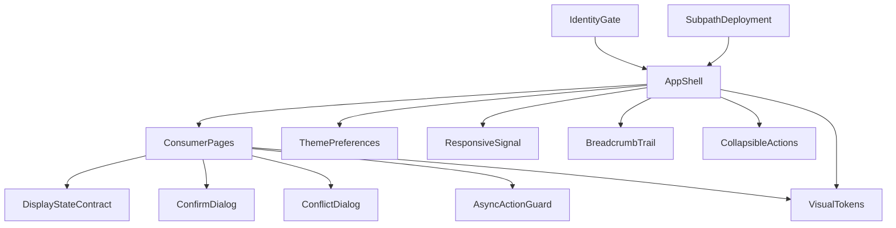
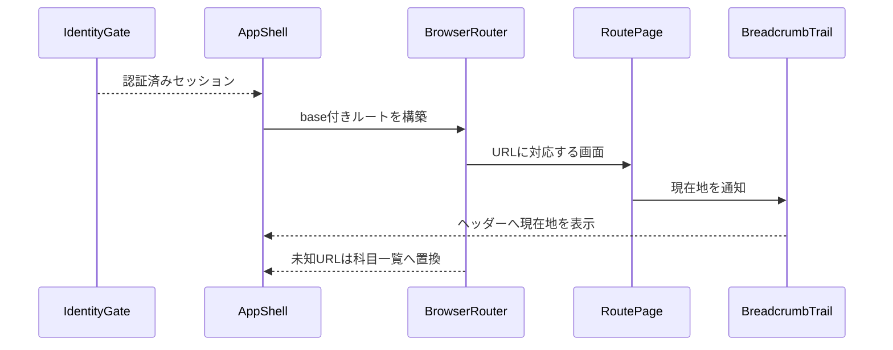
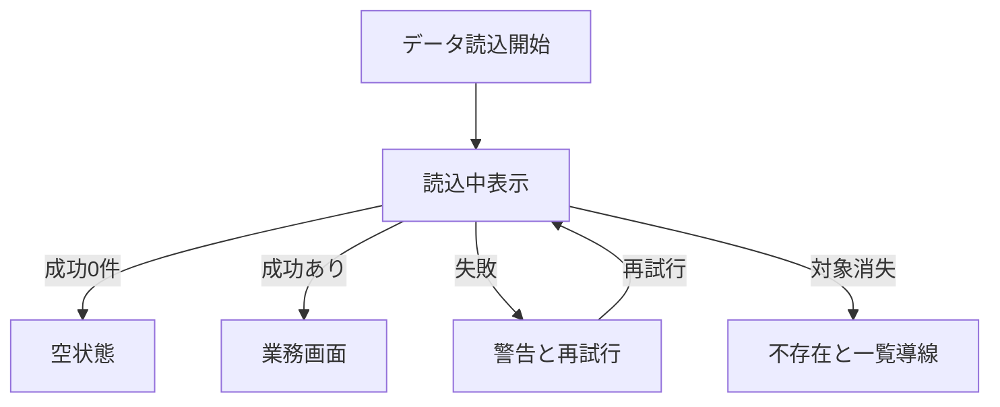

# 技術設計書

## 概要

本仕様は、認証済みの個人学習者に対して、保護画面のルーティング、共通ヘッダーと現在地、テーマ、画面幅に応じたナビゲーション、共通操作部品、表示状態、および GitHub Pages のサブパス到達性を提供する。`App` を薄い配線境界とし、小さな共有 UI／純粋ロジック／CSS token を下流 feature が再利用する現行構造を固定する。

これは既存実装のベースライン設計であり、新しい画面、UI フレームワーク、状態管理、データモデル、依存関係を導入しない。読み込みや不存在の判定、文言、データ操作は各業務 feature が所有し、本仕様は利用者が観測する最低限の表示・復帰契約だけを定義する。

### 目標

- 認証後の URL、共通ヘッダー、パンくず、ブラウザ履歴の既存契約を固定する。
- テーマ、レスポンシブナビ、共通メニュー／ダイアログ、配色を再利用可能な横断契約として固定する。
- `ConfirmDialog`、`ConflictDialog`、`RowActions`、`submitGuard` を feature 非依存の共通所有物として固定する。
- 読み込み、空、失敗、再試行、不存在、処理中を業務画面が満たす最低品質として定義する。
- 決定表21列、コード、ワイヤーフレーム、ユニットテスト、E2E、配信 workflow を要件へ追跡可能にする。

### 非目標

- 認証セッションの有効性、ログイン、ログアウト結果を再設計しない。
- 業務データの取得、空判定、不存在判定、保存結果、固有文言を共通シェルへ移さない。
- 編集画面のペイン／タブ、学習画面の本文高さや固定操作など、下流画面固有の適応 UI を所有しない。
- focus trap、閉じた後のフォーカス復元、OS テーマ変更への実行中追従、選択中タブ表示を新たに追加しない。
- デザインや breakpoint を統一し直さない。

## Boundary Commitments

### This Spec Owns

- 認証済み領域の URL と画面の対応、共通ヘッダー、モバイル下部ナビ、未知 URL の科目一覧フォールバック。
- 画面が提供する `Crumb[]` を共通ヘッダーへ表示する現在地契約。
- テーマの初期解決、切替、端末保存、`html.dark` への反映契約。
- シェルの 768px 境界、共通ダイアログの 640px 境界、狭幅用操作メニューの契約。
- 共通ボタン／カード／ペイン／入力欄の CSS class、ライト／ダーク token、フォーカス／ホバー／コントラスト契約。
- `ConfirmDialog`、`ConflictDialog`、`RowActions` の feature 非依存 props と、`src/lib/submitGuard.ts` の非同期重複防止契約。
- 読み込み、空、失敗、再試行、不存在、処理中について下流画面が満たす `DisplayStateContract`。
- production base、Router basename、GitHub Pages の 404 フォールバックからなるサブパス配信契約。

### Out of Boundary

- セッション復元、未認証保護、認証 API、認証エラーは `identity-and-access` が所有する。
- 各画面の問い合わせ、業務状態、エラー文言、空文言、消失 ID の判定と戻り先は各業務 spec が所有する。
- 解答中断時の回答記録は `adaptive-study-session`、編集保存の衝突判定と確定処理は `markdown-keyword-authoring` が所有する。下流は共通 guard と dialog を利用し、業務状態遷移だけを所有する。
- `ConflictDialog` の表示・選択・busy・アクセシビリティは本仕様が所有する。差分の生成、値の意味、適用結果、および `KeywordDialog` の編集規則は下流仕様が所有する。
- ワイヤーフレームの全面改訂、新規 UI ライブラリ、専用サーバー、オフライン同期を扱わない。

### Allowed Dependencies

- `identity-and-access` が確定した認証済み `Session`。シェルは資格情報の正しさを再判定しない。
- React 19 の state／effect／context、React Router 7 の BrowserRouter／Route／Link／Navigate。
- ブラウザの `matchMedia`、`localStorage`、history、DOM class、GitHub Pages の静的配信。
- Tailwind CSS 4 の既存 breakpoint と utility、および `src/index.css` の custom properties／共通 class。
- 下流 feature は共有部品と契約へ依存できるが、共有部品から feature API または feature 型へ新たに依存しない。

### Revalidation Triggers

- 認証後に構築する Router、保護 URL、ルート引数、未知 URL の遷移先を変更する場合。
- `Crumb`、`RowActions`、`ConfirmDialog`、`ConflictDialog`、`AsyncActionGuard`、テーマ関数、共通 class の公開契約を変更する場合。
- 768px／640px／下流固有 breakpoint、モバイル下部ナビの高さまたは固定方法を変更する場合。
- 色 token、共通部品の組み合わせ、フォーカス／ホバー状態を追加または変更する場合。
- production base、リポジトリ名、Router basename、GitHub Pages workflow、404 フォールバックを変更する場合。
- 下流 feature が表示状態または処理中契約を変更し、本仕様の最低品質を満たさなくなる場合。

## アーキテクチャ

### 既存アーキテクチャ分析

- `App` は上流のセッションゲートを通過した後だけ Router とシェルを構築し、ルート配線、ヘッダー、本文、下部ナビを1か所で接続する。
- `TrailProvider` は画面から現在地だけを受け取る。`RowActions` と `ConfirmDialog` は業務データを取得せず props だけで動作する。
- theme、幅判定、二重送信 guard、コントラスト計算は `src/lib/` の小さなモジュールであり、業務 feature に依存しない。
- loading／empty／error／not-found は共通部品ではなく、各 Page が同じ表示順序と回復導線を実装する。
- production subpath は Vite、Router、deploy workflow の3か所が同じ前提を共有する。

### アーキテクチャパターンと境界マップ



- **採用パターン**: 薄いアプリケーションシェル＋props 駆動の共有 UI＋下流実装契約。`ConsumerPages` は利用側を示す論理ノードであり、本仕様は feature Page のファイルを所有しない。
- **依存方向**: 純粋ロジック／token → 共通 UI → `App`／Page → 業務 feature。共有層から Page、feature API、Supabase への逆依存を作らない。
- **維持する既存パターン**: named export、厳密な TypeScript、context によるパンくず、MediaQuery 購読、CSS custom properties、決定表と列番号による回帰追跡。
- **新規コンポーネント**: なし。`DisplayStateContract` と `SubpathDeployment` は既存実装を説明する設計境界であり、新しいランタイム抽象化ではない。

### 技術スタック

| 層 | 選択／バージョン | 本機能での役割 | 備考 |
|---|---|---|---|
| フロントエンド | React 19、TypeScript 5.9 | シェル、context、状態、共通 UI | `strict`、`any` 不使用 |
| ルーティング | React Router 7 | Browser history、URL と Page の対応、basename | 新規依存なし |
| UI | Tailwind CSS 4、CSS custom properties | breakpoint、共通 class、テーマ token | シェル768px、ダイアログ640px |
| ブラウザ基盤 | MediaQuery、localStorage、DOM | 幅判定、テーマ保存、`html.dark` | storage 失敗時も継続 |
| 配信 | Vite 7、GitHub Pages、GitHub Actions | production base、静的配信、404 fallback | リポジトリサブパス `/blank-study/` |
| テスト | Vitest 3、Playwright 1.56 | 純粋関数、配色、共通利用者経路 | E2E はローカル環境で直列実行 |

## ファイル構成計画

### ディレクトリ構成

```text
src/
├── App.tsx                              # IdentityGate（上流）とAppShell: 認証後ルート、共通レイアウト
├── components/
│   ├── Trail.tsx                        # BreadcrumbTrail: Crumb context と現在地表示
│   ├── RowActions.tsx                   # CollapsibleActions: 広幅直列／狭幅メニュー
│   ├── ConfirmDialog.tsx                # ConfirmDialog: 確認モーダル、初期focus、Escape
│   └── ConflictDialog.tsx               # feature非依存の差分比較・選択・busyダイアログ
├── lib/
│   ├── theme.ts                         # ThemePreferences: 解決、切替、保存
│   ├── theme.test.ts                    # テーマ純粋ロジック回帰
│   ├── useNarrow.ts                     # ResponsiveSignal: 768px境界のMediaQuery購読
│   ├── submitGuard.ts                   # AsyncActionGuard: 同一非同期操作の重複防止
│   ├── submitGuard.test.ts              # guardの成功／失敗／並行実行回帰
│   ├── contrast.ts                      # VisualTokensのコントラスト計算とtoken抽出
│   └── contrast.test.ts                 # ライト／ダーク配色回帰
├── index.css                            # VisualTokens: 色token、共通class、focus／hover
e2e/
└── ui.spec.ts                           # shell契約と代表consumerの適合回帰
spec/tables/
└── 20-ui.jsonl                          # 21列の既存詳細決定表
design/
├── canvas.json                          # デスクトップ／モバイル画面配置
└── *.dc.html                            # 見た目の参照ワイヤーフレーム
vite.config.ts                           # SubpathDeployment: production base
.github/workflows/deploy.yml              # SubpathDeployment: build、404、Pages配信
```

### 変更対象ファイル

本書は既存実装のベースラインを記録するが、`ConflictDialog` が下流 feature 型を import している依存逆転は未解消ギャップである。共通表示型を `src/components/ConflictDialog.tsx` 側へ移し、下流は adapter で props を構成する。下流の `EditorPage` 等は利用例であり、本仕様の変更対象ファイルには含めない。

## システムフロー





## 要件トレーサビリティ

| 要件 | 概要 | コンポーネント | 契約／フロー |
|---|---|---|---|
| 1.1, 1.2 | URL と既存画面の対応 | AppShell | Route table |
| 1.3 | 共通ヘッダー操作 | AppShell、CollapsibleActions | Header composition |
| 1.4 | 上位リンクと現在地 | BreadcrumbTrail | `Crumb[]` state |
| 1.5 | ブラウザの戻る | AppShell | Browser history |
| 1.6 | 未知 URL のフォールバック | AppShell | Navigate replace |
| 2.1, 2.4 | OS 既定と保存値優先 | ThemePreferences、AppShell | Theme resolution |
| 2.2, 2.3 | 切替と端末保存 | ThemePreferences、AppShell | Theme state |
| 2.5 | 不正値／storage失敗時の継続 | ThemePreferences | Safe persistence |
| 3.1, 3.2, 3.3 | 768px 境界のシェル切替 | ResponsiveSignal、AppShell | MediaQuery state |
| 3.4, 3.5 | 行／ヘッダー操作の格納 | CollapsibleActions、AppShell | Responsive actions |
| 3.6, 3.7 | 640px 境界のダイアログ | ConfirmDialog | Responsive modal |
| 3.8 | 狭幅の共通ボタン高さ | VisualTokens | Shared button classes |
| 4.1, 4.2 | ダイアログ意味、focus、Escape | ConfirmDialog | Dialog lifecycle |
| 4.3, 4.4 | メニュー展開状態と終了 | CollapsibleActions | Menu state |
| 4.5 | キーボード focus 表示 | VisualTokens | `focus-visible` |
| 4.6, 4.7 | 操作可能要素とカードの hover | VisualTokens | Hover states |
| 4.8, 4.9, 4.10 | 共通差分選択と処理中抑止 | ConflictDialog、AsyncActionGuard | Conflict view state |
| 5.1, 5.2 | loading と empty の分離 | DisplayStateContract | Display-state flow |
| 5.3, 5.4 | 警告と同条件の retry | DisplayStateContract | Display-state flow |
| 5.5 | 消失データと一覧導線 | DisplayStateContract | Missing-resource state |
| 6.1, 6.2, 6.3, 6.4 | busy と同一操作の重複防止 | AsyncActionGuard、DisplayStateContract | Guard lifecycle |
| 7.1 | テーマ別共通 token | VisualTokens、ThemePreferences | Theme class |
| 7.2, 7.3 | 文字／輪郭コントラスト | VisualTokens | Contrast checks |
| 7.4 | 面の濃度順 | VisualTokens | Luminance ordering |
| 8.1 | asset と route の同一 base | SubpathDeployment、AppShell | Base contract |
| 8.2, 8.3 | 直リンク／再読込の SPA 復帰 | SubpathDeployment | 404 fallback |

## コンポーネントとインターフェース

| コンポーネント | 層 | 意図 | 対応要件 | 主要依存 | 契約 |
|---|---|---|---|---|---|
| AppShell | アプリ境界 | 認証後のルートと共通レイアウトを接続する | 1.1, 1.2, 1.3, 1.4, 1.5, 1.6, 2.2, 3.1, 3.2, 3.3, 3.5, 8.1 | IdentityGate P0、BrowserRouter P0 | State |
| ThemePreferences | 共通ロジック | テーマを解決、反転、読書きする | 2.1, 2.2, 2.3, 2.4, 2.5, 7.1 | localStorage P1 | Service |
| ResponsiveSignal | 共通ロジック | 768px境界を購読する | 3.1, 3.2, 3.3, 3.4, 3.5 | matchMedia P0 | Service、State |
| BreadcrumbTrail | 共通 UI | Page の現在地をヘッダーへ表示する | 1.4 | Router Link P1 | State |
| CollapsibleActions | 共通 UI | 狭幅で補助操作をメニューへ格納する | 1.3, 3.4, 3.5, 4.3, 4.4 | ResponsiveSignal P0 | State |
| ConfirmDialog | 共通 UI | 確認操作をモーダルとして表示する | 3.6, 3.7, 3.8, 4.1, 4.2 | VisualTokens P1 | State |
| ConflictDialog | 共通 UI | feature 非依存の差分比較、採用側選択、busy 表示を提供する | 3.6, 3.7, 3.8, 4.8, 4.9, 4.10 | VisualTokens P1 | State |
| DisplayStateContract | 下流統合契約 | loading／empty／error／missing／busyの最低表示を定める | 5.1, 5.2, 5.3, 5.4, 5.5, 6.1, 6.2, 6.3, 6.4 | ConsumerPages P0 | State |
| AsyncActionGuard | 共通ロジック | 同一非同期操作の並行実行を抑止する | 6.1, 6.2, 6.3, 6.4 | なし | Service、State |
| VisualTokens | UI 基盤 | 色、寸法、focus、hoverを共有する | 3.8, 4.5, 4.6, 4.7, 7.1, 7.2, 7.3, 7.4 | Tailwind CSS P0 | State |
| SubpathDeployment | 配信境界 | production base と SPA fallback を一致させる | 8.1, 8.2, 8.3 | Vite P0、GitHub Pages P0 | Batch |

### アプリ境界

#### AppShell

**ルート契約**:

| URL | 画面 | 備考 |
|---|---|---|
| `/` | SubjectsPage | 既定／未知 URL の復帰先 |
| `/subjects/:subjectId` | MaterialsPage | 消失科目は Page が処理 |
| `/materials/:materialId/edit` | EditorPage | 消失教材は Page が処理 |
| `/materials/:materialId/study` | StudyPage | 教材単位 |
| `/subjects/:subjectId/study` | StudyPage | 科目単位 |
| `/history` | HistoryPage | 学習履歴 |
| `*` | `/` | replace 遷移 |

- **状態**: 上流から得たセッション、初期 theme、`narrow`。セッションの意味は本仕様で再定義しない。
- **不変条件**: `BrowserRouter.basename` は build が公開する base と同じ値を使う。狭幅本文には固定下部ナビ分の余白を置く。
- **統合**: 下流 Page を import してルートへ配置するが、Page のデータ取得や業務型を解釈しない。

### 共通ロジック

#### ThemePreferences

```typescript
type Theme = 'light' | 'dark';
type ThemeSetting = Theme | null;

function resolveTheme(setting: ThemeSetting, prefersDark: boolean): Theme;
function nextTheme(current: Theme): Theme;
function loadTheme(): ThemeSetting;
function saveTheme(theme: Theme): void;
```

- 保存 key は `blank-study:theme`。`light` と `dark` 以外は未設定として扱う。
- storage 例外は外へ投げず、読取は `null`、書込は表示中 theme の維持を結果とする。
- `AppShell` は `Theme` を state に保持し、`html.dark` の有無へ反映する。実行中の OS 設定変更は購読しない。

#### ResponsiveSignal

```typescript
function useNarrow(query?: string): boolean;
```

- 既定 query は `(max-width: 767px)`。
- mount 時に現在値を反映し、MediaQuery の `change` を購読、unmount 時に解除する。
- 任意 query を受け取れるが、AppShell と CollapsibleActions は既定値を使う。

#### AsyncActionGuard

```typescript
type AsyncActionGuard = {
  busy: () => boolean;
  run: (action: () => Promise<void>) => Promise<void>;
};

function createSubmitGuard(): AsyncActionGuard;
```

- `run` の実行中に受けた後続呼出しは action を実行せず解決する。
- action の成功／失敗を問わず `finally` で busy を解除する。action の失敗自体は呼出側へ返す。

### 共通 UI

#### BreadcrumbTrail

```typescript
type Crumb = { label: string; to?: string };

function TrailProvider(props: { children: React.ReactNode }): React.ReactNode;
function useTrail(crumbs: Crumb[]): void;
function Trail(): React.ReactNode;
```

- `to` がある要素はリンク、末尾の `to` なし要素は現在地として表示する。
- Page unmount 時に trail を空へ戻し、前画面の現在地を残さない。

#### CollapsibleActions

```typescript
type RowActionsProps = {
  primary?: React.ReactNode;
  label?: string;
  children: React.ReactNode;
};

function RowActions(props: RowActionsProps): React.ReactNode;
```

- 広幅では `primary` と `children` を同列に返す。狭幅では `primary` を残し、`children` をメニューへ格納する。
- trigger は `aria-label` と `aria-expanded` を持つ。項目選択、外側クリック、Escape で閉じる。
- AppShell は同じ部品を `label="ヘッダの操作"` で使用する。

#### ConfirmDialog

```typescript
type ConfirmDialogProps = {
  title: string;
  children: React.ReactNode;
  confirmLabel: string;
  cancelLabel?: string;
  destructive?: boolean;
  busy?: boolean;
  onConfirm: () => void;
  onCancel: () => void;
};
```

- `role="dialog"`、`aria-modal="true"`、タイトル由来の `aria-label` を持つ。
- mount 後は cancel button へ focus し、Escape は `onCancel` を呼ぶ。focus trap と終了後の focus 復元は現行契約に含めない。
- 639px 以下は下端・全幅、640px 以上は中央・最大幅。高さは内容依存であり「常に全画面高」は保証しない。

#### ConflictDialog

```typescript
type ConflictViewItem = {
  conflictId: string;
  docId: string;
  candidates: readonly {
    candidateId: string;
    label: string;
    answers: readonly string[];
  }[];
};

type ConflictDialogProps = {
  title: string;
  description: string;
  items: readonly ConflictViewItem[];
  resolutions: Readonly<Record<string, string>>;
  busy?: boolean;
  onChange: (conflictId: string, candidateId: string) => void;
  onApply: () => void;
  onCancel: () => void;
};
```

- 共通 component は feature の `Conflict`、keyword、import 型を import せず、表示に必要な安定 conflict／candidate ID、doc ID、表示ラベル、正答文字列配列だけをローカル表示型として受け取る。旧2択 props は authoring／portability adapter の切替完了まで互換層で受け付ける。
- 候補数にかかわらず `aria-pressed` で選択中の1候補を表し、未選択 conflict がある間は確定できない。busy 中は確定と取消を無効化する。適用順、衝突判定、保存／import は呼出側の責務である。
- editor と portability は必要に応じて feature adapter で共有契約へ変換し、自身の統合テストだけを所有する。共有型をさらに変更する場合は両 consumer の adapter task を完了するまで旧 props を削除しない。

#### DisplayStateContract

これは新しい型または共通コンポーネントではなく、各 Page が既存 state で実現する統合契約である。

| 状態 | 表示契約 | 所有境界 |
|---|---|---|
| loading | 「読み込んでいます…」を表示し empty を出さない | Page が開始／終了を判定 |
| empty | 読込成功後の0件を案内する | Page が固有文言を所有 |
| error | `role="alert"`、失敗内容、再試行を表示する | Page／feature API が文脈を所有 |
| retry | 同じ route parameter を閉じた `load` を再実行する | Page が問い合わせを所有 |
| missing | 対象の消失と上位一覧導線を表示する | Page が判定と戻り先を所有 |
| busy | 同じ変更を再送せず、対象操作を無効化または処理中表示する | Page または AsyncActionGuard |

### UI 基盤と配信

#### VisualTokens

- `:root` と `.dark` は同じ `--c-*` 名へテーマ別の色を割り当てる。画面は意味名を利用し、個別の dark 上書きを増やさない。
- `.btn-p`、`.btn`、`.btn-s`、`.btn-warn`、`.field` は44px高を標準とする。
- `:focus-visible` は link token の2px outline、操作可能要素は pointer、disabled は not-allowed を使う。
- `.card-act` は内側の共通ボタンが hover の間、親カードの hover 背景を適用しない。
- コントラスト保証は `contrast.test.ts` に列挙された既存 token ペアに限る。新しい組合せはテスト表へ明示的に追加する。

#### SubpathDeployment

- production build は `/blank-study/` を asset base とし、開発時は `/` を使う。
- AppShell は `import.meta.env.BASE_URL` を Router basename に渡し、手書きで二重管理しない。
- deploy build 後に `dist/index.html` を `dist/404.html` へ複製し、GitHub Pages が深い URL へ入口 HTML を返せる状態にする。
- リポジトリ名または公開パスを変更する場合は、production build、直リンク、再読み込み、内部 Link をまとめて再検証する。

## データモデル

### ドメインモデル

- `Theme` は `light | dark` の値オブジェクトであり、唯一の永続値は端末 storage の文字列である。
- `Crumb` は表示 label と任意の内部 URL を持つ一時的な画面状態であり、永続化しない。
- `narrow`、メニュー開閉、busy、表示状態はブラウザ内の一時 state であり、DB や業務エンティティを所有しない。

### データ契約と統合

- theme storage key: `blank-study:theme`。受理値は `light`、`dark` のみ。
- route parameter は下流 Page へ文字列として渡し、存在確認とデータ解釈を下流へ委ねる。
- 本仕様に DB schema、migration、API payload、event schema の変更はない。

## エラー処理

- theme storage: 例外または不正値を未設定として扱い、アプリ起動と切替を継続する。
- loading failure: 下流 Page が操作文脈を含むメッセージを `role="alert"` で出し、同じ `load` を再試行する。
- missing resource: 下流 Page が消失判定を行い、上位一覧への Link を出す。未知 route の無言フォールバックと混同しない。
- async action: busy 中の同一実行を捨て、失敗時も busy を解除する。業務的な rollback とエラー文言は下流が所有する。
- subpath failure: base／basename／404 の不一致は起動不能または誤 route となるため、3要素を同一変更で検証する。

## テスト戦略

### ユニットテスト

- `theme.test.ts` で未保存時の OS 選択、保存値優先、壊れた値、反転を検証する（2.1, 2.2, 2.4, 2.5）。storage 例外そのものは未検証項目として残す。
- `submitGuard.test.ts` で並行二重実行、完了後の再実行、失敗後の解除を検証する（6.1, 6.2, 6.3, 6.4）。
- `contrast.test.ts` でライト／ダークの文字4.5:1、輪郭3:1、面の濃度順を CSS token から検証する（7.1–7.4）。
- ConfirmDialog、ConflictDialog、RowActions、Trail、useNarrow のキーボード／DOM lifecycle はコード証拠があるが自動テストがなく、未完了検証対象とする（1.4, 3.3–3.7, 4.1–4.5, 4.8–4.10）。

### E2E／統合テスト

- `ui.spec.ts` でテーマ切替／保持、390px下部ナビ、確認ダイアログ幅、教材一覧ボタン高さ、行／ヘッダー操作メニューを検証する（2.2–2.4, 3.1–3.8）。
- loading と empty の分離、通信失敗と retry、消失科目と一覧導線を検証する（5.1–5.5）。
- ブラウザ戻る、カード内ボタン hover、ボタン相当要素の hover を検証する（1.5, 4.6, 4.7）。
- 現行 E2E の44px検証は教材一覧の可視 button に限られるため、共通 class と代表画面の横断検証を未完了対象とする（3.8）。
- 開発時 base `/` の確認だけでなく、production base `/blank-study/`、深い URL、404 fallback、再読み込みを組み合わせた統合検証を未完了対象とする（8.1–8.3）。

### 品質ゲート

- 型検査、全ユニットテスト、決定表カバレッジ、production build を通常ゲートとする。
- シェル、共通 UI、色、breakpoint、route、配信を変更した場合は `e2e/ui.spec.ts` と下流の影響画面を直列実行する。

## アクセシビリティと視認性

- 既存の role／aria、初期 focus、Escape、focus-visible、44px共通ボタン、配色閾値を維持する。
- 現行にない focus trap、focus 復元、モバイルナビの `aria-current` は本ベースラインへ追加しない。追加する場合は要件変更から開始する。
- token test は選定済み組合せの保証であり、opacity や全 DOM の計算済み色を網羅するものではない。

## 移行戦略

本仕様の作成に伴うアプリケーション、DB、配信設定の移行はない。将来の変更は要件と設計を先に更新し、必要な決定表、ワイヤーフレーム、共通部品、テスト、配信設定を同じ変更単位で追従させる。
