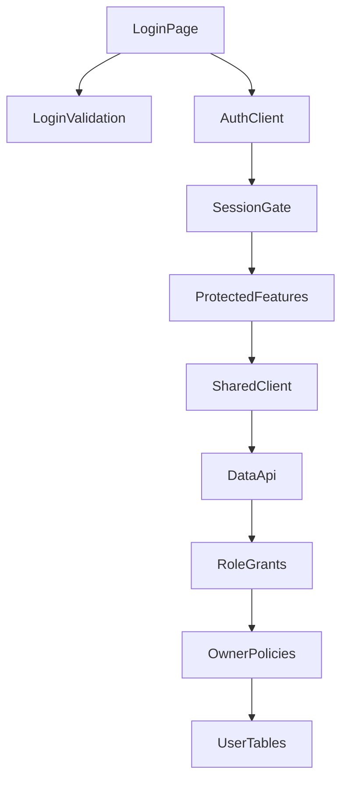
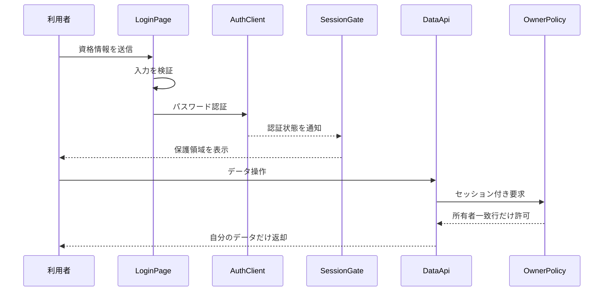

# 技術設計書

## 概要

本仕様は、管理者からアカウントを与えられた個人学習者に対して、メールアドレス／パスワード認証、セッションに基づく保護画面の切替、および所有者単位のデータ分離を提供する。クライアント側の画面ゲートとデータ層の認可を重ね、画面経由でも直接データアクセスでも同じ利用者境界を維持する。

これは既存実装のベースライン設計であり、新しい認証方式、画面、データモデル、依存関係は導入しない。今後の全保護機能は、この仕様が定義する `Session` と `owner_id = auth.uid()` の契約へ依存する。

### 目標

- 入力検証、認証結果、通信失敗の既存挙動を固定する。
- セッション復元、状態監視、ログアウト、未認証保護を共通境界として固定する。
- 6つの利用者データテーブルと公開 RPC に所有者・ロール境界を適用する。
- 決定表、ユニットテスト、E2E、migration の証拠を要件へ追跡可能にする。

### 非目標

- 公開サインアップ、パスワード再設定、多要素認証、OAuth を追加しない。
- 管理者によるアカウント作成 UI を設計しない。
- データ操作中の認証エラーに対する新しい共通通知を追加しない。
- 共通ヘッダー、一般ルーティング、レスポンシブ外観、各データの業務規則を所有しない。

## Boundary Commitments

### This Spec Owns

- ログインフォームの送信可否、メール形式検証、認証要求、エラー分類と表示の契約。
- 初期セッション復元と認証状態監視による、ログイン画面と保護領域の切替契約。
- 利用者データの `owner_id` と現在の認証利用者を一致させる読取・書込境界。
- 匿名、認証済み、テスト用特権ロールに対するテーブルおよび RPC 権限の契約。
- 公開 user-data RPC を列挙し、各 RPC に同じ4主体の回帰を要求する `RpcSecurityMatrix` 契約。
- ブラウザが公開クライアントキーだけを使用する起動時設定契約。

### Out of Boundary

- 認証済み領域内の URL 構成、未知 URL の遷移先、ヘッダー表示は `app-shell-and-responsive-experience` が所有する。
- 科目、教材、章、キーワード、学習状態、解答履歴の業務規則は各下流仕様が所有する。
- Auth 管理画面やサーバー設定による利用者作成禁止は、本ベースラインの UI 非提供契約に含めない。
- E2E の準備・後片付け以外で特権アクセスを利用する機能を追加しない。

### Allowed Dependencies

- Supabase JS 2 の Auth クライアントと `Session` 型。
- Supabase Auth のメール／パスワード認証、セッション永続化、認証状態通知。
- PostgreSQL 17 の RLS、ロール権限、`auth.uid()`。
- React 19 の状態と effect。認証 feature から業務 feature への直接依存は作らない。
- 下流 feature API は共有 `src/lib/supabase.ts` を介し、DB の所有者ポリシーに認可を委ねる。

### Revalidation Triggers

- 認証方式、セッション保存形式、認証イベント、またはログアウト契約の変更。
- 利用者データテーブルまたは公開 RPC の追加、削除、権限変更。
- `owner_id`、`auth.uid()`、認証ロール、特権ロールの意味変更。
- ブラウザ用環境変数、公開キー種別、接続先の起動要件変更。
- 本仕様へ依存する保護ルートまたは feature API の認可前提変更。

公開 user-data RPC の一覧が変わる変更では、本仕様の列挙テストに加え、RPC を所有する下流仕様の owner／cross-owner 統合ケースを同じ変更で再実行する。

## アーキテクチャ

### 既存アーキテクチャ分析

- React SPA は `App` で初期セッションを読み、Auth の状態変更を購読する。セッションがない場合は Router より先に `LoginPage` を返すため、保護 URL 全体を一括して閉じる。
- `LoginPage` は純粋関数へ入力検証と通信失敗分類を委ね、認証 SDK を直接呼ぶ。成功時に直接遷移せず、認証状態イベントで `App` のセッションを更新する。
- feature API は共有 Supabase クライアントで Data API／RPC を利用する。各作成処理は現在利用者を取得して `owner_id` を設定し、最終認可は RLS とロール権限へ委ねる。
- テーブルと RPC のアクセス制御は migration が正であり、適用済み migration は変更しない。

### アーキテクチャパターンと境界マップ



- **採用パターン**: セッションゲートと所有者ポリシーによる多層防御。UI の可視性とデータ認可を別コンポーネントが担当し、同じ認証主体で接続する。
- **依存方向**: 検証関数 → 認証 UI → セッションゲート → 保護 feature → 共有クライアント → ロール権限 → RLS。上流へ逆向きに業務責務を持ち込まない。
- **維持する既存パターン**: feature-first、共有クライアント、純粋検証関数、migration 管理、決定表の列番号を使うテスト追跡。
- **新規コンポーネント**: なし。

### 技術スタック

| 層 | 選択／バージョン | 本機能での役割 | 備考 |
|---|---|---|---|
| フロントエンド | React 19、TypeScript 5.9 | 入力状態、セッション状態、画面ゲート | `strict`、`any` 不使用 |
| 認証・データ API | Supabase JS 2 | パスワード認証、セッション復元・通知、Data API／RPC | 新規依存なし |
| データ | PostgreSQL 17、Supabase Auth | 利用者 ID、RLS、ロール権限 | `owner_id` を共通認可属性とする |
| テスト | Vitest 3、Playwright 1.56 | 純粋検証と利用者経路／RLS の回帰 | E2E はローカル Supabase で直列実行 |

## ファイル構成計画

### ディレクトリ構成

```text
src/
├── App.tsx                              # セッション復元・監視と保護領域ゲート
├── features/auth/
│   ├── LoginPage.tsx                    # ログインフォーム、認証要求、利用者向けエラー
│   ├── validation.ts                    # メール、空欄、通信失敗の純粋判定
│   └── validation.test.ts               # 純粋判定のユニット回帰
└── lib/supabase.ts                      # 公開設定から生成する共有クライアント
e2e/
├── auth.spec.ts                         # 決定表10ケースの認証・読取分離 E2E
├── rpc-security.spec.ts                 # 公開 user-data RPC の列挙、grant、匿名拒否
├── helpers/rpcSecurity.ts               # 下流 E2E が利用する4主体セキュリティ検証 harness
├── db.ts                                # テスト用特権クライアントと利用者準備
└── fixtures.ts                          # UI 経由ログイン fixture
supabase/migrations/
├── 20260829000000_init.sql              # owner_id、6テーブルの RLS と所有者 policy
├── 20260830000000_import_material.sql   # 現在利用者を所有者とする取り込み RPC
├── 20260831000000_grants.sql            # テーブル／RPC のロール権限
├── 20260901000000_revoke_rpc_from_anon.sql # 取り込み RPC の匿名実行拒否
├── 20260902000000_harden_functions.sql  # 関数 search_path と自動 RLS 関数の権限強化
├── 20260903000000_material_summary.sql  # RLS に従う集計 RPC と実行権
└── 20260904000000_sync_active_keywords.sql # RLS に従う同期 RPC と実行権
spec/tables/01-auth.jsonl                 # 認証の回帰決定表
```

### 変更対象ファイル

本書は既存実装のベースラインを記録するため、アプリケーションファイルおよび migration の変更を要求しない。将来この境界を変更する場合は、上記の責務を保ったまま、適用済み migration の編集ではなく新しい migration を追加し、決定表と対応テストを同じ変更で更新する。

## システムフロー



入力不正時は Auth への呼び出し前に停止する。認証成功後の画面切替は Auth の状態通知を経由し、データ操作ではクライアント条件に依存せず所有者ポリシーを必ず通過する。

## 要件トレーサビリティ

| 要件 | 概要 | コンポーネント | 契約／フロー |
|---|---|---|---|
| 1.1, 1.2 | 空欄と送信可否 | LoginPage、LoginValidation | LoginFormState |
| 1.3, 1.4, 1.5 | メール形式と認証前停止 | LoginPage、LoginValidation | ValidateLoginInput |
| 2.1 | 認証成功と科目一覧 | LoginPage、AuthClient、SessionGate | Login flow |
| 2.2, 2.3 | 資格情報エラーの非識別化 | LoginPage | LoginError |
| 2.4 | 通信失敗の区別 | LoginPage、LoginValidation | LoginError |
| 2.5 | 重複送信防止 | LoginPage | LoginFormState |
| 2.6 | 公開登録導線の非提供 | LoginPage | UI boundary |
| 3.1, 3.2 | 初期セッション復元 | SessionGate、AuthClient | Session state |
| 3.3 | 未認証保護 URL | SessionGate | Session state |
| 3.4 | ログアウト | SessionGate、AuthClient | Auth state event |
| 3.5, 3.6 | 失効と状態追従 | SessionGate、AuthClient | Auth state event |
| 4.1 | 所有行の読取 | OwnerPolicies、UserTables | RLS using |
| 4.2, 4.3, 4.5 | 所有行だけの書込 | OwnerPolicies、UserTables | RLS with check and using |
| 4.4 | 他利用者データを返さない | OwnerPolicies、UserTables | RLS using |
| 5.1 | 匿名テーブル操作拒否 | RoleGrants、OwnerPolicies | Role privileges |
| 5.2 | 匿名 RPC 拒否 | RoleGrants | Function execute privileges |
| 5.3, 5.4 | 公開キーと特権キーの分離 | SharedClient、TestAdminClient | Runtime config |
| 5.5 | 設定不足時の停止 | SharedClient | Client initialization |
| 5.6 | E2E 特権利用の限定 | TestAdminClient | Test setup and teardown |
| 5.7 | 新規・変更 RPC の4主体回帰 | RpcSecurityMatrix、RoleGrants、OwnerPolicies、TestAdminClient | RPC security conformance |

## コンポーネントとインターフェース

| コンポーネント | 層 | 意図 | 対応要件 | 主要依存 | 契約 |
|---|---|---|---|---|---|
| LoginValidation | ドメインロジック | 入力と失敗種別を純粋判定する | 1.1–1.5, 2.4 | なし | Service |
| LoginPage | 認証 UI | 認証要求と結果表示を担う | 1.1–2.6 | LoginValidation P0、AuthClient P0 | State |
| SessionGate | アプリ境界 | セッションの復元・追従と保護領域切替を担う | 2.1, 3.1–3.6 | AuthClient P0 | State |
| SharedClient | 基盤 | 公開設定から認証・データクライアントを生成する | 5.3–5.5 | RuntimeConfig P0 | Service |
| OwnerPolicies | データ認可 | 所有者一致による行可視性と書込検査を担う | 4.1–4.5, 5.1 | AuthIdentity P0 | API |
| RoleGrants | データ認可 | 匿名・認証済み・特権ロールの操作範囲を制限する | 5.1, 5.2, 5.6 | PostgreSQL roles P0 | API |
| RpcSecurityMatrix | テスト契約 | 公開 user-data RPC を列挙し、同じ4主体の検証を下流へ提供する | 4.1–4.5, 5.1, 5.2, 5.6, 5.7 | RoleGrants P0、OwnerPolicies P0、TestAdminClient P0 | Service、API |
| TestAdminClient | テスト基盤 | E2E の利用者・データ準備と後片付けだけを担う | 5.6 | service role P0 | Service |

### 認証 UI 層

#### LoginValidation

| 項目 | 詳細 |
|---|---|
| 意図 | SDK や UI へ依存せずログイン入力と通信失敗を分類する |
| 要件 | 1.1, 1.2, 1.3, 1.4, 1.5, 2.4 |

**サービス契約**:

```typescript
function isValidEmail(value: string): boolean;
function canSubmitLogin(email: string, password: string): boolean;
function isNetworkFailure(error: unknown): boolean;
```

- 事前条件: 文字列は未加工のフォーム値、失敗値は `unknown` とする。
- 事後条件: メール判定は前後空白を除く。送信可否はメールの非空白とパスワード非空だけを判定する。
- 不変条件: 資格情報エラーを通信失敗として分類しない。

#### LoginPage

- **状態**: `email`、`password`、`error`、`busy`。`canSubmit` は入力の非空判定と `busy` から導出する。
- **依存**: Outbound `LoginValidation`（P0）、External `supabase.auth.signInWithPassword`（P0）。
- **不変条件**: 認証へ渡すメールだけを trim し、パスワードは加工しない。認証エラーはアカウントの有無を識別させない。
- **失敗**: SDK が返す通信失敗と例外を通信メッセージへ、それ以外の認証失敗を共通資格情報メッセージへ写像する。

### アプリ境界層

#### SessionGate

- **状態**: `Session | null` と初期確認中を表す `loading: boolean`。
- **依存**: External `getSession` と `onAuthStateChange`（P0）。
- **不変条件**: 初期確認中は保護領域を表示せず、セッションなしでは Router および全保護 feature を構築しない。
- **ライフサイクル**: mount 時に保存セッションを取得して状態購読を開始し、unmount 時に購読解除する。

### データ認可層

#### OwnerPolicies

- **対象**: `subjects`、`materials`、`chapters`、`keywords`、`keyword_stats`、`answer_logs`。
- **読取／変更／削除契約**: `USING owner_id = auth.uid()` により、現在利用者に一致する行だけを対象にする。
- **作成／変更契約**: `WITH CHECK owner_id = auth.uid()` により、別利用者を所有者とする行を保存できない。
- **不変条件**: 全対象テーブルで RLS を有効にし、policy の対象ロールを `authenticated` に限定する。

#### RoleGrants

- **認証済みロール**: 6テーブルの CRUD と公開業務 RPC の実行を許可し、行単位の可否は OwnerPolicies に委ねる。
- **匿名ロール**: 6テーブルの全操作と、利用者データを扱う公開 RPC の実行を許可しない。
- **テスト用特権ロール**: E2E の準備と後片付けに必要な操作を許可するが、ブラウザクライアントへ渡さない。

#### RpcSecurityMatrix

```typescript
type RpcSecurityCase<TResult> = {
  rpcName: string;
  prepareAsServiceRole: () => Promise<void>;
  invokeAsOwner: () => Promise<TResult>;
  invokeAsCrossOwner: () => Promise<TResult>;
  invokeAsAnon: () => Promise<unknown>;
  readBackAsServiceRole: () => Promise<unknown>;
  assertOwnerResult: (result: TResult) => Promise<void>;
  assertCrossOwnerIsolation: (result: TResult) => Promise<void>;
  assertAnonRejectedBeforeBody: (result: unknown) => Promise<void>;
  assertServiceRoleReadBack: (snapshot: unknown) => Promise<void>;
};

function verifyUserDataRpcSecurity<TResult>(testCase: RpcSecurityCase<TResult>): Promise<void>;
```

- `rpc-security.spec.ts` は DB の公開 user-data RPC と権限を列挙し、匿名実行権がなく authenticated だけに必要な実行権があることを検証する。固定の「3 RPC」件数を契約にしない。
- harness は authenticated owner の成功、cross-owner の返却値と副作用の分離、anon の関数本体到達前拒否、service role が準備・事後確認だけに使われることを共通手順にする。
- harness は通常利用者経路へ service-role client を渡さず、`prepareAsServiceRole` と `readBackAsServiceRole` の呼出箇所を setup／assertion phase に制限する。各 case は owner、cross-owner、anon の各 client と事前・事後 snapshot を明示する。
- 新規 RPC を所有する仕様は migration と業務テストを所有し、自身の E2E ファイルからこの harness を利用する。本仕様は下流の payload や業務結果を所有しない。
- RPC 一覧と下流のセキュリティケースが一致しない場合は品質ゲートを失敗させ、未登録 RPC を見逃さない。

## データモデル

### ドメインモデル

認証主体は Auth 利用者 ID であり、6つの利用者データエンティティはすべて同じ ID を `owner_id` として保持する。個別 feature が階層や学習規則を所有する一方、本仕様は全エンティティに共通する所有者不変条件だけを所有する。

### 物理データモデル

| テーブル | 所有者列 | 制約 | RLS |
|---|---|---|---|
| `subjects` | `owner_id uuid` | `NOT NULL`、`auth.users(id)` 外部キー、利用者削除時 cascade | 所有者 policy |
| `materials` | `owner_id uuid` | 同上 | 所有者 policy |
| `chapters` | `owner_id uuid` | 同上 | 所有者 policy |
| `keywords` | `owner_id uuid` | 同上 | 所有者 policy |
| `keyword_stats` | `owner_id uuid` | 同上 | 所有者 policy |
| `answer_logs` | `owner_id uuid` | 同上 | 所有者 policy |

適用済み schema は変更しない。対象テーブルまたは RPC を追加する場合、同じ所有者列、RLS、ロール権限を新しい migration で明示する。

## エラー処理

- 入力形式エラー: 認証要求前に「メールアドレスの形式が正しくありません」を表示する。
- 資格情報エラー: 未登録とパスワード不一致を「メールアドレスまたはパスワードが違います」へ統合する。
- 通信失敗: retryable fetch、ブラウザ fetch 例外、応答なしを「通信に失敗しました。しばらくしてからもう一度お試しください」へ統合する。
- セッションなし／失効: 保護領域を表示せず、通常のログイン画面を表示する。専用の失効メッセージはベースラインに含めない。
- データ認可失敗: UI メッセージの共通化は各下流 feature の責務とし、本仕様はデータを返さない／書込を拒否する境界を保証する。

## テスト戦略

### ユニットテスト

- `validation.test.ts` で正当なメール、不正メール、ドットのないドメイン、空白、前後空白を検証する（1.1–1.5）。
- 空欄時の送信不可と、形式不正でも非空なら押下後に理由を示す分離を検証する（1.1–1.4）。
- retryable fetch、`TypeError`、status 0 と、通常の 400／401 認証エラーを分類する（2.2–2.4）。

### E2E／統合テスト

- 正しい資格情報で科目一覧へ入り、誤パスワードと未登録メールが同じ文言でログイン画面に留まることを検証する（2.1–2.3）。
- 不正メールで認証エンドポイントへ要求せず、空欄でボタンが無効、通信遮断で別メッセージとなることを検証する（1.1–1.4, 2.4, 2.5）。
- 未認証の直接 URL、ログアウト、保存トークン喪失後の再読み込みがログイン画面になることを検証する（3.1–3.6）。
- 別利用者の科目が一覧にも直接 URL にも現れないことを検証する（4.1, 4.4）。
- 防御的回帰として、別利用者を所有者とする insert／update／delete の拒否、および匿名ロールの6テーブル／列挙された全 user-data RPC 拒否を追加検証対象とする（4.2, 4.3, 4.5, 5.1, 5.2, 5.7）。
- `rpc-security.spec.ts` は公開 user-data RPC を列挙して anon grant を検査し、各 RPC の所有仕様は共通 harness で owner 成功、cross-owner 分離、anon 拒否、service-role 用途限定を検証する（4.1–4.5, 5.1, 5.2, 5.6, 5.7）。

## セキュリティ考慮事項

- アカウント列挙を避けるため、未登録メールとパスワード不一致の表示を統一する。
- クライアント側のルート保護を認可の根拠にせず、すべての利用者データを DB の所有者 policy で制限する。
- `USING` と `WITH CHECK` を対にし、既存行の可視性と新しい所有者値の双方を検査する。
- 関数は呼び出し利用者の権限で実行し、`search_path = ''` とスキーマ修飾を維持する。
- publishable／anon key は公開前提として扱い、service role は E2E 支援コードのみに置く。
- user-data RPC の追加は、`SECURITY INVOKER`、空の `search_path`、スキーマ修飾、anon revoke に加え、RpcSecurityMatrix への適合を完了条件とする。

## 移行戦略

本仕様の作成に伴うアプリケーションまたは DB の移行はない。将来の変更は、要件と設計を先に更新し、新しいタイムスタンプ付き migration、決定表、ユニット／E2E を同じ変更単位で追加する。
