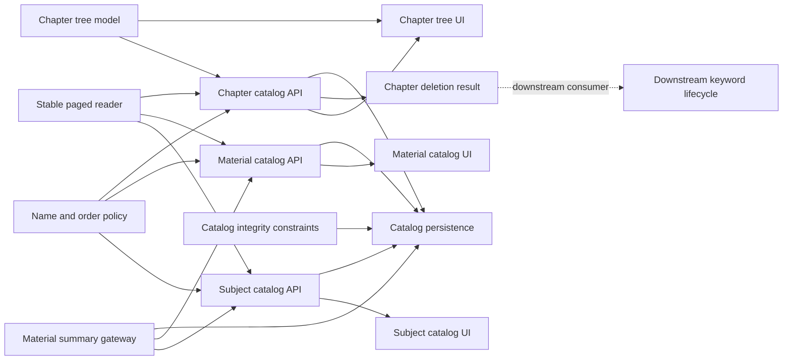
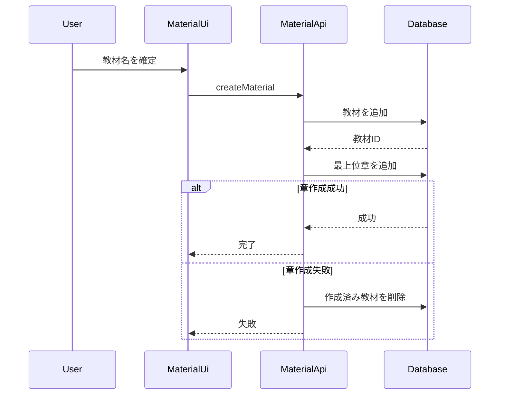
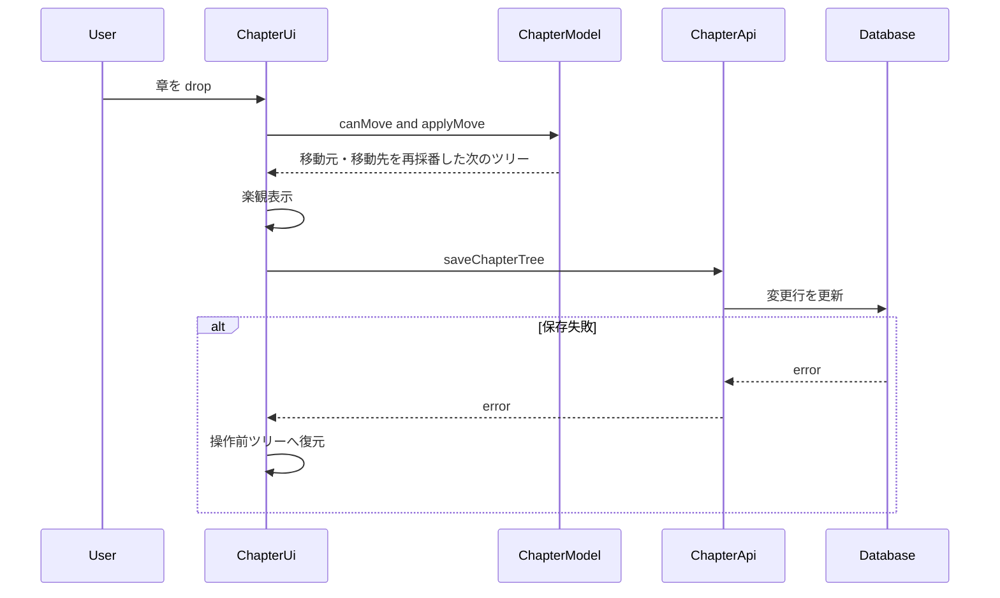
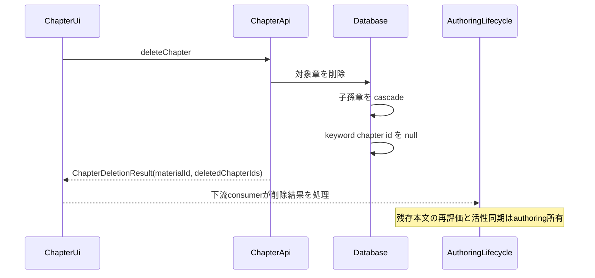
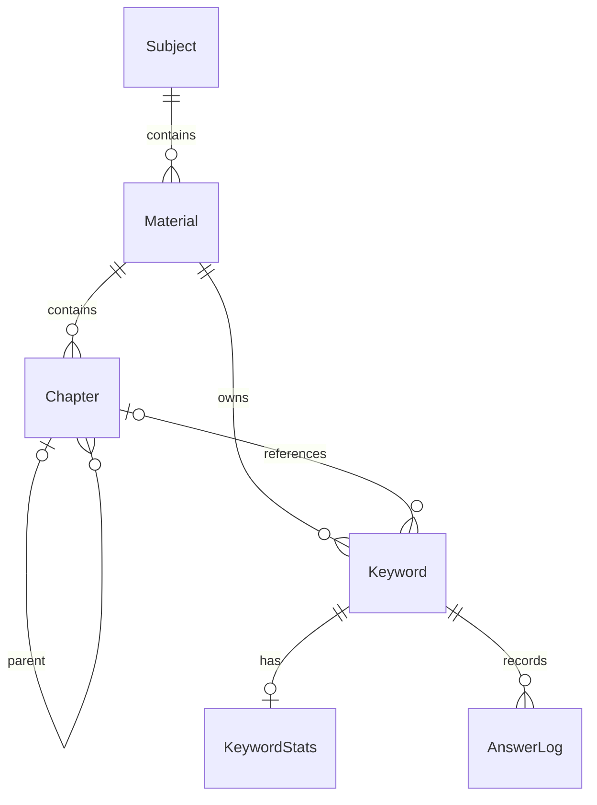

# 技術設計書

## Overview

**Purpose**: 本機能は、個人学習者に科目、教材、章からなる順序付き教材カタログを提供し、階層を安全に編集・削除できるようにする。
**Users**: 認証済みの個人学習者が、科目一覧、教材一覧、教材編集画面で教材構造を管理し、学習開始範囲を選ぶ。
**Impact**: 現行の feature-first 実装と45列の回帰決定表をベースラインとして固定しつつ、取得上限を超える構造データと DB の所有者／親子整合性について発見されたギャップを実装計画へ明示する。

### Goals

- 科目と教材の順序付きコレクション、および教材内の章ツリーを安定契約にする。
- 資源ごとに異なる削除影響、cascade、章削除時の履歴保持を明確にする。
- 1回の行取得上限を超えても構造一覧、章本文、キーワード、および削除確認の集計を欠落・重複させない。
- owner、subject、material、parent の関係を通常 Data API と一括処理のどちらでも破壊できない DB 契約にする。
- 下流の authoring、portability、study、insights が利用する ID、順序、活性状態の再検証条件を定める。

### Non-Goals

- Markdown 本文、キーワード内容、保存時衝突解決の設計
- zip インポート／エクスポートの解析と原子的取り込み
- 出題選択、採点、SRS、履歴・統計画面の設計
- 科目間の教材移動、教材間の章移動
- 教材作成や複数行順序保存を原子化する仕様外改善

## Boundary Commitments

### This Spec Owns

- `subjects`、`materials`、`chapters` の識別子、名称、所属、親子関係、兄弟順に関する契約
- 科目・教材の一覧取得、作成、名称変更、同一親内の並べ替え、削除影響と削除操作
- 章ツリーの構築、作成、名称変更、循環しない部分木移動、削除影響と削除操作
- 科目・教材削除時の完全な cascade と、章削除時にキーワード／履歴を保持して下流同期へ渡す `ChapterDeletionResult`
- 教材一覧の章数、有効キーワード数、正答率、当日復習件数と学習開始可否
- 大量件数を欠落させない一覧集計および削除影響集計
- `src/lib/paged.ts` の全件取得契約と、科目・教材・章・章本文・キーワードを安定した一意順序で取り切る共通ページング
- `subjects`、`materials`、`chapters` と keyword provenance の owner／material／parent 整合性を DB で保証する追加 migration

### Out of Boundary

- `chapters.body` の内容、キーワードマスタの内容、および本文とキーワードの通常保存
- zip データ形式、取り込み突合、エクスポート生成
- 学習候補の選択、出題形式、解答判定、SRS 更新
- 学習履歴と集計画面の表示
- 認証セッション、RLS／ロール権限の横断設計、共通画面シェル
- 下流 feature 固有のページング adapter、業務変換、または page component の実装

### Allowed Dependencies

- `identity-and-access` が提供する認証済みセッションと所有者分離済み Supabase client
- `app-shell-and-responsive-experience` が提供する Router、共通エラー表示、確認ダイアログ、パンくず、行アクション
- `src/lib/supabase.ts` と `material_summary` RPC による所有者スコープ済み永続化・集計
- `identity-and-access` の `RpcSecurityMatrix`。catalog 所有 RPC／migration の owner、cross-owner、anon、service-role 回帰に利用する
- `markdown-keyword-authoring` は本仕様の `ChapterDeletionResult` を下流で消費し、残存章本文からキーワード活性を同期する。本仕様から authoring 実装へは依存しない
- 下流機能は `Subject.id`、`Material.id`、`ChapterRow`、保存済み順序、キーワード活性状態を読取契約として利用できる

### Revalidation Triggers

- `subjects`、`materials`、`chapters` の ID、外部キー、`sort_order`、`parent_id`、削除規則の変更
- `material_summary` の返却列、有効キーワード条件、正答率または当日復習件数の定義変更
- 章削除後の `ChapterDeletionResult`、`keywords.chapter_id` の provenance 意味、または下流の活性同期契約変更
- 科目・教材・章の移動範囲、名前規則、初期章作成規則の変更
- カタログ画面の route、not-found、empty、retry 契約の変更
- 共通ページングの page size、cursor／range、安定順序、重複排除、または全件終了条件の変更
- owner／subject／material／parent の複合参照制約、または `keywords.chapter_id` の provenance 意味の変更

これらの変更では `markdown-keyword-authoring`、`material-portability`、`adaptive-study-session`、`learning-insights` を再検証する。

## Architecture

### Existing Architecture Analysis

- feature-first 構造により、科目、教材、章の UI／API／純粋ロジックが分離されている。
- 名前正規化と一次元並べ替えは `subjects/validation.ts`、章固有の木操作は `chapters/tree.ts` にある。
- UI は API 成功後に再読込し、並べ替えだけは楽観反映後に失敗時ロールバックする。
- 永続化は Supabase Data API を直接使い、集計だけを `material_summary` RPC へ寄せる。
- 教材と初期章の作成、複数行の順序保存は現行 transaction ではなく補償または画面ロールバックを利用する。章削除後に catalog API から authoring の活性同期を直接呼ぶ現行依存は、下流 consumer が `ChapterDeletionResult` を処理する形へ解消する未完了ギャップである。

### Architecture Pattern & Boundary Map



**Architecture Integration**:

- Selected pattern: 既存の feature-first と、UI から分離した純粋ドメイン操作／Data API gateway を維持する。
- Domain boundaries: 一次元コレクション、章ツリー、全件ページング、集計、永続化を別責務とし、章本文とキーワード内容の業務解釈を所有しない。
- Dependency direction: `Pure Policies → Feature APIs → Feature UI`。Feature API は `Shared Supabase／Summary／限定された Active Sync` にだけ依存し、UI や下流の学習ロジックへ依存しない。
- Existing patterns preserved: camelCase への境界変換、日本語 `Error`、`Promise.all`、楽観更新のロールバック、RLS による可視性制御。
- New components rationale: なし。設計名は既存ファイルの責務を示す論理コンポーネントである。

### Technology Stack

| Layer | Choice / Version | Role in Feature | Notes |
|---|---|---|---|
| Frontend | React 19、React Router 7 | 一覧、フォーム、確認、drag and drop、状態遷移 | 既存 HTML5 drag and drop を維持 |
| Client data | Supabase JS 2 | 認証利用者の CRUD と RPC 呼出し | DB 行を feature API で変換 |
| Data | PostgreSQL 17、PostgREST | 階層、順序、外部キー、RLS、集計 | 既存 migration を正とする |
| Validation | Vitest 3、Playwright 1.56 | 純粋ロジックと利用者経路／DB副作用 | E2E はローカル DB 上で直列実行 |

## File Structure Plan

### Directory Structure

```text
src/
├── features/
│   ├── subjects/
│   │   ├── validation.ts          # 共通の名前正規化と一次元並べ替え
│   │   ├── validation.test.ts     # 名前・並べ替えの純粋ロジック回帰
│   │   ├── api.ts                 # 科目の CRUD、影響集計、順序保存
│   │   └── SubjectsPage.tsx       # 科目一覧の利用者操作と表示状態
│   ├── materials/
│   │   ├── api.ts                 # 教材の CRUD、初期章、集計、順序保存
│   │   └── MaterialsPage.tsx      # 教材一覧、学習導線、削除確認
│   ├── chapters/
│   │   ├── tree.ts                # 章ツリー構築、循環判定、部分木移動
│   │   ├── tree.test.ts           # 章ツリー純粋ロジック回帰
│   │   ├── api.ts                 # 章 CRUD、影響集計、順序保存、削除連携
│   │   └── ChapterTree.tsx        # 章ツリーと drop target の表示
└── lib/
    ├── paged.ts                   # 安定した一意順序を前提に1,000件ずつ全件取得
    ├── paged.test.ts              # 上限超え、短い応答、重複・終了条件の回帰
    └── summary.ts                 # material_summary RPC の型変換

supabase/migrations/
├── 20260829000000_init.sql                  # catalog schema、FK、index、RLS
├── 20260903000000_material_summary.sql      # 大量件数対応の教材集計
└── 20261010000000_catalog_integrity.sql     # owner／subject／material／parent整合性

e2e/
├── subject.spec.ts                # 科目14ケース
├── material.spec.ts               # 教材15ケース
├── chapter.spec.ts                # 章管理14ケース
├── catalog-volume.spec.ts         # 1,001件超の構造・本文・keyword全件取得
├── catalog-integrity.spec.ts      # 複合参照制約と4主体のセキュリティ適合回帰
└── study.spec.ts                  # 章削除除外と章順反映の下流回帰

spec/tables/
├── 02-subject.jsonl               # 科目の詳細決定表
├── 03-material.jsonl              # 教材の詳細決定表
└── 04-chapter.jsonl               # 章の詳細決定表
```

### Modified Files

- 共通ページングの既存実装は `src/lib/paged.ts` にあるが、安定順序の呼出契約とカタログ API への全面適用は未完了である。
- 参照整合性は新規 `20261010000000_catalog_integrity.sql` で追加し、適用済み migration は変更しない。
- 教材作成の補償削除回帰を追加する場合は `e2e/material.spec.ts` と既存 `e2e/fixtures.ts`／`e2e/db.ts` の支援契約だけを利用する。

### Component to File Mapping

| Component | Files |
|---|---|
| NameAndOrderPolicy | `src/features/subjects/validation.ts` |
| ChapterTreeModel | `src/features/chapters/tree.ts` |
| StablePagedReader | `src/lib/paged.ts`, `src/lib/paged.test.ts` |
| SubjectCatalogApi | `src/features/subjects/api.ts` |
| MaterialCatalogApi | `src/features/materials/api.ts` |
| ChapterCatalogApi | `src/features/chapters/api.ts` |
| CatalogSummaryGateway | `src/lib/summary.ts`, `supabase/migrations/20260903000000_material_summary.sql` |
| SubjectsPage | `src/features/subjects/SubjectsPage.tsx` |
| MaterialsPage | `src/features/materials/MaterialsPage.tsx` |
| ChapterTreeIntegration | `src/features/chapters/ChapterTree.tsx`, `e2e/chapter.spec.ts` |
| CatalogPersistence | `supabase/migrations/20260829000000_init.sql`, `supabase/migrations/20261010000000_catalog_integrity.sql` |
| CatalogVolumeConformance | `e2e/catalog-volume.spec.ts` |
| CatalogIntegrityConformance | `e2e/catalog-integrity.spec.ts`, `e2e/helpers/rpcSecurity.ts`（上流契約を利用） |
| ChapterDeletionSignal | `src/features/chapters/api.ts` |

## System Flows

### 教材と初期章の作成



### 章の移動と失敗時復元



### 章削除と学習資産保持



## Requirements Traceability

| Requirement | Summary | Components | Interfaces | Flows |
|---|---|---|---|---|
| 1.1, 1.2, 1.3 | trim、空白拒否、同名許容 | NameAndOrderPolicy、各 UI | `normalizeName`, `isValidName` | 作成・名称変更 |
| 2.1 | 科目一覧と件数 | SubjectCatalogApi、CatalogSummaryGateway、SubjectsPage | `listSubjects` | 一覧読込 |
| 2.2, 2.3 | 科目作成・名称変更 | SubjectCatalogApi、SubjectsPage | `createSubject`, `renameSubject` | 操作後再読込 |
| 2.4 | 科目順序保存 | NameAndOrderPolicy、SubjectCatalogApi、SubjectsPage | `reorder`, `saveSubjectOrder` | 楽観並べ替え |
| 2.5, 2.6 | 科目空状態・追加失敗 | SubjectsPage | UI state | 読込・追加 |
| 3.1, 3.2, 3.3 | 教材と初期章作成 | MaterialCatalogApi、MaterialsPage、CatalogPersistence | `createMaterial` | 教材と初期章の作成 |
| 3.4 | 教材名称変更 | MaterialCatalogApi、MaterialsPage | `renameMaterial` | 操作後再読込 |
| 3.5 | 教材一覧指標 | MaterialCatalogApi、CatalogSummaryGateway | `listMaterials` | 一覧読込 |
| 3.6 | 教材順序保存 | NameAndOrderPolicy、MaterialCatalogApi | `reorder`, `saveMaterialOrder` | 楽観並べ替え |
| 3.7, 3.8, 3.9 | 空状態と学習開始可否 | MaterialsPage | UI state | 一覧読込 |
| 3.10 | 科目間移動なし | MaterialsPage | UI affordance | 一覧表示 |
| 3.11 | 科目 not found | MaterialCatalogApi、MaterialsPage | `getSubjectName` | 一覧読込 |
| 4.1 | 章ツリー表示 | ChapterTreeModel、ChapterCatalogApi、ChapterTree | `buildTree`, `listChapters` | 編集画面読込 |
| 4.2, 4.3, 4.4 | 章作成・名称変更 | ChapterCatalogApi、ChapterTreeIntegration | `createChapter`, `renameChapter` | consumer統合後の再読込 |
| 4.5, 4.6, 4.7 | empty、not found、retry | ChapterCatalogApi、ChapterTreeIntegration | `getMaterialPlace`, `listChapters` | consumer適合回帰 |
| 4.8 | 教材間移動なし | ChapterTreeIntegration | UI affordance | ツリー表示 |
| 5.1, 5.2, 5.3, 5.4, 5.7 | 章移動規則と両 sibling set の保存 | ChapterTreeModel、ChapterCatalogApi、ChapterTree | `canMove`, `applyMove`, `saveChapterTree` | 章の移動 |
| 5.5 | 章保存失敗時復元 | ChapterTreeIntegration、ChapterCatalogApi | error contract | 章の移動 |
| 5.6 | 学習へ新順序を提供 | ChapterCatalogApi、CatalogPersistence | `ChapterRow` | 下流読取 |
| 6.1, 6.2, 6.3, 6.4 | 科目削除 | SubjectCatalogApi、SubjectsPage、CatalogPersistence | `countSubjectImpact`, `deleteSubject` | 確認と cascade |
| 6.5, 6.6, 6.7 | 教材削除 | MaterialCatalogApi、MaterialsPage、CatalogPersistence | `countMaterialImpact`, `deleteMaterial` | 確認と cascade |
| 6.8, 6.9 | 章本文の出現影響、章削除、履歴保持 | ChapterCatalogApi、ChapterDeletionSignal、CatalogPersistence | `getChapterDeletionPreview`, `deleteChapter` | authoring consumerによる確認と章削除結果の通知 |
| 6.10 | 取消不能の提示 | SubjectsPage、MaterialsPage | ConfirmDialog props | 削除確認 |
| 6.11, 6.12, 6.13 | owner／subject／material／parent 整合性 | CatalogPersistence | composite FK／constraint validation | 全書込経路 |
| 7.1, 7.3 | 大量件数の一覧 | CatalogSummaryGateway | `fetchMaterialSummary` | 一覧読込 |
| 7.2 | 科目削除の大量件数 | SubjectCatalogApi | exact count | 削除確認 |
| 7.4 | 教材削除の大量件数 | MaterialCatalogApi | exact count | 削除確認 |
| 7.5, 7.6, 7.7 | 科目・教材・章の全件一覧 | StablePagedReader、各 CatalogApi | `fetchAll` | 一覧読込 |
| 7.8 | 下流へ提供する構造・本文・keyword 全件 | StablePagedReader | paged read contract | feature adapter |

## Components and Interfaces

| Component | Domain / Layer | Intent | Req Coverage | Key Dependencies | Contracts |
|---|---|---|---|---|---|
| NameAndOrderPolicy | Domain | 共通の名前と一次元順序 | 1.1, 1.2, 1.3, 2.4, 3.6 | なし | Service |
| ChapterTreeModel | Domain | 章ツリー構築と安全な部分木移動 | 4.1, 5.1, 5.2, 5.3, 5.4 | なし | Service |
| StablePagedReader | Shared data | 安定した一意順序で1,000件ずつ全件を取り切る | 2.1, 3.5, 4.1, 7.5, 7.6, 7.7, 7.8 | PostgREST range P0 | Service |
| SubjectCatalogApi | Data access | 科目 CRUD と影響集計 | 2.1, 2.2, 2.3, 2.4, 6.1, 6.2, 6.3, 6.4, 7.1, 7.2 | Supabase、Summary | API |
| MaterialCatalogApi | Data access | 教材 CRUD、初期章、影響集計 | 3.1, 3.2, 3.3, 3.4, 3.5, 3.6, 6.5, 6.6, 6.7, 7.3, 7.4 | Supabase、Summary | API |
| ChapterCatalogApi | Data access | 章 CRUD、影響、順序、削除結果 | 4.1, 4.2, 4.3, 4.4, 4.5, 4.6, 4.7, 5.1, 5.2, 5.3, 5.4, 5.5, 5.6, 6.8, 6.9 | Supabase、Tree | API |
| CatalogSummaryGateway | Shared data | 教材単位の欠落しない集計 | 2.1, 3.5, 7.1, 7.3 | material_summary | API |
| SubjectsPage | UI | 科目一覧の操作と状態表示 | 2.1, 2.2, 2.3, 2.4, 2.5, 2.6, 6.1, 6.2, 6.3, 6.4, 6.10 | SubjectCatalogApi | State |
| MaterialsPage | UI | 教材一覧、学習導線、削除確認 | 3.1, 3.2, 3.3, 3.4, 3.5, 3.6, 3.7, 3.8, 3.9, 3.10, 3.11, 6.5, 6.6, 6.7, 6.10 | MaterialCatalogApi | State |
| ChapterTreeIntegration | UI | 章ツリー操作と editor consumer 適合 | 4.1, 4.2, 4.3, 4.4, 4.5, 4.6, 4.7, 4.8, 5.1, 5.2, 5.3, 5.4, 5.5, 6.8, 6.9 | ChapterTreeModel、ChapterCatalogApi | State |
| CatalogPersistence | Data | 階層、順序、削除および複合参照整合性 | 2.1, 2.2, 2.3, 2.4, 3.1, 3.2, 3.3, 3.4, 3.5, 3.6, 4.1, 4.2, 4.3, 4.4, 5.1, 5.2, 5.3, 5.4, 5.6, 6.4, 6.6, 6.9, 6.11, 6.12, 6.13, 7.1, 7.2, 7.3, 7.4 | PostgreSQL、RLS | API、State |
| CatalogVolumeConformance | Integration test | 1,001件超の構造・本文・keywordの件数、順序、一意性を検証する | 7.5, 7.6, 7.7, 7.8 | StablePagedReader P0、各CatalogApi P0 | API |
| CatalogIntegrityConformance | Integration test | 通常 Data API／RPC の複合整合性と4主体の権限適合を検証する | 6.11, 6.12, 6.13 | CatalogPersistence P0、RpcSecurityMatrix P0 | API |
| ChapterDeletionSignal | Integration contract | 教材 ID と削除章 ID を authoring consumer へ返す | 6.9 | ChapterCatalogApi P0 | API |

### Domain

#### NameAndOrderPolicy

| Field | Detail |
|---|---|
| Intent | 科目・教材・章の名前と一次元順序を副作用なく判定する |
| Requirements | 1.1, 1.2, 1.3, 2.4, 3.6 |

**Contracts**: Service [x]

```typescript
function normalizeName(value: string): string;
function isValidName(value: string): boolean;
function reorder<T>(items: readonly T[], from: number, to: number): T[];
```

- `normalizeName` は前後空白を除去する。
- `isValidName` は正規化後が空でない場合だけ true とし、一意性を判定しない。
- `reorder` は範囲外または同一位置なら入力順を維持した新配列を返す。

#### ChapterTreeModel

| Field | Detail |
|---|---|
| Intent | 平坦な章行から表示木を作り、循環しない部分木移動を計画する |
| Requirements | 4.1, 5.1, 5.2, 5.3, 5.4 |

**Contracts**: Service [x]

```typescript
type ChapterRow = {
  id: string;
  parentId: string | null;
  title: string;
  sortOrder: number;
};

type ChapterNode = ChapterRow & {
  depth: number;
  children: ChapterNode[];
};

function buildTree(rows: readonly ChapterRow[]): ChapterNode[];
function isDescendant(rows: readonly ChapterRow[], ancestorId: string, nodeId: string): boolean;
function canMove(rows: readonly ChapterRow[], movingId: string, newParentId: string | null): boolean;
function applyMove(rows: readonly ChapterRow[], movingId: string, newParentId: string | null, index?: number): ChapterRow[];
function flatten(nodes: readonly ChapterNode[]): ChapterNode[];
```

- 兄弟は `sortOrder` 昇順である。
- 自分自身または子孫を新しい親にできない。
- 移動対象の子孫は既存の `parentId` を維持し、部分木として追従する。
- 親をまたぐ移動では移動元と移動先の両 sibling set を、同じ親内の移動ではその sibling set を、安定順で0から再採番する。

#### StablePagedReader

| Field | Detail |
|---|---|
| Intent | PostgREST の行取得上限にかかわらず、安定した一意順序で認可済み全行を取り切る |
| Requirements | 2.1, 3.5, 4.1, 7.5, 7.6, 7.7, 7.8 |

**Contracts**: Service [ ]

```typescript
const PAGE_SIZE = 1000;
type Page<T> = { rows: T[]; total: number | null };

function fetchAll<T>(
  fetchPage: (from: number, to: number) => Promise<Page<T>>,
  pageSize?: number,
): Promise<T[]>;
```

- 呼出側は必ず業務上の順序列と一意な `id` の複合順序を指定する。科目は `(sort_order, id)`、科目内教材は `(sort_order, id)`、教材内章は `(parent_id, sort_order, id)`、keyword は `(material_id, doc_id, id)` を基準とする。
- range は実際に返った件数だけ進め、既知 total 到達または0件で終了する。total 不明時だけ page size 未満を終了条件にする。
- `fetchAll` は重複を隠して修復しない。一意順序違反または同じ ID の再出現をテストで検出し、呼出 query の契約違反として扱う。
- 下流仕様はこの helper と順序契約を利用し、feature 固有の filter／mapping／統合テストだけを所有する。

### Data Access

#### SubjectCatalogApi

| Field | Detail |
|---|---|
| Intent | 科目の一覧、変更、影響集計、削除を利用者スコープで提供する |
| Requirements | 2.1, 2.2, 2.3, 2.4, 6.1, 6.2, 6.3, 6.4, 7.1, 7.2 |

**Contracts**: API [x]

```typescript
type Subject = {
  id: string;
  name: string;
  sortOrder: number;
  materialCount: number;
  keywordCount: number;
};

type SubjectImpact = {
  materialCount: number;
  keywordCount: number;
  answerLogCount: number;
};

function listSubjects(): Promise<Subject[]>; // StablePagedReaderで全件
function createSubject(name: string, currentCount: number): Promise<void>;
function renameSubject(id: string, name: string): Promise<void>;
function countSubjectImpact(id: string): Promise<SubjectImpact>;
function deleteSubject(id: string): Promise<void>;
function saveSubjectOrder(orderedIds: readonly string[]): Promise<void>;
```

#### MaterialCatalogApi

| Field | Detail |
|---|---|
| Intent | 科目内の教材、初期章、表示指標、削除影響を提供する |
| Requirements | 3.1, 3.2, 3.3, 3.4, 3.5, 3.6, 3.11, 6.5, 6.6, 6.7, 7.3, 7.4 |

**Contracts**: API [x]

```typescript
type Material = {
  id: string;
  name: string;
  sortOrder: number;
  chapterCount: number;
  keywordCount: number;
  correctRate: number | null;
  dueToday: number;
};

type MaterialImpact = {
  chapterCount: number;
  keywordCount: number;
  answerLogCount: number;
};

function getSubjectName(subjectId: string): Promise<string | null>;
function listMaterials(subjectId: string): Promise<Material[]>; // StablePagedReaderで全件
function createMaterial(subjectId: string, name: string, currentCount: number): Promise<void>;
function renameMaterial(id: string, name: string): Promise<void>;
function countMaterialImpact(id: string): Promise<MaterialImpact>;
function deleteMaterial(id: string): Promise<void>;
function saveMaterialOrder(orderedIds: readonly string[]): Promise<void>;
```

- `createMaterial` は教材追加後に同名の最上位章を作り、章作成失敗時は教材を補償削除して同じ操作文脈のエラーを返す。
- `correctRate` は全解答の `correctCount / totalCount`、未解答なら null である。
- `dueToday` は未出題、または利用者ローカル日の終端以前が期限の有効キーワードを数える。

#### ChapterCatalogApi

| Field | Detail |
|---|---|
| Intent | 教材内の章 CRUD、影響集計、変更行の順序保存、削除後同期を提供する |
| Requirements | 4.1, 4.2, 4.3, 4.4, 4.5, 4.6, 4.7, 5.1, 5.2, 5.3, 5.4, 5.5, 5.6, 6.8, 6.9 |

**Contracts**: API [x]

```typescript
type MaterialPlace = {
  name: string;
  subjectId: string;
  subjectName: string;
};

type ChapterDeletionPreview = {
  chapters: readonly { id: string; body: string }[];
};

type ChapterDeletionResult = {
  materialId: string;
  deletedChapterIds: readonly string[];
};

function getMaterialPlace(materialId: string): Promise<MaterialPlace | null>;
function listChapters(materialId: string): Promise<ChapterRow[]>; // StablePagedReaderで全件
function listChapterBodies(materialId: string): Promise<Array<{ id: string; body: string }>>;
function getChapterBody(chapterId: string): Promise<string>;
function createChapter(materialId: string, parentId: string | null, title: string, siblingCount: number): Promise<void>;
function renameChapter(id: string, title: string): Promise<void>;
function getChapterDeletionPreview(materialId: string, chapterId: string): Promise<ChapterDeletionPreview>;
function deleteChapter(materialId: string, chapterId: string): Promise<ChapterDeletionResult>;
function saveChapterTree(before: readonly ChapterRow[], after: readonly ChapterRow[]): Promise<void>;
```

- `getChapterDeletionPreview` は対象章と全子孫の ID／body を返すだけで本文を解釈しない。章数は `chapters.length` で得る。authoring の consumer が読み取り専用 doc ID 抽出契約で章ごとの出現数を合算し、同じ doc ID が複数章にあれば章出現単位で数える。`keywords.chapter_id` は件数根拠にしない。
- `saveChapterTree` は `parentId` または `sortOrder` が変化した行だけを保存する。
- `listChapterBodies` は authoring、portability、study、insights が教材全体を走査するときの構造取得契約であり、本文の解釈は各下流仕様へ委ねる。
- `deleteChapter` は章削除後に `materialId` と `deletedChapterIds` を返し、authoring 実装を import または直接呼出ししない。authoring の `KeywordLifecycleAdapter` が残存本文を再評価し、別章に出現があれば活性維持、どこにもなければ非活性化する。

#### CatalogSummaryGateway

| Field | Detail |
|---|---|
| Intent | 行取得上限に左右されない教材単位集計を camelCase へ変換する |
| Requirements | 2.1, 3.5, 7.1, 7.3 |

**Contracts**: API [x]

```typescript
type MaterialSummary = {
  materialId: string;
  subjectId: string;
  chapterCount: number;
  keywordCount: number;
  totalCount: number;
  correctCount: number;
  dueCount: number;
};

function fetchMaterialSummary(now?: Date): Promise<MaterialSummary[]>;
```

- RPC の bigint は境界で number へ変換する。
- `keywordCount` と学習指標は `is_active = true` のキーワードだけを対象にする。
- RPC は呼出利用者の RLS を適用する。

### UI State Contracts

- `SubjectsPage`: `loading`、`error`、`busy`、作成、名称変更、削除確認、drag index を管理する。操作成功後は一覧を再取得し、並べ替え失敗時は直前配列へ戻す。
- `MaterialsPage`: 科目 not-found と教材 empty を分け、キーワード0件の学習開始ボタンを無効化する。科目間移動 UI を提供しない。
- `ChapterTreeIntegration`: 本仕様は `ChapterTree`、chapter API、および catalog consumer の適合テストを所有する。`EditorPage` は下流 consumer として章一覧、選択、作成、名称変更、削除確認、移動、empty／not-found／retry を接続するが、そのファイル自体は authoring の所有境界である。

## Data Models

### Domain Model



- Subject は Material の順序付き集合である。
- Material は Chapter tree と Keyword master の整合性境界である。
- Chapter の親は同じ owner・同じ教材内に限り、アプリ操作経路だけでなく DB 制約でも維持する。
- 同じ親を持つ兄弟の `sort_order` が表示順を決める。名前と順序は DB 上で一意ではない。

### Physical Data Model

| Table | Catalog fields | Referential behavior |
|---|---|---|
| `subjects` | `id`, `owner_id`, `name`, `sort_order` | owner 削除で cascade |
| `materials` | `id`, `subject_id`, `owner_id`, `name`, `sort_order` | subject 削除で cascade |
| `chapters` | `id`, `material_id`, `parent_id`, `owner_id`, `title`, `body`, `sort_order` | material／parent 削除で cascade |
| `keywords` | `material_id`, `chapter_id`, `is_active` | material 削除で cascade、chapter 削除で `chapter_id = null` |
| `keyword_stats` | `keyword_id` | keyword 削除で cascade |
| `answer_logs` | `keyword_id` | keyword 削除で cascade |

- 名前／タイトルには `btrim(value) <> ''` の CHECK がある。
- 主な読取順に `subjects(owner_id, sort_order)`、`materials(subject_id, sort_order)`、`chapters(material_id, parent_id, sort_order)` の index がある。
- 現行 DB には owner と参照先 owner、章と親章の material を組で検査する制約がない。`20261010000000_catalog_integrity.sql` で一意な複合参照キーと FK、または同等の constraint trigger を追加する。
- `materials(subject_id, owner_id)` は同じ owner の `subjects(id, owner_id)`、`chapters(material_id, owner_id)` は同じ owner の `materials(id, owner_id)` だけを参照できる。
- `chapters(parent_id, material_id, owner_id)` は同じ material・owner の親章だけを参照できる。`parent_id = null` の最上位章は許可する。
- `keywords(material_id, owner_id)` と nullable な provenance `chapter_id` も同じ material・owner に限定し、章削除時は provenance だけを null 化して keyword と履歴を保持する。

### Consistency & Integrity

- 科目削除: 科目 → 教材 → 章／キーワード → 学習状態／解答履歴を cascade する。
- 教材削除: 教材 → 章／キーワード → 学習状態／解答履歴を cascade する。
- 章削除: 対象章 → 子孫章だけを cascade し、keyword と履歴を保持して provenance `chapter_id` を null 化する。catalog は `ChapterDeletionResult` を返し、残存本文に基づく活性同期は authoring consumer が行う。
- 教材作成: 教材と初期章はクライアントの2段操作であり、後段失敗時は作成教材を補償削除する。
- 順序保存: 変更対象を複数更新する現行契約であり、UI は失敗時に表示を戻す。DB transaction 性は本ベースラインの保証に含めない。
- 全書込経路: 通常 Data API、RPC、import の別を問わず複合制約を通過し、別 owner／別 material の関連付けを保存できない。

## Error Handling

### Error Strategy

- feature API は失敗した操作を示す日本語文脈と元エラーメッセージを結合して `Error` を投げる。
- UI は読み込みまたは操作エラーを `role="alert"` で表示し、データ取得を再試行できるようにする。
- `maybeSingle` が null の科目／教材は、権限外を含め not-found として扱い、一覧へ戻る導線を示す。
- 二重送信は `busy` で抑止する。
- 科目・教材の操作成功後はサーバー状態を再読込し、章移動の保存失敗時は直前のツリーへ戻す。

### Known Failure Boundaries

- 教材作成の補償削除、複数行順序更新、章削除結果からの下流活性同期は単一 transaction ではない。
- 本仕様は成功時と既存 UI 回復動作を固定し、新しい原子性保証を追加しない。
- これらを原子化する場合は API 契約、migration、失敗時要求を先に更新する。

## Testing Strategy

### Unit Tests

- `NameAndOrderPolicy`: 空、半角／全角空白、trim、同名許容、前後／範囲外の並べ替えを検証する（1.1, 1.2, 1.3, 2.4, 3.6）。
- `ChapterTreeModel`: 親子構築、深さ、子孫判定、循環拒否、同親並べ替え、部分木移動を検証する（4.1, 5.1, 5.2, 5.3）。

### Integration / E2E Tests

- `subject.spec.ts`: 14列すべてについて作成、名称変更、確認、cascade、取消、順序、empty、失敗、1000件超集計を検証する（2.1, 2.2, 2.3, 2.4, 2.5, 2.6, 6.1, 6.2, 6.3, 6.4, 6.10, 7.1, 7.2）。
- `material.spec.ts`: 15列すべてについて初期章、表示指標、学習開始可否、移動禁止、削除、順序、1000件超集計を検証する（3.1, 3.2, 3.4, 3.5, 3.6, 3.7, 3.8, 3.9, 3.10, 6.5, 6.6, 6.7, 6.10, 7.3, 7.4）。教材追加と初期章の後段失敗に対する補償削除は追加回帰対象である（3.3）。
- `chapter.spec.ts`: 作成、名称変更、削除 preview／result、履歴保持、順序／ネスト、循環拒否、移動禁止、ロールバック、not-found、empty、retry を検証する（4.1, 4.2, 4.3, 4.4, 4.5, 4.6, 4.7, 4.8, 5.1, 5.2, 5.3, 5.4, 5.5, 6.8, 6.9）。
- `catalog-integrity.spec.ts`: Data API と代表 RPC から別 owner の subject／material、別 material の parent／provenance を保存できないことを検証し、identity の RpcSecurityMatrix で owner、cross-owner、anon、service-role の役割を再検証する（6.11, 6.12, 6.13）。
- `study.spec.ts`: 章順変更が出現順へ反映されることを検証する（5.6）。章削除後の活性同期は authoring の lifecycle integration が所有する。

### Runtime Prerequisites

- E2E は Node.js 24、`.env.local`、ローカル Supabase DB／Auth／REST、Playwright Chromium を必要とする。
- `globalSetup` が E2E 利用者を用意し、対象利用者データを初期化する。
- 共有 DB のため `workers: 1`、`fullyParallel: false` で直列実行する。

### Performance / Volume

- 科目一覧と教材一覧は1001件を超えるキーワードを準備し、全件数が表示されることを確認する。
- 科目・教材の削除確認は同じデータで exact count が頭打ちにならないことを確認する。
- 1001件を超える科目、同一科目の教材、同一教材の章と本文、keyword を用意し、安定順序で欠落・重複なく取得されることを検証する。

## Security Considerations

- カタログ API は上流の認証済み session と RLS に依存し、service role をブラウザで利用しない。
- catalog table と関連学習 table の所有者 policy は `owner_id = auth.uid()` を `USING` と `WITH CHECK` の双方で適用する。
- catalog 所有の `material_summary` は invoker 権限と空の `search_path` を維持し、認証済みロールだけが実行する。`sync_active_keywords` の権限と呼出しは authoring が所有する。
- 所有者／ロール境界の完全な設計と回帰は `identity-and-access` が所有し、本仕様では変更しない。
- `20261010000000_catalog_integrity.sql` と catalog RPC は identity の RpcSecurityMatrix を利用し、owner 成功、cross-owner 拒否、anon 拒否、service role のテスト準備限定を完了条件とする。

## Performance & Scalability

- 一覧集計は `material_summary` で DB 側集計し、クライアントへキーワード全行を転送しない。
- 削除影響のキーワード／履歴件数は `count: exact, head: true` を使う。
- 科目・教材・章・章本文・keyword の全行が必要な処理は StablePagedReader または同等の DB 内集計／RPC を使用し、単一取得へ戻さない。
