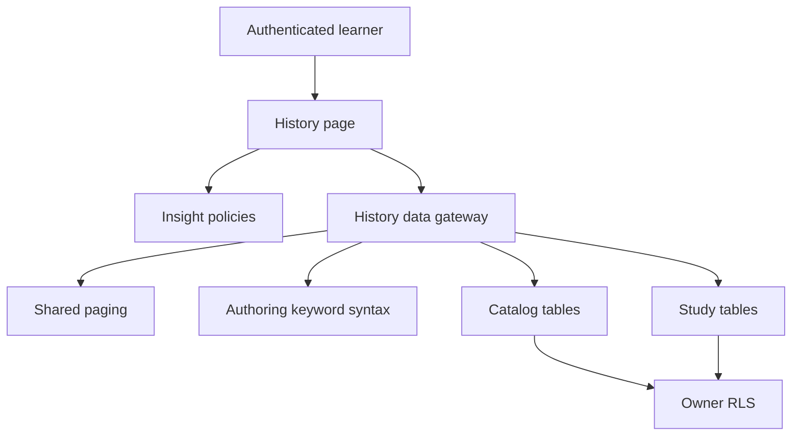
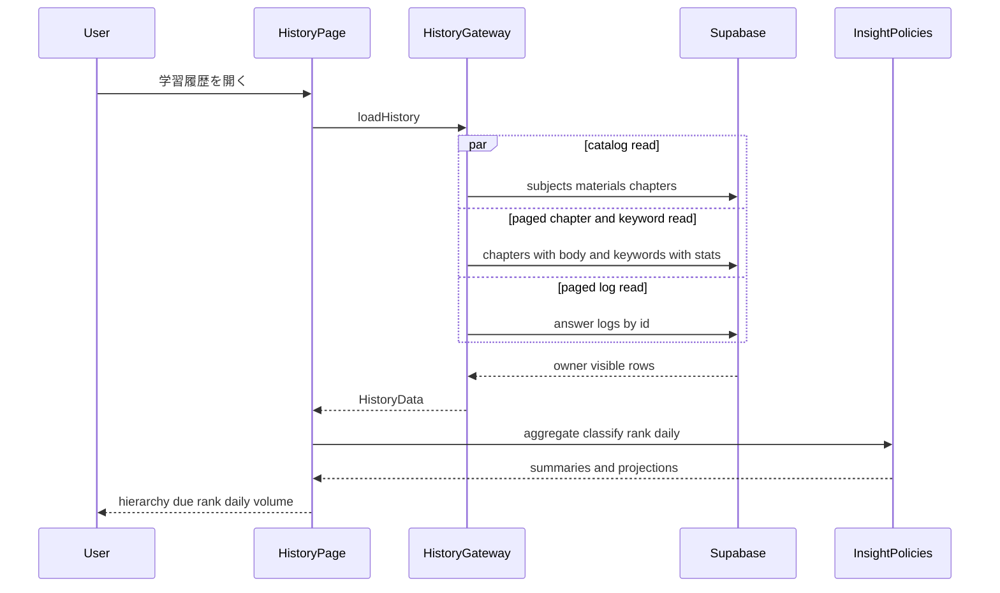
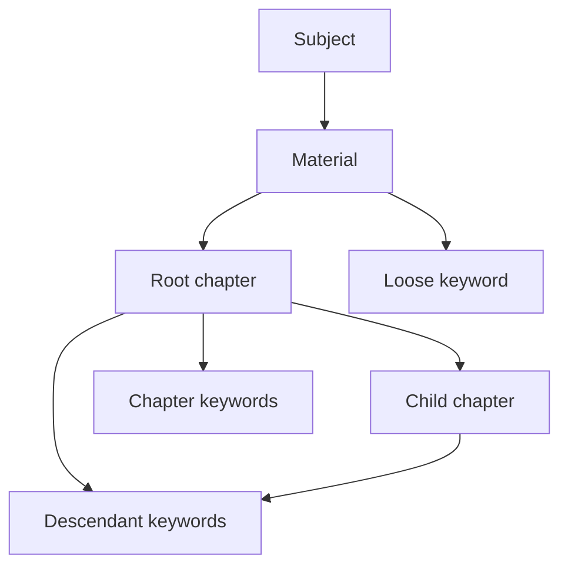
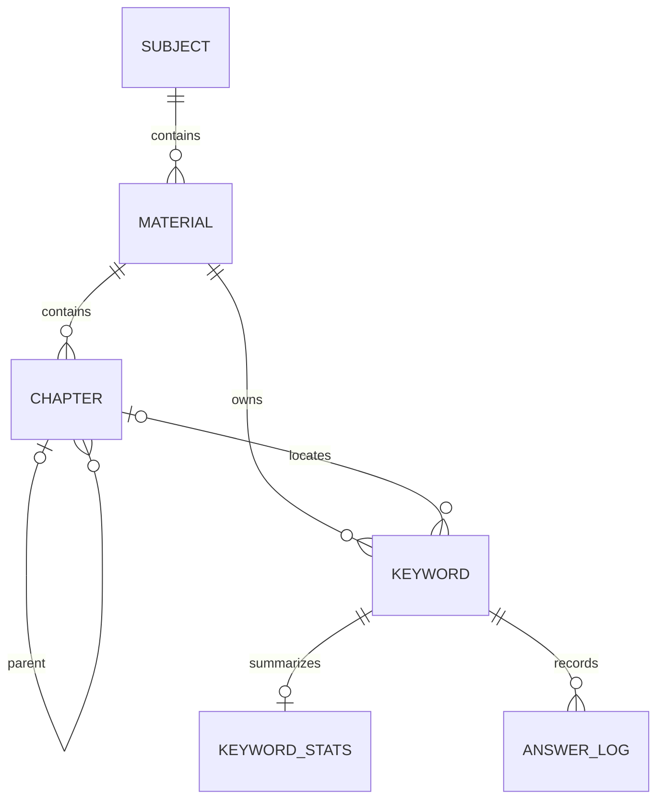

# 設計書

## Overview

**Purpose**: 本機能は、個人学習者に、教材階層ごとの達成度、直近の復習予定、解答済みキーワードの順位、および日別学習量を提供する。

**Users**: 認証済みの個人学習者が学習履歴画面を開き、次に復習する範囲を判断する。

**Impact**: 新しい挙動やデータを追加せず、既存の `history` feature を読取り専用の下流投影として固定し、catalog と study の変更時に再検証すべき契約を明示する。

### Goals

- 所有者スコープの教材階層、章本文の doc ID 出現、キーワード学習状態、解答履歴を欠落なく read model へ変換する。
- 未出題／苦手／定着、重み付き正答率、復習予定、順位、14日間の日別量を純粋計算として固定する。
- 階層展開、空状態、読込失敗、再試行を含む既存画面契約を維持する。
- 決定表20列、unit、E2E と requirement を追跡できるようにする。

### Non-Goals

- 科目、教材、章、キーワードの編集または活性同期
- 出題、採点、解答記録、別解登録、SRS 更新
- `material_summary` の変更または history 専用 DB 集計 RPC の追加
- 通知、目標、ランキング、CSV 出力、他利用者との比較
- 新しいグラフライブラリ、UI リデザイン、DB migration

## Boundary Commitments

### This Spec Owns

- `HistoryData` と `HistoryNode` からなる学習履歴画面の read model 投影。章は本文トークン出現単位、教材／科目は keyword UUID 重複除外とする
- `StatRow` に対する分類、階層集計、復習期限集計、解答済み順位、日別量の純粋規則
- `/history` の loading、error、retry、empty、階層展開、達成度、順位、日別量の表示状態
- catalog 所有の StablePagedReader を科目、教材、章／本文、keywords、answer_logs の history adapter へ適用する利用契約

### Out of Boundary

- `subjects`、`materials`、`chapters` の CRUD、順序、親子関係、cascade。これらは `learning-content-catalog` が所有する
- keyword master の編集、`keywords.chapter_id` provenance、`is_active` 同期、keyword parser。catalog／authoring の上流契約を参照する
- `keyword_stats`、`answer_logs` の作成・更新、別解訂正、SRS。これらは `adaptive-study-session` が所有する
- `SETTLED_COUNT`、`SETTLED_RATE` の値。本仕様は study の定数を参照し二重定義しない
- catalog 一覧用 `material_summary` RPC。本仕様はその関数や `src/lib/summary.ts` を変更しない
- 共通 `fetchAll` のページサイズ、安定順序、終了判定。本仕様は catalog 所有契約を利用し、`src/lib/paged.ts` を変更しない

### Allowed Dependencies

- `learning-content-catalog`: 科目／教材／章 ID、名称、`sort_order`、`parent_id`、章本文、owner／material／parent 整合性、StablePagedReader、削除結果
- `markdown-keyword-authoring`: 文書内 ID トークンの解釈、`keywords.chapter_id` は provenance hint に限ること、残存本文に基づく活性同期
- `adaptive-study-session`: `keyword_stats`、`answer_logs`、別解訂正後の値、`SETTLED_COUNT`、`SETTLED_RATE`
- `src/lib/paged.ts`: catalog が所有し、業務順序 + `id` の一意順で全ページを返す `fetchAll`
- `src/lib/supabase.ts`: authenticated browser client と RLS
- `src/components/Trail.tsx` および app shell: breadcrumb と `/history` route
- PostgreSQL schema／RLS: `20260829000000_init.sql` の既存表、索引、policy

依存方向は `HistoryPage -> aggregate / history api -> shared paging / Supabase -> PostgreSQL` とする。history から catalog／study の Page または更新 API へ依存しない。

### Revalidation Triggers

- 科目／教材／章の ID、名称、保存順、`parent_id`、章本文、owner／material／parent 整合性が変わる
- キーワード記法、文書内 ID、`keywords.chapter_id` の provenance 意味、本文出現からの活性同期が変わる
- keyword の `answers`、`is_active`、所属、削除・履歴保持方針が変わる
- `keyword_stats.total_count`、`correct_count`、`due_at` または `answer_logs.answered_at`、`is_correct` の意味が変わる
- study の `SETTLED_COUNT`、`SETTLED_RATE` または別解訂正契約が変わる
- RLS、1回の行取得上限、`fetchAll` の終了条件または安定順要件が変わる
- 端末日付ではなく利用者 profile timezone を採用する

## Architecture

### Existing Architecture Analysis

- `src/features/history/api.ts` は5つの独立 read を並列化し、DB row を `HistoryData` へ変換する。現行は keywords と answer_logs だけがページング済みで、科目／教材／章本文の全件取得と本文出現投影は未完了ギャップである。
- `src/features/history/aggregate.ts` は時刻を引数に受ける純粋関数として分類、summary、順位、日別bucketを提供する。
- `HistoryPage.tsx` は一度だけ現在時刻を固定し、取得、再試行、展開集合、14日表示、上位10件を統合する。
- catalog の `material_summary` は教材一覧の欠落しない集計であり、history の全階層・順位・日別量を満たす契約ではない。ownership を重ねないため再利用しない。
- schema は `owner_id` RLS、keyword 削除時の stats／logs cascade、章削除時の keyword provenance set null、`answer_logs(owner_id, answered_at desc)` と `keyword_stats(owner_id, due_at)` を提供する。章所属は `chapter_id` ではなく各 `chapters.body` の doc ID 出現から求める。

### Architecture Pattern & Boundary Map



**Architecture Integration**:

- Selected pattern: feature-first の read model gateway + 純粋 projection + Page orchestration
- Domain boundaries: catalog は階層／本文／ページング／構造整合性、authoring は doc ID token と provenance／活性の意味、study は記録としきい値、insights は本文出現の読取り投影と表示を所有する
- Existing patterns preserved: DB row の snake_case から camelCase への API 境界変換、操作文脈付き日本語 `Error`、独立 read の並列化、共通ページング
- New components rationale: `ChapterOccurrenceProjection` は `chapter_id` 依存を除き本文出現単位と UUID 単位を分離する未実装 gap であり、既存 aggregate の責務を増やさずに追加する
- Steering compliance: `any` なし、Page からの DB 直接アクセスなし、RLS 依存、1,000件超で欠落なし

### Technology Stack

| Layer | Choice / Version | Role in Feature | Notes |
|---|---|---|---|
| Frontend | React 19、TypeScript 5.9 | 取得状態、階層展開、集計表示 | 既存 stack、追加依存なし |
| Data access | Supabase JS 2、PostgREST | 所有者スコープの5 read | 全 read が catalog の StablePagedReader を消費 |
| Data | PostgreSQL 17、RLS | catalog と study の永続行 | schema 変更なし |
| Tests | Vitest 3、Playwright 1.56 | 純粋集計と利用者経路 | E2E はローカル Supabase、1 worker |

## File Structure Plan

```text
src/features/history/
├── aggregate.ts             # StatRow の分類、Summary、順位、日別量
├── aggregate.test.ts        # 決定表 19 の純粋集計回帰 19件
├── occurrences.ts           # authoring token を章出現と material/subject UUID 集合へ投影
├── occurrences.test.ts      # 複数章・同一章重複・provenance 削除回帰
├── api.ts                   # catalog paging を消費し所有者スコープを HistoryData へ投影
└── HistoryPage.tsx          # /history の取得、再試行、展開、表示
src/features/study/
└── question.ts              # 上流所有の SETTLED_COUNT と SETTLED_RATE
src/lib/
├── keyword.ts               # authoring 所有の doc ID token 契約
├── paged.ts                 # catalog 所有の StablePagedReader
└── summary.ts               # catalog 所有の material_summary adapter
supabase/migrations/
├── 20260829000000_init.sql              # catalog／study schema、索引、owner RLS
├── 20260903000000_material_summary.sql  # catalog 一覧用集計。変更対象外
└── 20260904000000_sync_active_keywords.sql # keyword 活性同期。変更対象外
e2e/
└── history.spec.ts          # 履歴画面6経路と追加すべき gap fixtures
spec/tables/
└── 19-history.jsonl         # 20列の詳細回帰資産
```

### Modified Files

- ベースライン作成ではアプリケーションファイルを変更しない。
- 将来の既存挙動変更は、所有する `src/features/history/*`、`e2e/history.spec.ts`、`spec/tables/19-history.jsonl`、本 spec を同じ変更で同期する。
- 上流 schema または定数の変更は上流 spec が先に所有し、本 spec は再検証だけを行う。

### Component-to-File Mapping

| Component | Existing file boundary |
|---|---|
| HistoryDataGateway | `src/features/history/api.ts` |
| HistoryTreeProjection | `src/features/history/api.ts`, `src/features/history/occurrences.ts` |
| ChapterOccurrenceProjection | `src/features/history/occurrences.ts`, `src/features/history/occurrences.test.ts` |
| MasteryClassification | `src/features/history/aggregate.ts` |
| InsightAggregation | `src/features/history/aggregate.ts` |
| WeakKeywordProjection | `src/features/history/aggregate.ts` |
| DailyVolumeProjection | `src/features/history/aggregate.ts` |
| HistoryPage | `src/features/history/HistoryPage.tsx` |
| HistoryOwnerIsolationConformance | `e2e/history.spec.ts`, `e2e/helpers/rpcSecurity.ts`（上流契約の消費） |

## System Flows

### 読取り、投影、および表示



一つの read が失敗すれば `loadHistory` 全体を失敗にし、Page が alert と再試行を出す。部分データを成功として確定しない。

### 階層集計対象の構成



章は自身と子孫の本文トークン出現を順序と重複を保って持つ。教材と科目は、同じ keyword UUID が複数章または同一章に複数回出現しても1件に重複除外する。`keywords.chapter_id` は投影に使わない。本文出現がない active keyword は教材／科目だけに含め、非活性の除外は aggregate policy が一貫して行う。

## Requirements Traceability

| Requirement | Summary | Components | Interfaces | Flows |
|---|---|---|---|---|
| 1.1, 1.2, 1.3 | 所有者スコープの順序付き階層 | HistoryDataGateway、HistoryTreeProjection | `loadHistory`、`HistoryNode` | 読取り、投影、および表示 |
| 1.4, 1.5, 1.6, 1.7, 1.10 | 本文出現の章集計と UUID 重複除外 | ChapterOccurrenceProjection、HistoryTreeProjection | `projectKeywordOccurrences`、`HistoryNode.keywordRefs` | 階層集計対象の構成 |
| 1.8, 1.9 | 非活性の集計除外と履歴保持 | InsightAggregation、DailyVolumeProjection | `aggregate`、`weakKeywords`、`dailyVolume` | 読取り、投影、および表示 |
| 2.1, 2.2, 2.3, 2.4, 2.5 | 3区分と共用しきい値 | MasteryClassification | `classify`、study constants | 読取り、投影、および表示 |
| 3.1, 3.2, 3.3 | 階層件数と重み付き正答率 | InsightAggregation、HistoryPage | `aggregate`、`Summary` | 階層集計対象の構成 |
| 3.4, 3.5, 3.6 | 0件／未出題と帯表示 | InsightAggregation、HistoryPage | `Summary`、UI state | 読取り、投影、および表示 |
| 3.7 | 別解訂正後の値 | HistoryDataGateway、InsightAggregation | stats／logs read contract | 読取り、投影、および表示 |
| 4.1, 4.2, 4.3, 4.4 | 今日／今週の復習予定 | InsightAggregation、HistoryPage | `aggregate(rows, now)` | 読取り、投影、および表示 |
| 5.1, 5.2, 5.3 | 解答済み順位 | WeakKeywordProjection | `weakKeywords` | 読取り、投影、および表示 |
| 5.4, 5.5 | 上位10件と空状態 | HistoryPage | UI state | 読取り、投影、および表示 |
| 6.1, 6.2, 6.3, 6.4 | 14日の日別bucket | DailyVolumeProjection、HistoryPage | `dailyVolume` | 読取り、投影、および表示 |
| 6.5 | 履歴なし状態 | HistoryPage | UI state | 読取り、投影、および表示 |
| 7.1, 7.2, 7.3, 7.4 | 初期展開、開閉、階層空状態 | HistoryPage | open set、UI state | 読取り、投影、および表示 |
| 7.5, 7.6, 7.7 | loading、error、retry | HistoryPage、HistoryDataGateway | error envelope、`load` | 読取り、投影、および表示 |
| 8.1, 8.2, 8.5 | 構造／本文／keywords／logs 全ページ | HistoryDataGateway | catalog `fetchAll` | 読取り、投影、および表示 |
| 8.3, 8.4 | 所有者分離 | HistoryDataGateway、HistoryOwnerIsolationConformance | RLS、catalog integrity | 読取り、投影、および表示 |

## Components and Interfaces

| Component | Domain / Layer | Intent | Req Coverage | Key Dependencies | Contracts |
|---|---|---|---|---|---|
| HistoryDataGateway | Data access | catalog paging を使い5 read を実行しアプリ型へ変換する | 1.1〜1.10, 3.7, 7.6, 7.7, 8.1〜8.5 | Supabase P0、Catalog paging P0、RLS P0 | Service、State |
| ChapterOccurrenceProjection | Application | authoring token と chapter body から出現単位の参照を作る | 1.4, 1.5, 1.6, 1.7, 1.10 | Authoring syntax P0、Catalog body P0 | Service |
| HistoryTreeProjection | Application | catalog 行と本文出現から集計用 tree を作る | 1.2〜1.7, 1.10 | ChapterOccurrenceProjection P0 | Service |
| MasteryClassification | Domain | StatRow を3区分へ分類する | 2.1〜2.5 | Study constants P0 | Service |
| InsightAggregation | Domain | 章の出現列または教材／科目の UUID 集合から Summary と復習予定を計算する | 1.4〜1.8, 3.1〜3.7, 4.1〜4.4 | MasteryClassification P0、Clock P1 | Service |
| WeakKeywordProjection | Domain | 解答済み active keyword を UUID 単位で順位付けする | 1.6, 1.8, 5.1〜5.5 | StatRow P0 | Service |
| DailyVolumeProjection | Domain | 解答履歴を端末日付のbucketへ射影する | 1.9, 6.1〜6.5 | Clock P1 | Service |
| HistoryPage | UI / Application | 読込、展開、空状態、insight 表示を統合する | 3.1〜7.7 | 全 history component P0、Trail P1 | State |
| HistoryOwnerIsolationConformance | Integration test | 上流 RLS と catalog 整合性を history の読取り結果で再検証する | 8.3, 8.4 | Identity RLS P0、Catalog integrity P0 | API |

### Data Access

#### HistoryDataGateway

| Field | Detail |
|---|---|
| Intent | 所有者が参照できる catalog／study 行を完全な `HistoryData` へ変換する |
| Requirements | 1.1〜1.10, 3.7, 7.6, 7.7, 8.1〜8.5 |

**Responsibilities & Constraints**

- 科目、教材、章／本文、keywords／stats、logs の5 read すべてを catalog 所有の StablePagedReader に接続し、業務上の保存順 + `id` で一意に読む。
- 独立した5 read を並列実行し、`src/lib/paged.ts` の実装や終了判定は変更せず、history 固有の select／filter／mapping だけを所有する。
- DB の snake_case、nullable stats、timestamp を camelCase、0初期値、`Date` へ変換する。
- 読取り失敗は操作文脈を付けた日本語 `Error` とし、部分 `HistoryData` を返さない。

**Dependencies**

- Outbound: Supabase client — catalog／study read（P0）
- Outbound: Catalog StablePagedReader — 1,000件超の構造、本文、keywords／logs（P0）
- External: PostgreSQL RLS — owner visibility（P0）

**Contracts**: Service [x] / API [ ] / Event [ ] / Batch [ ] / State [x]

```typescript
type HistoryData = {
  tree: HistoryNode[];
  rows: Map<string, StatRow>;
  logs: { answeredAt: Date; correct: boolean }[];
};

type HistoryNode = {
  kind: 'subject' | 'material' | 'chapter';
  id: string;
  title: string;
  parentId: string | null;
  keywordRefs: AggregationRef[];
  children: HistoryNode[];
};

type AggregationRef = {
  keywordId: string;
  occurrenceKey: string; // chapter token は一意、material/subject は keywordId
};

function loadHistory(): Promise<HistoryData>;
```

- Preconditions: authenticated client が利用可能で、schema／RLS が適用済みである。
- Postconditions: 成功時は見える全構造行、章本文、keyword、answer log が欠落・ページ重複なく read model へ反映される。
- Invariants: gateway は永続行を更新しない。`rows` key は keyword UUID、tree の `keywordRefs.keywordId` はその key を参照する。`keywords.chapter_id` は参照投影の入力にしない。

#### ChapterOccurrenceProjection and HistoryTreeProjection

| Field | Detail |
|---|---|
| Intent | 平坦な catalog 行、章本文の doc ID 出現、keyword master を表示・集計用 tree へ投影する |
| Requirements | 1.2, 1.3, 1.4, 1.5, 1.6, 1.7, 1.10 |

**Responsibilities & Constraints**

- 同一教材内で `parent_id` を再帰的に辿り、catalog の複合整合性を前提に別教材／別 owner の親子を作らない。
- authoring 所有の token scanner で各章本文の有効な doc ID 出現を本文順に抽出し、`(chapterId, tokenIndex, keywordId)` を一意な `occurrenceKey` にする。
- 章には自身と全子孫の出現参照を重複を保って持たせる。教材と科目は keyword UUID で重複除外し、本文出現がない active keyword も material ownership により含める。
- provenance 章が削除されても、別章本文の doc ID 出現と active 状態から参照を再構成する。
- active 判定は投影から分離し、Summary と順位の policy が行う。

**Contracts**: Service [x] / API [ ] / Event [ ] / Batch [ ] / State [ ]

```typescript
type ChapterBody = { id: string; materialId: string; body: string };
type KeywordIdentity = { id: string; materialId: string; docId: string };

function projectKeywordOccurrences(
  chapters: readonly ChapterBody[],
  keywords: readonly KeywordIdentity[],
): ReadonlyMap<string, readonly AggregationRef[]>;
```

### Domain Policies

#### MasteryClassification and InsightAggregation

| Field | Detail |
|---|---|
| Intent | keyword の3区分と階層 Summary を副作用なく算出する |
| Requirements | 1.4〜1.8, 2.1〜2.5, 3.1〜3.7, 4.1〜4.4 |

```typescript
type Level = 'untouched' | 'weak' | 'settled';

type Summary = {
  total: number;
  untouched: number;
  weak: number;
  settled: number;
  correctRate: number | null;
  dueToday: number;
  dueThisWeek: number;
};

function classify(row: StatRow): Level;
function aggregate(rows: readonly StatRow[], now: Date): Summary;
function aggregateRefs(
  refs: readonly AggregationRef[],
  rows: ReadonlyMap<string, StatRow>,
  now: Date,
): Summary;
```

- `classify` は study の `SETTLED_COUNT` と `SETTLED_RATE` を import し、ローカル定数を持たない。
- `aggregate` は active rows だけを対象にし、`total` は keyword 数、`correctRate` は累積数の加重比とする。
- `aggregateRefs` は章ノードで occurrenceKey ごとに同じ `StatRow` を評価するため、同じ keyword の複数出現が章の `total`、3区分、正答率、復習予定に出現数分反映される。material／subject の refs はあらかじめ keyword UUID で重複除外済みである。
- `dueAt = null` は today／week の双方で期限内として数える。
- 週は端末時刻の日曜開始・土曜終了とする。

#### WeakKeywordProjection

| Field | Detail |
|---|---|
| Intent | active かつ解答済み keyword を学習優先度順へ並べる |
| Requirements | 1.6, 1.8, 5.1〜5.5 |

```typescript
function weakKeywords(rows: readonly StatRow[]): StatRow[];
```

- 正答率昇順、同率では出題回数降順にする。
- 関数は全件を返し、Page が先頭10件を選ぶ。
- 関数名にかかわらず settled を除外しない。現行の利用者表示契約を優先する。

#### DailyVolumeProjection

| Field | Detail |
|---|---|
| Intent | 解答 event を端末日付の連続したbucketへ投影する |
| Requirements | 1.9, 6.1〜6.5 |

```typescript
type DayVolume = {
  date: string;
  count: number;
  correctRate: number | null;
};

function dailyVolume(
  logs: readonly { answeredAt: Date; correct: boolean }[],
  now: Date,
  days: number,
): DayVolume[];
```

- `days = 14` は Page の表示契約である。
- 範囲内の各端末日付を `YYYY-MM-DD` で先に生成し、該当 event だけを加算する。
- `count = 0` では `correctRate = null` とする。

### UI

#### HistoryPage

| Field | Detail |
|---|---|
| Intent | 学習履歴の read、projection、展開、空状態、エラー回復を統合する |
| Requirements | 3.1〜7.7 |

**State Management**

- `data`: 最新の成功した `HistoryData` または初期 null
- `loading`: read 中だけ true
- `error`: 操作文脈付き error message。再試行時に消す
- `open`: 展開中 node ID。成功読込直後は subject ID だけを含む
- `now`: mount 時に固定した `Date`。同じ表示内の全 Summary と14日bucketで共有する

**Implementation Notes**

- Integration: node ごとの `keywordRefs` を `rows` Map へ解決し、章では出現列、教材／科目では UUID 集合として純粋 policy に渡す。
- Validation: child なし button は disabled。error は `role="alert"`、再試行は同じ `load` を呼ぶ。
- Risks: 画面を長時間開いたまま日付が変わっても `now` は更新されない。現行ベースラインとして維持し、変更は別要求とする。

## Data Models

### Domain Model

- `HistoryData` は画面単位の read model であり、永続化の所有単位ではない。
- `HistoryNode` は catalog の subject／material／chapter を同じ表示契約に投影する。keyword を所有せず `AggregationRef` だけを持つ。chapter の ref は本文出現単位、material／subject の ref は keyword UUID 単位である。
- `StatRow` は keyword master と nullable `keyword_stats` を結合した集計入力である。
- `Summary`、`DayVolume`、順位結果は再計算可能な projection であり保存しない。

### Logical Data Model



### Physical Data Model

| Table | Read fields | Insight semantics |
|---|---|---|
| `subjects` | `id`, `name`, `sort_order` | root node。ownership と変更は catalog |
| `materials` | `id`, `name`, `subject_id`, `sort_order` | subject child。ownership と変更は catalog |
| `chapters` | `id`, `title`, `material_id`, `parent_id`, `sort_order`, `body` | recursive node と doc ID 出現源。ownership と変更は catalog／authoring |
| `keywords` | `id`, `doc_id`, `answers`, `chapter_id`, `material_id`, `is_active` | aggregation input。`chapter_id` は provenance hint に限り、章所属には使わない |
| `keyword_stats` | `keyword_id`, `total_count`, `correct_count`, `due_at` | current cumulative projection。更新は study |
| `answer_logs` | `id`, `answered_at`, `is_correct` | daily immutable events。別解時の直前訂正は study |

- 全表は `owner_id` を持ち、authenticated role の `USING` と `WITH CHECK` で `auth.uid()` に制限される。
- keyword 削除で stats／logs は cascade する。章削除では keyword の provenance `chapter_id` が null になるが、authoring は残存本文に同じ doc ID があれば active を維持する。insights は次回 read で残存章へ再投影する。
- owner／subject／material／parent／provenance の複合整合性は catalog 所有の DB 制約を消費し、history が migration を所有しない。
- `keyword_stats(owner_id, due_at)` と `answer_logs(owner_id, answered_at desc)` の既存 index を維持する。
- history 用の新しい表、column、index、migration はない。

## Error Handling

### Error Strategy

- subjects、materials、chapters、keywords、answer_logs の read error はそれぞれ `科目の取得に失敗しました` 等の操作文脈と Supabase message を結合する。
- `loadHistory` は all-or-error とし、ある read の failure を空配列へ変換しない。
- Page は loading を解除し、`role="alert"`、message、再試行 button を表示する。
- unknown throwable は `読み込みに失敗しました` に正規化する。
- 再試行は全5 read をやり直し、成功時に `data` と subject 初期展開を置き換える。

### Monitoring

- 専用 telemetry は現行範囲外である。利用者に表示する日本語 error とブラウザ console／Supabase logs を既存運用に従って使う。
- 新しい retry loop、backoff、部分成功 cache は導入しない。

## Testing Strategy

### Unit Tests

- `classify`: 0回、3回／90%以上、未達、3回および90%境界を確認する（2.1〜2.5）。
- `aggregate`: active filter、3区分、空、全未出題、累積加重率、今日／今週、上位合計、別解訂正後累積を確認する（1.8, 3.1〜4.3, 3.7）。
- `weakKeywords`: 未出題／非活性除外、正答率昇順、同率の出題数降順を確認する（5.1〜5.3）。
- `dailyVolume`: 当日解答数／率、0件の日、古い順を確認する（6.1〜6.4）。
- `occurrences.test.ts`: 同一 doc ID の同一章内複数出現、複数章出現、章の祖先反映、material／subject の UUID 重複除外、provenance 章削除後の別章再活性化を確認する（1.4〜1.7, 1.10）。

### E2E and Integration Tests

- 既存6件: 章の3区分と79%、教材開閉、順位、当日3件、履歴なし、1,002 keywords を確認する。
- gap: answer_logs 初回 REST だけを 500 にし、alert と retry 後の chart を確認する（7.6, 7.7）。
- gap: 親／子／孫章本文へ doc ID トークンを置き、同じ keyword を同一章と2回、別章と1回出現させ、章は出現数、教材／科目は UUID 1件となることを確認する（1.3〜1.7, 3.2）。
- gap: provenance 章を削除後、別章本文に残る同じ doc ID が active のまま当該章と material／subject へ集計されることを確認する（1.10）。
- gap: 同一 active keyword に当日 answer_logs 1,001件を batch insert し、最終 bucket の `data-count="1001"` と正答率を確認する（8.2）。
- gap: 所有者A／Bへ同名階層と異なる件数を seed し、Aの画面にBの node、件数、logs が出ないことを確認する（8.3, 8.4）。
- gap: 1,001件超の科目、教材、章／本文のページ境界をまたぐ末尾出現が階層集計に反映されることを確認する（8.5）。

### Performance and Load

- keywords fixture は既存1件 + `seedManyKeywords(... count: 1001)` の合計1,002件を使い、全体と章行の双方で `1002 問` を確認する。
- answer_logs fixture は1 keyword へ同一当日内の1,001行を1回の batch insert で作り、2ページ目を含む全件を日別bucketで確認する。
- 構造 fixture は catalog の安定順契約と同じ tie-breaker を使い、科目／教材／章本文の1,001件超を history adapter でも欠落・重複なく読む。
- 新しい応答時間目標は設定しない。合否基準は「欠落しない」である。

### Quality Gates

- `npm run typecheck`
- `npm test -- src/features/history/aggregate.test.ts`
- `npm run spec:coverage`
- `npm run build`
- ローカル Supabase と Chromium、`workers: 1` で `npm run test:e2e -- e2e/history.spec.ts`

## Security Considerations

- browser は公開可能 key と authenticated session を使い、history request に service role を使用しない。
- `subjects`、`materials`、`chapters`、`keywords`、`keyword_stats`、`answer_logs` の RLS が read visibility を所有者へ限定する。
- Page や pure policy は `owner_id` を client 側 filter として信頼せず、RLS の結果だけを入力にする。
- owner policy、FK、active sync の変更は上流が所有し、history は混在 fixture で再検証する。

## Performance & Scalability

- 現行の keywords と answer_logs は `id` の安定順で `fetchAll` を使い、1回1,000行の上限を越える。
- subjects、materials、chapters／bodies、keywords／stats、answer_logs のすべてに catalog 所有の StablePagedReader を使い、業務順序 + `id` で安定させる。この適用は未完了タスクであり、helper 自体は catalog が所有する。
- データ転送量は構造、本文、keywords、logs の件数に比例する。本文 token の走査量にも応じて増えるが、既存要求に応答時間目標はない。性能上の問題が観測されるまで新しい DB read model を追加しない。
- `material_summary` は catalog 一覧の server aggregation として維持し、history の全行 requirement を代替しない。

## Migration Strategy

- ベースライン作成に schema migration、データ移行、rollout はない。
- 将来 history 専用 RPC を追加する場合は既存 migration を変更せず、新しい timestamp migration、`SECURITY INVOKER`、空の `search_path`、schema 修飾、anon revoke、owner isolation test を要求する。

## Baseline Evidence

- `src/features/history/aggregate.ts` と `aggregate.test.ts` が決定表列1〜16、19の純粋規則を直接示す。
- `src/features/history/api.ts` と `HistoryPage.tsx` が現行 read model、keyword／log のページング、provenance ベースの階層、UI state を示す。本文出現投影と構造行の全件ページングは未完了である。
- `e2e/history.spec.ts` 6件が章集計、開閉、順位、日別、空状態、1,002 keyword の利用者経路を示す。
- `spec/tables/19-history.jsonl` 20列を詳細回帰資産として維持する。
- `20260829000000_init.sql`、`20260903000000_material_summary.sql`、`20260904000000_sync_active_keywords.sql` が schema、RLS、catalog summary、active history retention の隣接契約を示す。
