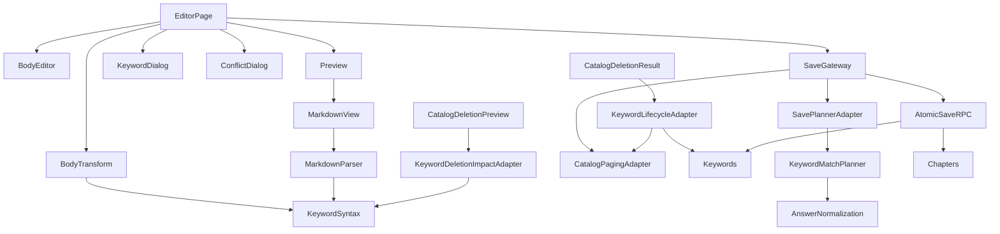
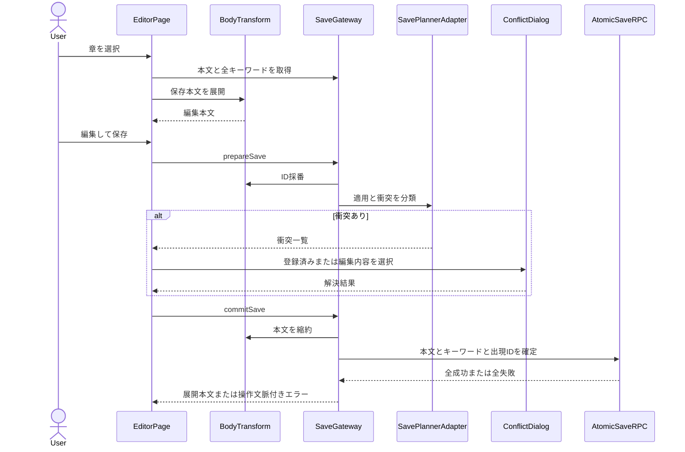
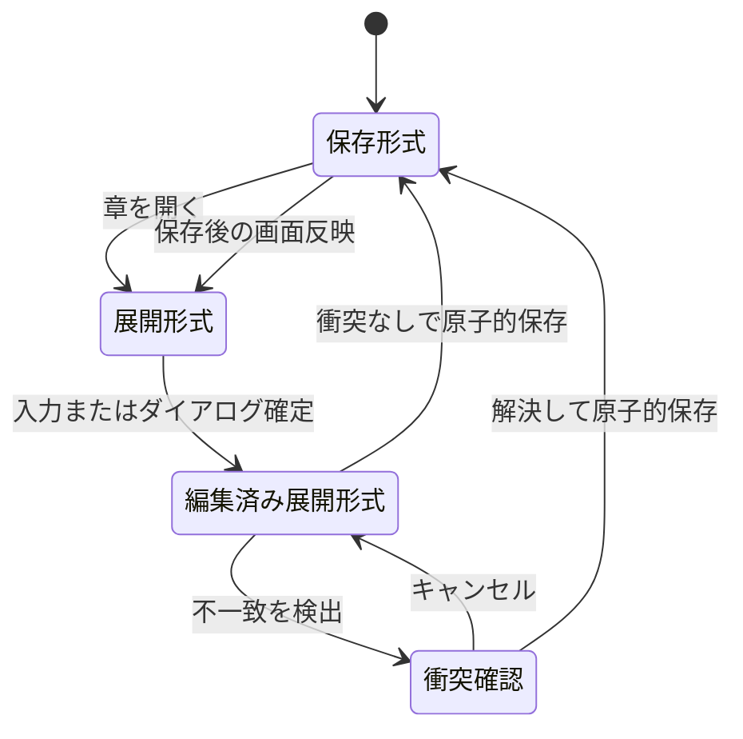
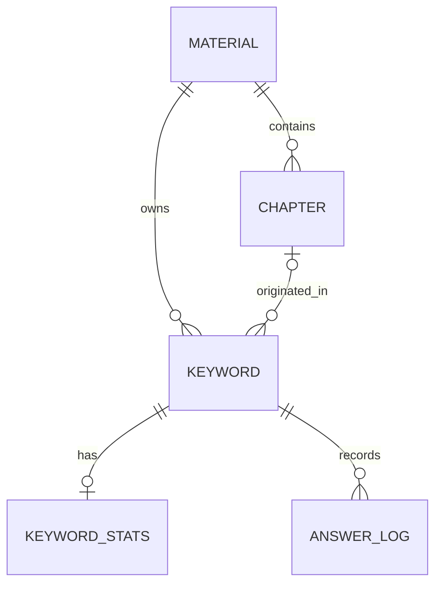
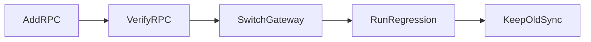

# 技術設計書

## 概要

本機能は、教材の章本文を Markdown として編集し、本文中のキーワード記法をキーワードマスタへ結び付ける。編集画面では可読な展開形式を扱い、永続化では本文を安定した文書内 ID の参照へ縮約することで、本文の重複を避けながら学習履歴を継続する。

既存の feature-first 構造、純粋な parser／formatter、二段階の保存準備／確定、共通 Markdown 表示と衝突ダイアログを維持する。唯一の既知の実装ギャップは、確定時のキーワード、章本文、活性状態が現在は別々に書き込まれる点であり、単一 DB トランザクションへ集約する設計を追加する。

### 目標

- Markdown とキーワード記法の双方向契約を固定する
- editor UI、キーワードマスタ、保存本文の責務境界を明確にする
- 文書内 ID と活性状態によって学習履歴を継続する
- 保存失敗時の部分更新を防ぎ、再試行可能な未保存状態を保つ
- 決定表 05〜09 と既存テストを今後の回帰基準として維持する

### 非目標

- 科目、教材、章の CRUD または順序管理を再定義すること
- zip import／export、出題、採点、SRS、履歴集計を実装すること
- Markdown の画像を描画または管理すること
- 共同編集、競合する複数利用者のリアルタイム同期、曖昧採点を追加すること
- 現行 Markdown サブセットを外部 parser へ置き換えること

## 境界コミットメント

### 本仕様が所有するもの

- キーワード記法のトークン化、解釈、整形、文書内 ID の検証と採番
- 正答文字列の正規化と完全一致、既存／取り込み／編集キーワードの overlap・duplicate 判定、`Plan`／`Conflict` を含む共有突合契約
- 編集用の展開本文と保存用の ID 参照本文の双方向変換
- editor の本文、選択、キーワードダイアログ、未保存、衝突解決、保存状態
- 章本文保存時のキーワードマスタ更新と教材内 `is_active` 同期
- catalog の章削除結果を受けた、残存章本文からの authoring-owned `is_active` 再同期
- catalog の章削除 preview を受けた、対象本文中の doc ID トークン出現数の authoring-owned 算出
- 既存キーワードを同じ ID で更新したときの履歴継続に必要な識別契約

### 境界外

- 教材と章の存在、名称、階層、順序、削除
- catalog の章削除処理、削除 transaction、catalog API／UI ファイル
- import／export のファイル構造と原子的取り込み
- 非活性キーワードを除外した後の出題順、問題表示、正誤判定、SRS 更新
- 共通ヘッダー、テーマ、ルーティング、認証セッションの所有
- 共通ページング、共通衝突ダイアログ、共通の操作中ガードの実装所有
- 画像データの取得、表示、保存

### 許可する依存

- `learning-content-catalog` が提供する教材 ID、章 ID、章本文の読み取り契約
- `learning-content-catalog` が提供する章削除完了結果と対象教材 ID
- `learning-content-catalog` が提供する削除対象 chapter ID／body の preview
- `learning-content-catalog` が所有する `src/lib/paged.ts` の安定順全件取得契約
- `identity-and-access` が提供する認証済み利用者と owner RLS
- `app-shell-and-responsive-experience` が提供するルート、テーマ、`src/components/ConflictDialog.tsx`、`src/lib/submitGuard.ts` の共通 UI／非同期ガード契約
- `src/components/MarkdownView.tsx` の共有表示契約
- `src/lib/supabase.ts` の共通 client

### 再検証トリガー

- キーワード記法、引用規則、文書内 ID 形式、教材内一意性の変更
- 正答正規化、`KeywordMatchPlanner`、`Plan`／`Conflict`、overlap／duplicate 契約の変更。この場合は portability と study も再検証する
- `chapters.body` または `keywords` の所有関係・列・制約の変更
- catalog の章削除結果または削除後 hook の変更。この場合は catalog と authoring lifecycle 統合を再検証する
- 衝突判定、保存 RPC、活性同期、RLS または関数権限の変更
- Markdown の位置情報または `MarkdownView` の空欄描画契約の変更
- 1回の取得件数上限、ページング契約、狭幅 breakpoint の変更
- `src/lib/paged.ts` の変更では catalog 契約と editor adapter、`ConflictDialog` または `submitGuard` の変更では app-shell 契約と editor 統合を再検証する

## アーキテクチャ

### 既存アーキテクチャ分析

- `EditorPage` は画面固有状態と利用者フローを統合し、DB 呼び出しを直接実装しない。
- `keyword.ts`、`body.ts`、`markdown.ts` は副作用を持たず、UI と保存の双方が同じ記法契約を利用する。
- editor の API 境界は DB 行を camelCase のアプリ型へ変換し、全件取得には共通ページングを使う。
- `keywords` は `(material_id, doc_id)` で一意であり、章削除時には残存できる。学習状態と履歴は keyword の UUID を参照するため、同じ行の upsert で継続する。
- 現行確定処理は upsert、章更新、活性同期の順に別要求を送る。中間失敗時の原子性だけが要求と一致していない。

### アーキテクチャパターンと境界図



**統合判断**:

- 選択パターン: feature-first の画面オーケストレーション + 共有純粋変換 + Supabase gateway
- 依存方向: `AnswerNormalization／KeywordSyntax → KeywordMatchPlanner／BodyTransform／MarkdownParser → editor adapter／SaveGateway → EditorPage`。portability と study は `src/lib` の共有契約を利用し、authoring から transfer feature へ依存しない。DB 書き込みは `SaveGateway → AtomicSaveRPC` に限定する。
- 保存準備は読み取り専用、利用者の衝突解決後の確定だけをトランザクションにする。章削除後は catalog の削除結果を authoring-owned `KeywordLifecycleAdapter` が消費し、catalog 実装へ keyword 更新を持ち込まない。
- 新規ライブラリや汎用 repository 層は追加しない。

### 技術スタック

| 層 | 選択／バージョン | 本機能での役割 | 備考 |
|---|---|---|---|
| フロントエンド | React 19、TypeScript 5.9 | 編集状態、3ペイン／タブ、ダイアログ | strict、`any` 不使用 |
| 表示 | Tailwind CSS 4 | 既存ワイヤーフレームに沿うレスポンシブ表示 | breakpoint は既存 767px 境界 |
| データアクセス | Supabase JS 2 | 全件読み取り、保存準備、RPC 呼び出し | Page／共通 UI から直接呼ばない |
| 永続化 | PostgreSQL 17、RLS | 章本文、キーワードマスタ、活性同期 | 確定書き込みは単一 RPC へ集約 |
| テスト | Vitest 3、Playwright 1.56 | 純粋契約と DB／UI 統合の回帰 | E2E は1 worker |

## ファイル構造計画

### ディレクトリ構造

```text
src/
├── features/editor/
│   ├── EditorPage.tsx          # editor 状態と利用者フローの統合
│   ├── BodyEditor.tsx          # 生本文入力、選択、記法ハイライト
│   ├── Preview.tsx             # editor 用空欄操作を MarkdownView へ供給
│   ├── KeywordDialog.tsx       # 正答・タグ・誤答の編集と解除
│   ├── overwrite.ts            # 共有突合計画を editor 保存へ適用する adapter
│   ├── overwrite.test.ts       # editor adapter の統合回帰
│   └── api.ts                  # 全件読み取り、保存準備、確定 gateway
├── features/keywords/
│   ├── deletionImpact.ts       # catalog preview body から doc ID 出現数を算出
│   ├── deletionImpact.test.ts  # 章出現単位、重複、無効記法の回帰
│   ├── lifecycle.ts            # catalog 章削除結果から活性同期を起動する authoring consumer
│   └── lifecycle.test.ts       # 残存出現あり／なしの adapter 統合回帰
├── components/
│   ├── MarkdownView.tsx        # 共通 Markdown ブロック／インライン表示
│   └── ConflictDialog.tsx      # app-shell 所有。本仕様は props 統合のみ利用
└── lib/
    ├── answer.ts               # authoring 所有の正答正規化と完全一致契約
    ├── answer.test.ts          # 正答正規化の共有回帰
    ├── keywordMatch.ts         # authoring 所有の Plan／Conflict／overlap／duplicate planner
    ├── keywordMatch.test.ts    # editor／import 共通の突合回帰
    ├── keyword.ts              # 記法スキャン、パース、ID 検証
    ├── keyword.test.ts         # 記法と ID 境界値
    ├── body.ts                 # 整形、採番、縮約、展開、本文編集
    ├── body.test.ts            # 本文変換の回帰
    ├── markdown.ts             # Markdown サブセットと本文位置の解析
    ├── markdown.test.ts        # Markdown／画像素通し／空欄の回帰
    ├── paged.ts                # catalog 所有。本仕様は SaveGateway adapter から利用
    └── submitGuard.ts          # app-shell 所有。本仕様は EditorPage 統合から利用
supabase/migrations/
├── 20260829000000_init.sql                    # chapters／keywords／RLS／制約
├── 20260904000000_sync_active_keywords.sql    # 現行の活性同期 RPC
└── 20261010010000_save_chapter_with_keywords.sql # 計画: 原子的な保存確定 RPC
e2e/
└── editor.spec.ts              # editor UI、保存、衝突、DB 副作用の直列回帰
spec/tables/
└── 05-editor-ui.jsonl〜09-save-overwrite.jsonl # 詳細な回帰判断
```

### 変更対象

- `src/lib/answer.ts`、`src/lib/keywordMatch.ts` と共有契約テスト — 現行の正規化と `src/features/transfer/match.ts` の planner を authoring 所有へ集約する。
- `src/features/editor/overwrite.ts` と editor 統合テスト — editor の feature 間参照を共有契約の利用へ切り替える。transfer 側 adapter の変更は portability が所有する。
- `src/features/keywords/lifecycle.ts` と統合テスト — catalog の deletion result を受け、catalog 所有 paging で残存本文を読み、authoring 所有の活性同期を起動する。catalog ファイルは変更しない。
- `src/features/keywords/deletionImpact.ts` とテスト — catalog の deletion preview に含まれる chapter ID／body から有効な doc ID トークンを章出現単位で数え、provenance を参照しない。
- `supabase/migrations/20261010010000_save_chapter_with_keywords.sql` — 未実装の原子的保存 RPC を追加する。
- `src/features/editor/api.ts` — `commitSave` の3段階書き込みを原子的保存 RPC の1回呼び出しへ置き換える。
- `e2e/editor.spec.ts` — 中間失敗時の DB 不変と高速連打時の単一保存要求を追加検証する。

既存の parser、formatter、共通 UI 部品は要求を満たしており再作成しない。`paged.ts`、`submitGuard.ts`、`ConflictDialog.tsx` は所有 spec でのみ変更し、本仕様は adapter／統合テストに限定する。

| コンポーネント | 実装ファイル |
|---|---|
| KeywordSyntax | `src/lib/keyword.ts` |
| BodyTransform | `src/lib/body.ts` |
| MarkdownParser | `src/lib/markdown.ts` |
| AnswerNormalization | `src/lib/answer.ts` |
| KeywordMatchPlanner | `src/lib/keywordMatch.ts` |
| BodyEditor | `src/features/editor/BodyEditor.tsx` |
| Preview／MarkdownView | `src/features/editor/Preview.tsx`, `src/components/MarkdownView.tsx` |
| KeywordDialog | `src/features/editor/KeywordDialog.tsx` |
| SavePlannerAdapter | `src/features/editor/overwrite.ts` |
| ConflictDialogAdapter | `src/features/editor/EditorPage.tsx`（`src/components/ConflictDialog.tsx` を消費） |
| CatalogPagingAdapter／SaveGateway | `src/features/editor/api.ts`（`src/lib/paged.ts` を消費） |
| KeywordLifecycleAdapter | `src/features/keywords/lifecycle.ts`（catalog deletion result と `src/lib/paged.ts` を消費） |
| KeywordDeletionImpactAdapter | `src/features/keywords/deletionImpact.ts`（catalog deletion preview と `src/lib/keyword.ts` を消費） |
| SubmitGuardAdapter／EditorPage | `src/features/editor/EditorPage.tsx`（`src/lib/submitGuard.ts` を消費） |
| KeywordPersistence | `supabase/migrations/20260829000000_init.sql`, `20260904000000_sync_active_keywords.sql` |
| AtomicSaveRPC | `supabase/migrations/20261010010000_save_chapter_with_keywords.sql` |

## システムフロー

### 編集と保存



### 本文形式の状態



## 要求トレーサビリティ

| 要求 | 概要 | コンポーネント | 契約／フロー |
|---|---|---|---|
| 1.1, 1.2, 1.3, 1.4, 1.5, 1.6, 1.7, 1.8, 1.9 | Markdown 編集とレスポンシブプレビュー | EditorPage、BodyEditor、Preview、MarkdownView、MarkdownParser | 編集と保存フロー、UI state |
| 2.1, 2.2, 2.3, 2.4, 2.5, 2.6, 2.7, 2.8, 2.9 | キーワード作成・編集・解除 | EditorPage、KeywordDialog、BodyTransform、Preview | KeywordDraft、本文変換 |
| 3.1, 3.2, 3.3, 3.4, 3.5, 3.6, 3.7, 3.8, 3.9, 3.10 | 記法の解釈と整形 | KeywordSyntax、BodyTransform、MarkdownParser | ParsedKeyword、KeywordToken |
| 4.1, 4.2, 4.3, 4.4, 4.5, 4.6 | ID 検証と採番 | KeywordSyntax、BodyTransform、KeywordPersistence | KeywordDefinition、DB 制約 |
| 5.1, 5.2, 5.3, 5.4, 5.5, 5.6, 5.7, 5.8, 5.9, 5.10 | 縮約・展開・活性同期・章出現 | BodyTransform、SaveGateway、AtomicSaveRPC、KeywordPersistence、CatalogPagingAdapter、KeywordLifecycleAdapter、KeywordDeletionImpactAdapter | SavePreparation、保存フロー、provenance 契約、catalog deletion preview／result |
| 6.1, 6.2, 6.3, 6.4, 6.5, 6.6, 6.7, 6.8 | 正答衝突の解決 | AnswerNormalization、KeywordMatchPlanner、SavePlannerAdapter、ConflictDialogAdapter、EditorPage、SaveGateway | KeywordMatchPlan、Conflict、保存フロー |
| 7.1, 7.2, 7.3, 7.4, 7.5, 7.6 | 保存中断と離脱保護 | EditorPage、SubmitGuardAdapter、SaveGateway、AtomicSaveRPC | UI state、原子的確定 |

## コンポーネントとインターフェース

| コンポーネント | 層 | 責務 | 要求 | 主要依存 | 契約 |
|---|---|---|---|---|---|
| KeywordSyntax | 共通純粋ロジック | 記法スキャン、パース、ID 検証 | 3.1〜3.9, 4.6 | なし | Service |
| BodyTransform | 共通純粋ロジック | 整形、採番、縮約、展開、本文範囲編集 | 2.2〜2.9, 3.10, 4.1〜4.6, 5.1〜5.3 | KeywordSyntax P0 | Service |
| MarkdownParser | 共通純粋ロジック | Markdown サブセットと本文位置の解析 | 1.1, 1.3〜1.5 | KeywordSyntax P0 | Service |
| BodyEditor | UI | 本文入力、選択、ハイライト、スクロール | 1.2, 1.7, 1.8, 2.1 | BodyTransform P1 | State |
| Preview／MarkdownView | UI | Markdown と操作可能な空欄の表示 | 1.1〜1.5, 1.8, 2.1, 2.4 | MarkdownParser P0 | State |
| KeywordDialog | UI | 正答・タグ・誤答の編集、取消、解除 | 2.1, 2.4〜2.9 | BodyTransform P0 | State |
| AnswerNormalization | 共通純粋ロジック | 正答文字列の正規化と完全一致 | 6.2, 6.3, 6.6 | なし | Service |
| KeywordMatchPlanner | 共通純粋ロジック | `Plan`／`Conflict` と overlap／duplicate 判定 | 6.1〜6.3, 6.6, 6.8 | AnswerNormalization P0 | Service |
| SavePlannerAdapter | editor ドメイン | 共有突合結果へ trusted 編集経路を適用する | 6.1〜6.3, 6.6, 6.8 | KeywordMatchPlanner P0 | Service |
| ConflictDialogAdapter | editor UI 統合 | app-shell 所有 dialog へ衝突と選択を接続する | 6.3〜6.7 | SavePlannerAdapter P0 | State |
| CatalogPagingAdapter | editor データ統合 | catalog 所有 paging で全章・全 keyword を読む | 5.7 | `src/lib/paged.ts` P0、Supabase P0 | Service |
| KeywordLifecycleAdapter | authoring lifecycle 統合 | catalog 章削除後の残存本文から活性を再同期 | 5.4, 5.5, 5.8, 5.9 | catalog deletion result P0、CatalogPagingAdapter P0 | Service |
| KeywordDeletionImpactAdapter | authoring lifecycle 統合 | catalog 削除対象本文の doc ID トークン出現数を返す | 5.8, 5.10 | catalog deletion preview P0、KeywordSyntax P0 | Service |
| SubmitGuardAdapter | editor UI 統合 | app-shell 所有 guard を保存操作へ接続する | 7.6 | `src/lib/submitGuard.ts` P0 | Service |
| SaveGateway | データアクセス | 全件取得、保存準備、確定呼び出し、型変換 | 4.1〜4.6, 5.1〜5.8, 6.1〜6.8, 7.2, 7.3 | CatalogPagingAdapter P0、Supabase P0 | Service |
| KeywordPersistence | 永続化 | 章本文、キーワードマスタ、ID 制約、provenance、owner RLS | 4.1〜4.6, 5.1〜5.6, 5.8 | PostgreSQL P0 | State |
| AtomicSaveRPC | 永続化 | 本文・キーワード・活性状態の原子的確定 | 5.1, 5.2, 5.4〜5.7, 6.4, 6.5, 7.2, 7.3 | PostgreSQL／RLS P0 | API |
| EditorPage | UI 統合 | editor 状態、画面遷移、保存、離脱保護 | 1.1〜2.9, 6.1〜7.6 | UI parts P0、SaveGateway P0、SubmitGuardAdapter P0 | State |

### 共通純粋ロジック

#### KeywordSyntax

**責務と制約**

- 1行内の `{{...}}` だけをトークン化し、引用中の区切りと閉じ括弧を保護する。
- 未知キーは無視し、既知キーの重複は後勝ち、各リストは trim／空除外／順序を保った重複除去を行う。
- 文書内 ID の有効条件を `/^[a-z0-9]{6}$/` に一元化する。

**契約**: Service [x] / API [ ] / Event [ ] / Batch [ ] / State [ ]

```typescript
type ParsedKeyword = {
  answers: string[];
  docId: string | null;
  tags: string[];
  wrongChoices: string[];
};

type KeywordToken = {
  start: number;
  end: number;
  inner: string;
};

function scanKeywordTokens(body: string): KeywordToken[];
function parseKeywordToken(inner: string): ParsedKeyword | null;
function isValidDocId(docId: string): boolean;
```

#### BodyTransform

**責務と制約**

- 書式順序と引用規則を一意にし、ID だけの参照形式を生成する。
- 採番では既存 ID と同じ処理内の採番済み ID を避け、本文順を維持する。
- 展開は章内の最初の出現だけ、縮約はすべての有効な ID 付き記述に適用する。
- 解除時は本文またはマスタから得た最初の正答を通常文字列へ戻す。

**契約**: Service [x] / API [ ] / Event [ ] / Batch [ ] / State [ ]

```typescript
type KeywordFields = {
  answers: string[];
  tags: string[];
  wrongChoices: string[];
};

type KeywordDefinition = KeywordFields & { docId: string };

function assignDocIds(
  body: string,
  existingIds: Iterable<string>,
  nextId?: () => string,
): { body: string; keywords: KeywordDefinition[] };
function collapseBody(body: string): string;
function expandBody(body: string, byId: ReadonlyMap<string, KeywordFields>): string;
```

### editor UI と状態

#### EditorPage

**状態モデル**

```typescript
type Tab = 'chapters' | 'edit' | 'preview';

type EditorState = {
  selectedId: string | null;
  body: string;
  savedBody: string;
  selection: { start: number; end: number } | null;
  trusted: ReadonlySet<string>;
  pending: SavePreparation | null;
  resolutions: Readonly<Record<string, string>>;
  busy: boolean;
  error: string;
};
```

- `body !== savedBody` を未保存の唯一の判定とする。
- ダイアログ確定済みの既存 ID だけを `trusted` に入れ、保存後に空へ戻す。
- 衝突確認は登録済み候補があればそれを既定にし、なければ入力順の最初の候補を既定にする。別候補への変更は明示選択に限定する。
- 保存失敗時は `body` と `savedBody` を変更せず、操作文脈付きエラーを表示する。

#### UI 部品契約

```typescript
type KeywordDraft = ParsedKeyword & {
  start: number;
  end: number;
  existing: boolean;
};

type BodyEditorProps = {
  value: string;
  onChange: (next: string) => void;
  onSelect: (start: number, end: number) => void;
  hidden?: boolean;
  onScroll?: () => void;
};

type PreviewProps = {
  body: string;
  answersOf: (docId: string) => string[];
  onOpenBlank: (blank: Blank) => void;
  hidden?: boolean;
  onScroll?: () => void;
};
```

### 保存ドメインとデータアクセス

#### AnswerNormalization と KeywordMatchPlanner

```typescript
type MatchKeyword = KeywordFields & { docId: string | null };

type Plan =
  | { kind: 'new'; docId: string | null; fields: KeywordFields }
  | { kind: 'overwrite'; docId: string; fields: KeywordFields };

type Conflict = {
  conflictId: string;
  docId: string;
  reason: 'answers' | 'duplicate';
  candidates: readonly ConflictCandidate[];
};

type ConflictCandidate = {
  candidateId: string;
  source: 'existing' | 'incoming';
  fields: KeywordFields;
};

type ConflictResolution = {
  conflictId: string;
  candidateId: string;
};

type KeywordMatchPlan = {
  apply: Plan[];
  conflicts: Conflict[];
};

function normalizeAnswer(value: string): string;
function hasAnswerOverlap(left: readonly string[], right: readonly string[]): boolean;
function isDuplicateKeyword(left: KeywordFields, right: KeywordFields): boolean;
function planKeywordMatch(
  keywords: readonly MatchKeyword[],
  existing: ReadonlyMap<string, KeywordFields>,
): KeywordMatchPlan;
```

- authoring が正規化、overlap、duplicate、`Plan`、`Conflict` の意味を所有し、editor、portability、study は同じ `src/lib` 契約を利用する。
- 新規 ID と登録済み正答に overlap がある同一 ID は apply、正答不一致の同一 ID と同じ入力内の異内容 duplicate は conflict にする。
- conflict は doc ID と正規化済み内容から安定した `conflictId`／`candidateId` を作り、登録済み候補があれば先頭へ、その後に入力順を保った相異なる incoming 候補をすべて保持する。解決は候補 ID を1件指定し、候補が存在しない ID、別 conflict の候補、未解決 conflict を確定要求として受け付けない。
- `SavePlannerAdapter` は editor 固有の `trusted` だけを追加解釈し、明示編集された既存 ID を自動適用する。共有 planner の型や判定を再定義しない。

#### SaveGateway

```typescript
type KeywordRow = KeywordFields & {
  docId: string;
  isActive: boolean;
};

type SavePreparation = {
  body: string;
  apply: { docId: string; fields: KeywordFields }[];
  conflicts: Conflict[];
  existing: Map<string, KeywordFields>;
};

function listKeywords(materialId: string): Promise<KeywordRow[]>;
function prepareSave(
  materialId: string,
  expandedBody: string,
  trusted: ReadonlySet<string>,
): Promise<SavePreparation>;
function commitSave(
  materialId: string,
  chapterId: string,
  preparation: SavePreparation,
  resolutions?: readonly ConflictResolution[],
): Promise<string>;
```

- `listKeywords` は `fetchAll` で取得上限を超えて全件を返す。
- `prepareSave` は書き込みを行わない。
- `commitSave` は解決結果を本文へ反映し、縮約本文、更新するキーワード、教材全体の出現 ID を RPC に渡す。
- 成功時だけ展開本文を返し、失敗は日本語の操作文脈付き `Error` にする。

#### CatalogPagingAdapter と SubmitGuardAdapter

- `CatalogPagingAdapter` は catalog 所有の `src/lib/paged.ts` を `SaveGateway` の章／keyword query に適用する。ページング実装や順序契約そのものは変更しない。
- `SubmitGuardAdapter` は app-shell 所有の `src/lib/submitGuard.ts` を editor の保存操作へ適用する。ガード実装そのものは変更しない。
- 本仕様の検証範囲は feature adapter と editor 統合であり、共有基盤の単体所有テストは各所有 spec に置く。

#### KeywordDeletionImpactAdapter

```typescript
type ChapterDeletionPreview = {
  chapters: readonly {
    id: string;
    body: string;
  }[];
};

type KeywordDeletionImpact = {
  occurrenceCount: number;
  occurrenceCountByChapter: Readonly<Record<string, number>>;
};

function countKeywordOccurrencesForDeletion(
  preview: ChapterDeletionPreview,
): KeywordDeletionImpact;
```

- `ChapterDeletionPreview` は catalog 所有の出力契約であり、catalog は keyword parser や `keywords.chapter_id` に依存しない。
- authoring の token scanner と doc ID 検証を使い、対象本文に現れる有効な ID-only／full keyword token を1トークン1出現として数える。
- 同じ doc ID の複数章出現と同一章内の複数出現を省略せず、章 ID ごとの件数と合計を返す。
- authoring 所有の `CatalogDeletionIntegration`（EditorPage／章削除 consumer）はこの結果を表示へ渡し、app-shell 所有の共通 dialog／表示状態を消費する。catalog の削除実装へ parser を持ち込まない。

#### KeywordLifecycleAdapter

- catalog の章削除 transaction や catalog ファイルを変更せず、削除成功後に返る対象教材 ID を入力にする。
- 削除後の全章本文を `CatalogPagingAdapter` で取得し、本文に残る doc ID 集合を authoring 所有の活性同期へ渡す。
- provenance 章が削除されても別章本文に同じ doc ID があれば active を維持し、どの本文にもなければ keyword と履歴を削除せず inactive にする。
- catalog の削除失敗または取消では同期を起動しない。同期失敗は再試行可能な統合エラーとして扱い、catalog の削除責務へ keyword mutation を戻さない。

```typescript
type ChapterDeletionResult = {
  materialId: string;
  deletedChapterIds: readonly string[];
};

function syncKeywordActivityAfterChapterDeletion(
  result: ChapterDeletionResult,
): Promise<void>;
```

`ChapterDeletionResult` は catalog 所有の出力契約であり、本仕様は受信側の処理と本番接続を所有する。authoring 所有の `CatalogDeletionIntegration`（EditorPage／章削除 consumer）はこの関数を削除成功後にだけ呼び、取消・削除失敗では呼ばない。同期失敗は再試行可能な統合エラーとして表示し、catalog の削除実装へ authoring の DB 更新を埋め込まない。app-shell は共通 dialog／表示状態だけを提供し、業務 wiring を所有しない。

#### KeywordPersistence

- `chapters.body` の縮約本文と `keywords` の意味情報を永続化し、教材内文書 ID の一意性、ID 形式、非空正答、owner RLS を強制する。`keywords.chapter_id` は最後に定義を取り込んだ章の provenance hint に限り、章所属は各 `chapters.body` の doc ID 出現から求める。
- 現行の `sync_active_keywords` は教材内の出現 ID 集合から活性状態だけを一括同期する。
- 原子的保存の導入後も既存テーブル制約と RLS を正とし、RPC が制約を迂回しない。

#### AtomicSaveRPC

**契約**: Service [ ] / API [x] / Event [ ] / Batch [ ] / State [ ]

| 関数 | 入力 | 出力 | エラー |
|---|---|---|---|
| `save_chapter_with_keywords` | 教材 ID、章 ID、縮約本文、確定キーワード配列、教材内の出現文書 ID 配列 | 変更完了 | 未認証、RLS 不一致、ID／正答制約違反、章と教材の不一致 |

**事前条件**:

- 呼出者は認証済みで、対象教材・章・既存キーワードを RLS により操作できる。
- 確定キーワードは文書内 ID、正答、タグ、誤答選択肢を持つ。
- 章 ID は入力した教材 ID に属する。

**事後条件**:

- 指定キーワードは `(material_id, doc_id)` で upsert され、既存 keyword UUID と履歴参照を維持する。
- `chapters.body` は縮約本文になる。
- 教材内で出現する ID だけが `is_active = true`、それ以外は false になる。
- いずれかが失敗した場合は、上記3種の変更をすべてロールバックする。

**制約**:

- `SECURITY INVOKER`、`search_path = ''`、完全修飾名、authenticated／service_role だけへの execute grant を使う。
- identity 回帰では authenticated owner の成功、cross-owner の読取／更新拒否、anon の実行拒否を検証する。service role は E2E の準備・管理に限定し、ブラウザまたは通常利用者経路から使わない。
- 入力配列が空でも空本文保存と全キーワード非活性化を処理できる。

## データモデル

### ドメインモデル



- `Material` が文書内 ID の一意性境界である。
- `Chapter.body` は ID 参照形式を正とし、編集用展開本文は永続化しない。
- `Keyword` が正答、タグ、誤答選択肢、活性状態の正である。
- `chapter_id` は最後に定義を取り込んだ章を示す provenance hint であり membership ではない。章削除後も別章本文に同じ doc ID が残れば、再同期で keyword と学習資産を活性のまま継続できる。

### 物理データモデル

| 対象 | 主要列／制約 | 本機能での意味 |
|---|---|---|
| `chapters` | `id`, `material_id`, `owner_id`, `body text not null` | 縮約本文を保持する |
| `keywords` | `material_id`, `doc_id`, `answers`, `tags`, `wrong_choices`, `is_active` | キーワード意味情報の正 |
| `keywords_doc_id_unique` | unique `(material_id, doc_id)` | 教材内一意性と upsert 先の固定 |
| `doc_id` check | `^[a-z0-9]{6}$` | 文書内 ID の DB 境界検証 |
| `answers` check | 要素数1以上 | 空正答を永続化しない |
| owner RLS | `USING` と `WITH CHECK` が `auth.uid()` | 他利用者の教材を読み書きしない |

## エラー処理

### エラー戦略

- 記法として認識できない文字列は入力エラーにせず、本文として保持する。
- 正答0件、選択なし、既存記述との重なりは DB 呼び出し前に操作を無効化する。
- 読み取り／保存失敗は editor の alert に操作文脈付き日本語メッセージを表示し、再読込または保存再試行を可能にする。
- 原子的保存失敗では DB を変更前状態へ戻し、画面の編集本文と未保存表示を維持する。
- 衝突はシステムエラーにせず、利用者が項目単位に解決する業務状態として扱う。

### 監視と検証フック

- editor E2E は UI 表示だけでなく管理用クライアントで `chapters.body`、`keywords`、`is_active` を確認する。
- RPC は変更件数をログ用途の公開契約にせず、成功／失敗をトランザクション境界として扱う。
- 失敗注入テストでは、認証済みクライアントから有効な新規キーワードと `null` 本文を RPC へ直接渡し、キーワード処理後の章 `NOT NULL` 違反を発生させる。RPC 全体の失敗後に章本文、キーワード内容、活性状態がすべて不変であることを確認する。

## テスト戦略

### ユニットテスト

- `keyword.test.ts`: 16列の記法、引用、未知／重複キー、1行制約、ID 形式を検証する。
- `body.test.ts`: 整形、採番衝突、縮約／展開、作成可否、確定可否、解除を検証する。
- `markdown.test.ts`: Markdown サブセット、空欄位置、表内記法、画像記法の素通しを検証する。
- `answer.test.ts` と `keywordMatch.test.ts`: 正規化、完全一致、overlap、同一内容 duplicate、異内容 duplicate、`Plan`／`Conflict` を共有契約として検証する。
- `overwrite.test.ts`: editor adapter の trusted、一部正答一致、不一致、同一保存内不整合、新規 ID を検証する。
- `deletionImpact.test.ts`: catalog deletion preview の対象本文から、有効な doc ID トークンを章出現単位で数え、provenance を参照しないことを検証する。
- `lifecycle.test.ts`: catalog deletion result 後の残存本文に応じた active 維持／inactive 化、取消・失敗時の非実行、再試行可能な同期失敗を検証する。
- authoring は `paged.test.ts` と `submitGuard.test.ts` を所有せず、SaveGateway の複数ページ取得と EditorPage の高速連打を統合テストで検証する。

### 統合／E2E テスト

- editor 3ペイン、狭幅タブ、本文追随、双方の選択、ダイアログ、解除、スクロール同期を確認する。
- 章削除確認では authoring 所有の画面接続が出現数を app-shell の共通 dialog へ渡し、削除成功時だけ lifecycle consumer を呼び、取消・失敗時は呼ばないことを確認する。
- 採番、縮約、再展開、非活性化／再活性化、空本文、通信失敗、未保存離脱を DB 副作用込みで確認する。
- 正答衝突の自動適用、上書き、登録済み維持、キャンセルを確認する。
- 1001件のキーワードを用いて、全件の活性同期を確認する。
- 未実装: 有効な新規キーワードと `null` 本文による途中失敗で DB が不変であること、高速な保存連打で確定要求が1回だけ送信されることを確認する。

### 回帰ゲート

- `npm run typecheck`
- `npm test -- src/lib/answer.test.ts src/lib/keywordMatch.test.ts src/lib/keyword.test.ts src/lib/body.test.ts src/lib/markdown.test.ts src/features/editor/overwrite.test.ts src/features/keywords/deletionImpact.test.ts src/features/keywords/lifecycle.test.ts`
- `npm run spec:coverage`
- `npm run test:e2e -- e2e/editor.spec.ts`
- 保存境界を変更した場合は `npm run build` も成功させる。

## セキュリティ考慮

- ブラウザは認証済み利用者のセッションで呼び出し、service role を使用しない。
- chapters／keywords の読み書きと RPC 内の更新は owner RLS に従う。
- RPC は `SECURITY INVOKER` とし、`search_path` を空にしてすべての DB 名をスキーマ修飾する。
- Markdown のリンクは別タブで開き `rel="noreferrer"` を維持する。画像記法は描画しない。

## 性能と拡張性

- キーワードと章の全件読み取りは 1000件単位の `fetchAll` を使い、件数上限で途中終了しない。
- 活性同期はキーワードごとの往復を避け、1トランザクション内の集合更新にする。
- parser と本文変換は本文順の線形走査を基本とし、UI の入力ごとに DB を呼ばない。

## 移行戦略



- 新 migration で原子的保存 RPC を追加し、既存テーブルと `sync_active_keywords` は変更しない。
- migration 名は予約済みの `20261010010000_save_chapter_with_keywords.sql` を使用し、他 spec と timestamp を共有しない。
- RPC の DB 統合テスト後に `commitSave` だけを新 RPC へ切り替える。
- editor E2E と全品質ゲートが成功するまで既存の活性同期 RPC を他の呼出元向けに保持する。
- ロールバック時はクライアント呼出しを旧3段階へ戻せるが、Requirement 7.3を満たさないため恒久運用には戻さない。
