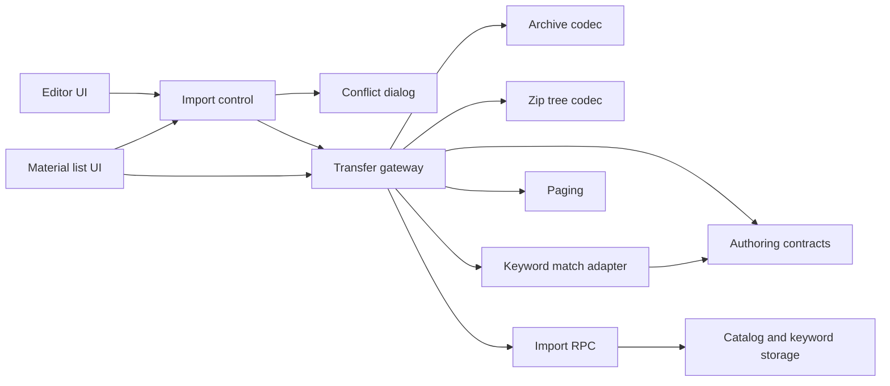
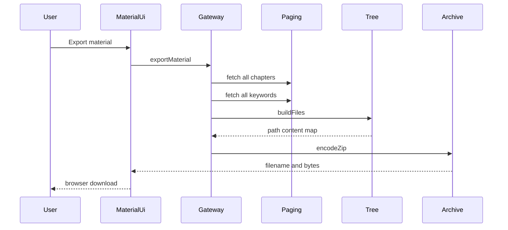
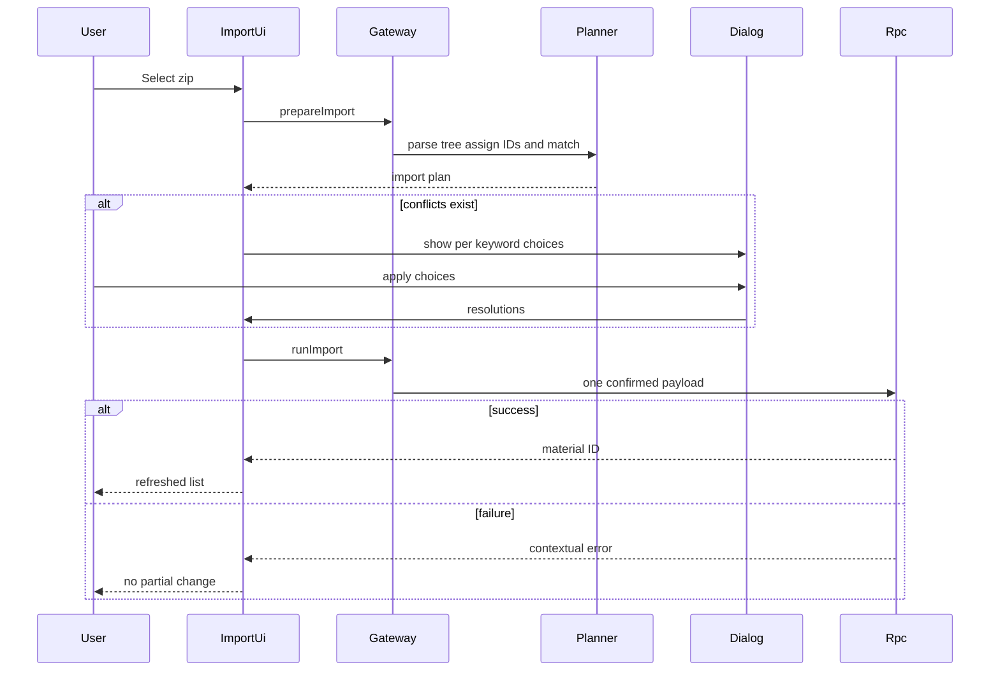

# 技術設計書

## 概要

**Purpose**: 本機能は、個人学習者へ教材の章階層と Markdown 本文を zip で持ち運ぶ契約を提供し、既存教材とのキーワード衝突を利用者の判断を保ちながら安全に解決する。
**Users**: 認証済みの個人学習者が、科目の教材一覧から教材単位で import／export し、教材編集画面から選択章の配下へ章単位で import する。
**Impact**: 現行の transfer feature、共有 authoring 契約、`import_material` RPC、29列の回帰決定表を外部データ契約として固定する。既存挙動は再実装せず、大量章 export、取り込み先所有関係、内部 rollback 検証の実在ギャップだけを後続タスクに残す。

### 目標

- zip path と Markdown から章階層、順序、本文を往復できる契約を固定する。
- authoring の文書内 ID、本文変換、正答正規化、キーワード突合 planner を再利用して import conflict と履歴継続を定義する。
- import を読み取り専用の準備と原子的な確定に分け、cancel／failure で部分変更を残さない。
- 取得上限を超える章とキーワードも export から欠落させない。
- 取り込み先が認証利用者の所有範囲にあることを永続化境界で保証する。

### 非目標

- 学習履歴、SRS 状態、画像、内部 UUID の export／import
- zip 以外のファイル形式、クラウド同期、教材間の直接移動
- Markdown parser、キーワード記法、ID 形式、正答正規化の再定義
- 部分成功、共同編集、import plan の optimistic concurrency control
- 現行画面のリデザインまたは新しい transfer UI の追加

## 境界コミットメント

### 本仕様が所有

- 教材 zip のファイル名、章 path、連番、フォルダ、`index.md` の交換契約
- zip bytes と path-content map の変換、および path-content map と章ツリーの変換
- 教材単位／章単位の import target、import plan、conflict resolution、確定 payload
- authoring 所有のキーワード突合結果と利用者選択を transfer フローへ適用する adapter 責務
- export gateway、import gateway、browser download、教材一覧／editor への transfer 操作接続
- `import_material` の原子的書込み、target ownership validation、実行権、search path
- transfer のユニット、E2E、決定表カバレッジ

### 境界外

- 科目、教材、章の通常 CRUD、章移動、削除、一覧集計
- キーワード記法、文書内 ID の形式、採番アルゴリズム、本文の縮約／展開、正答正規化、`KeywordMatchPlanner`、`Plan`／`Conflict`、overlap／duplicate 判定そのもの
- 共通ページング、共通衝突ダイアログ、共通の操作中ガードの実装所有
- editor の通常保存、活性同期、離脱保護
- 出題、採点、SRS 更新、履歴・統計
- auth session と全表共通 RLS の所有

### 許可する依存関係

- `learning-content-catalog` の `Subject.id`、`Material.id`、`ChapterRow`、親子関係、`sortOrder`
- `markdown-keyword-authoring` の `KeywordFields`、`assignDocIds`、`collapseBody`、`expandBody`、`AnswerNormalization`、`KeywordMatchPlanner`、`Plan`／`Conflict`
- `identity-and-access` の認証済み Supabase client、owner RLS、authenticated role
- `app-shell-and-responsive-experience` の共通 alert、button、modal、`src/components/ConflictDialog.tsx`、`src/lib/submitGuard.ts`、responsive UI
- `learning-content-catalog` が所有する `src/lib/paged.ts` の安定順全件取得、`src/lib/supabase.ts` の client、`fflate` 0.8.2
- PostgreSQL の既存 schema、constraints、`import_material` RPC

### 再検証トリガー

- zip path、連番、`index.md`、拡張子、文字コード、圧縮 library の変更
- `ChapterRow` の ID、親 ID、順序、本文または material ownership の変更
- `KeywordFields`、文書内 ID、キーワード記法、縮約／展開、正答正規化の変更
- authoring 所有の `AnswerNormalization`、`KeywordMatchPlanner`、`Conflict`、`Plan`、overlap／duplicate の意味変更
- `import_material` signature、transaction scope、role grant、RLS、search path の変更
- PostgREST の取得上限、paging contract、download API の変更
- `src/lib/paged.ts` の変更では catalog と transfer adapter、`ConflictDialog` または `submitGuard` の変更では app-shell と transfer 統合を再検証する

上記の変更では `learning-content-catalog`、`markdown-keyword-authoring`、`identity-and-access`、取り込み後の `adaptive-study-session` を再検証する。

## アーキテクチャ

### 既存アーキテクチャ分析

- `archive.ts` は zip bytes、`zip.ts` は章 tree を扱う portability 所有の純粋境界であり、`api.ts` が Supabase、catalog paging、authoring 所有の keyword planner を接続する。現行 `match.ts` から共有型と判定を `src/lib/keywordMatch.ts` へ移し、同じ path は portability adapter として残す。
- `ImportControl` はファイル選択から plan 作成まで永続化せず、conflict がなければ即時、あれば共有 `ConflictDialog` の選択後に確定する。
- `MaterialsPage` は教材 import／export、`EditorPage` は選択章配下への import のみを接続し、transfer の詳細を所有しない。
- `import_material` は client の1回の RPC で教材、章、キーワードを処理する。既存 row の upsert は同じ `(material_id, doc_id)` 行を更新するため、keyword stats と answer logs の参照が続く。
- キーワードは paging 済みだが章は単一 query であり、大量章の完全性が未達である。RPC 引数の所有関係検証と内部 rollback E2E も未達である。

### アーキテクチャパターンと境界図



**アーキテクチャ統合**:

- Selected pattern: pure codecs／planner + feature gateway + UI integration + transactional RPC。
- Domain boundaries: file/archive、chapter tree、keyword decision adapter、persistence を分け、catalog／authoring／app-shell の共有実装を取り込まない。
- Dependency direction: `Upstream Catalog and Authoring Contracts → Pure Transfer Codecs and Planner → Transfer Gateway → UI Integration／Import RPC`。UI は persistence detail へ直接依存しない。
- Existing patterns preserved: named export、camelCase app type、snake_case DB payload、日本語 contextual error、browser-only download、RLS と invoker RPC。
- New components rationale: 新規コンポーネントはない。未達を閉じる変更は既存 gateway／RPC と E2E に限定する。

### 技術スタック

| レイヤ | 選択／バージョン | 本機能での役割 | 備考 |
|---|---|---|---|
| Frontend | React 19 | file picker、conflict state、一覧再読込 | 既存 UI を維持 |
| Archive | fflate 0.8.2、UTF-8 | zip encode／decode | メモリ内処理、ファイルシステム展開なし |
| Client data | Supabase JS 2 | catalog read、keyword read、import RPC | paging は共通 helper |
| Data | PostgreSQL 17、PostgREST | owner-scoped persistence と transaction | invoker、空 search path |
| Validation | Vitest 3、Playwright 1.56 | codecs／planner、利用者経路、DB side effects | E2E は local DB で直列 |

## ファイル構成計画

### ディレクトリ構成

```text
src/
├── features/
│   ├── transfer/
│   │   ├── archive.ts              # zip bytes と path-content map の変換
│   │   ├── archive.test.ts         # encode／decode と壊れた zip
│   │   ├── zip.ts                  # 章 tree と Markdown path の相互変換
│   │   ├── zip.test.ts             # hierarchy、order、safe name、round trip
│   │   ├── match.ts                # authoring 所有 planner を import plan へ接続する薄い adapter
│   │   ├── match.test.ts           # portability 固有 payload との統合回帰
│   │   ├── api.ts                  # export／prepare import／run import gateway
│   │   ├── download.ts             # browser download
│   │   └── ImportControl.tsx       # file input、plan、conflict resolution、busy state
│   ├── materials/MaterialsPage.tsx # material import／export の接続
│   └── editor/
│       ├── EditorPage.tsx           # selected chapter import の接続
│       ├── api.ts                  # paged keywords と authoring contract
│       └── overwrite.ts            # shared match planner の editor 利用
├── components/ConflictDialog.tsx   # app-shell 所有。本仕様は props 統合のみ利用
└── lib/
    ├── body.ts                     # assign／collapse／expand contract
    ├── keyword.ts                  # keyword syntax と doc ID contract
    ├── answer.ts                   # authoring 所有の AnswerNormalization
    ├── keywordMatch.ts             # authoring 所有の planner／Plan／Conflict
    └── paged.ts                    # catalog 所有。本仕様は gateway adapter から利用

supabase/migrations/
├── 20260829000000_init.sql              # catalog／keyword schema、constraints、RLS
├── 20260830000000_import_material.sql   # import RPC
├── 20260831000000_grants.sql            # authenticated execute
├── 20260901000000_revoke_rpc_from_anon.sql
├── 20260902000000_harden_functions.sql  # fixed search path
└── 20261010020000_harden_import_targets.sql # target ownership／relation validation

e2e/transfer.spec.ts                     # import／export／DB side effects／large data
spec/tables/10-import.jsonl              # import 19-column regression asset
spec/tables/11-export.jsonl              # export 10-column regression asset
```

### 変更対象ファイル

- `src/features/transfer/api.ts` — export の章取得を `fetchAll` へ合わせる。
- `src/features/transfer/match.ts` と統合テスト — authoring 所有の共有 planner を portability payload へ接続する薄い adapter へ縮小し、共有型や判定の再定義を残さない。`api.ts` の既存 import path は維持する。
- `supabase/migrations/20261010020000_harden_import_targets.sql` — 適用済み migration を変更せず、同一 RPC signature へ所有関係検証を追加する。
- `e2e/transfer.spec.ts` — 1001章 export、cross-owner target 拒否、RPC 内部失敗 rollback を追加する。

既存の codec、UI、archive format は baseline evidence があるため再作成しない。`src/lib/paged.ts`、`src/components/ConflictDialog.tsx`、`src/lib/submitGuard.ts` は所有 spec でのみ変更し、本仕様は adapter／統合テストに限定する。

| コンポーネント | 実装ファイル |
|---|---|
| ArchiveCodec | `src/features/transfer/archive.ts` |
| ZipTreeCodec | `src/features/transfer/zip.ts` |
| KeywordMatchAdapter | `src/features/transfer/match.ts`（`src/lib/keywordMatch.ts` を消費） |
| TransferPagingAdapter／TransferGateway | `src/features/transfer/api.ts`（`src/lib/paged.ts` を消費） |
| ImportControl | `src/features/transfer/ImportControl.tsx` |
| ConflictDialogAdapter | `src/features/transfer/ImportControl.tsx`（`src/components/ConflictDialog.tsx` を消費） |
| MaterialUiIntegration | `src/features/materials/MaterialsPage.tsx` |
| EditorUiIntegration | `src/features/editor/EditorPage.tsx` |
| ImportRPC | `supabase/migrations/20260830000000_import_material.sql`, `20261010020000_harden_import_targets.sql` |

## システムフロー

### エクスポート



### インポート



## 要求トレーサビリティ

| 要求 | 概要 | コンポーネント | インターフェース | フロー |
|---|---|---|---|---|
| 1.1, 1.5, 1.6 | zip 名と export error | TransferGateway、ArchiveCodec、MaterialUiIntegration | ExportArtifact | Export |
| 1.2, 1.3, 1.4, 1.7 | 章階層、順序、収録範囲 | ZipTreeCodec | ExportChapter、path-content map | Export |
| 2.1, 2.2, 2.3 | 本文と keyword 展開 | TransferGateway、AuthoringContracts | KeywordFields、expandBody | Export |
| 2.4, 2.5, 2.6 | 全件取得と失敗 | TransferGateway、Paging | fetchAll、ExportArtifact | Export |
| 3.1, 3.2, 3.3 | import target | MaterialUiIntegration、EditorUiIntegration、ImportControl | ImportTarget | Import |
| 3.4, 3.5, 3.6, 3.7, 3.8 | tree parse | ZipTreeCodec | ImportedChapter | Import |
| 3.9, 3.10 | invalid archive | ArchiveCodec、ZipTreeCodec、ImportControl | Error | Import |
| 4.1, 4.2, 4.3, 4.4, 4.5 | ID 保持／採番、保存形式、provenance | TransferGateway、AuthoringContracts | ImportPlan、KeywordPayload | Import |
| 5.1, 5.2, 5.4, 5.5, 5.6 | match classification | KeywordMatchAdapter、AuthoringContracts | Plan、Conflict | Import |
| 5.3 | 既存 row と履歴継続 | ImportRPC、KeywordPersistence | upsert key | Import |
| 5.7 | conflict-free immediate apply | ImportControl、TransferGateway | ImportPlan | Import |
| 6.1, 6.2, 6.3, 6.4, 6.5, 6.6 | conflict UI と choices | ImportControl、ConflictDialogAdapter | Resolutions | Import |
| 7.1, 7.2, 7.3, 7.4, 7.5, 7.7 | atomic persistence、ownership、後続画面 | TransferGateway、ImportRPC、UI Integrations | ImportRPCContract | Import |
| 7.6 | round trip | 全 export／import components | ExportArtifact、ImportPlan | Export、Import |

## コンポーネントとインターフェース

| コンポーネント | ドメイン／レイヤ | 目的 | 要求範囲 | 主要依存 | 契約 |
|---|---|---|---|---|---|
| ArchiveCodec | pure archive | zip encode／decode | 1.1, 3.10 | fflate P0 | Service |
| ZipTreeCodec | pure transfer | chapter tree と path の変換 | 1.2〜1.7, 3.4〜3.9 | AuthoringContracts P1 | Service |
| KeywordMatchAdapter | pure transfer integration | authoring planner の結果を import plan へ接続 | 5.1〜5.7 | KeywordMatchPlanner P0 | Service |
| TransferPagingAdapter | data integration | catalog 所有 paging を章／keyword query に適用 | 2.4〜2.6 | `src/lib/paged.ts` P0、Supabase P0 | Service |
| TransferGateway | data access | export、prepare、confirmed import | 1.1, 1.6, 2.1〜2.6, 4.1〜4.5, 7.1〜7.6 | Supabase P0、TransferPagingAdapter P0、ImportRPC P0 | Service |
| ImportControl | feature UI | file input、plan、resolution、busy／error | 3.1〜3.3, 3.9, 3.10, 5.7, 6.1〜6.6 | TransferGateway P0、ConflictDialogAdapter P0 | State |
| ConflictDialogAdapter | feature UI integration | app-shell 所有 dialog へ conflict と overwrite／keep を接続 | 6.1〜6.6 | Conflict P0 | State |
| MaterialUiIntegration | feature UI | material import／export と list refresh | 1.1, 3.1, 3.2, 7.7 | ImportControl P0、TransferGateway P0 | State |
| EditorUiIntegration | feature UI | selected chapter import と tree refresh | 3.3, 7.7 | ImportControl P0 | State |
| ImportRPC | persistence | owner-scoped atomic import | 5.3, 7.1〜7.5 | PostgreSQL constraints P0、RLS P0 | API、State |

### 純粋な transfer 契約

```typescript
type ExportChapter = {
  id: string;
  parentId: string | null;
  title: string;
  sortOrder: number;
  body: string;
};

type ImportedChapter = {
  title: string;
  body: string;
  sortOrder: number;
  children: ImportedChapter[];
};

function encodeZip(files: Record<string, string>): Uint8Array;
function decodeZip(bytes: Uint8Array): Record<string, string>;
function buildFiles(
  chapters: readonly ExportChapter[],
  keywords: ReadonlyMap<string, KeywordFields>,
): Record<string, string>;
function parseFiles(files: Record<string, string>): ImportedChapter[];
```

- `buildFiles` は空の章配列を拒否する。
- `parseFiles` は `.md` 以外を無視し、Markdown が0件なら拒否する。
- ArchiveCodec は path をローカルファイルシステムへ書き出さない。

### KeywordMatchAdapter

```typescript
function planImportedKeywords(
  incoming: readonly KeywordDefinition[],
  existing: ReadonlyMap<string, KeywordFields>,
): KeywordMatchPlan;
```

- `KeywordDefinition`、`KeywordMatchPlan`、`Plan`、`Conflict`、正答 overlap、duplicate の型と判定は authoring 所有の `src/lib` 契約をそのまま import し、本仕様では再定義しない。
- adapter は import の章順で抽出した定義を共有 planner へ渡し、結果を `ImportPlan` に載せるだけに限定する。
- 同じ契約を editor と study も利用するため、変更時は authoring を先に更新し、portability と study の adapter／統合テストを再検証する。

#### ID 正規化と突合順序

1. 各キーワード記法の ID を検証し、妥当なら値を変更せず保持する。
2. ID が欠落または規約外の場合だけ、対象教材の既存 ID と同じ import 内の採番済み ID に衝突しない値を割り当てる。
3. 確定した ID を共有 planner へ渡し、same-ID の正答 overlap は overwrite、正答不一致は conflict、同一 zip 内の異内容 duplicate は conflict とする。
4. overwrite は `(material_id, doc_id)` の既存 row を更新し、keyword UUID、解答履歴、SRS を継続する。
5. export された妥当 ID を同じ教材へ戻した round trip でも同じ順序を適用し、再採番や重複行作成を行わない。

### TransferGateway

```typescript
type ImportTarget =
  | { kind: 'material'; subjectId: string; name: string }
  | { kind: 'chapter'; materialId: string; parentId: string | null };

type ImportPlan = {
  target: ImportTarget;
  chapters: FlatChapter[];
  apply: Plan[];
  conflicts: Conflict[];
  chapterOf: Map<string, string>;
};

type Resolutions = Readonly<Record<string, string>>; // conflictId -> candidateId
type ExportArtifact = { fileName: string; bytes: Uint8Array };

function exportMaterial(materialId: string): Promise<ExportArtifact>;
function prepareImport(bytes: Uint8Array, target: ImportTarget): Promise<ImportPlan>;
function runImport(plan: ImportPlan, resolutions?: Resolutions): Promise<string>;
```

- `prepareImport` の事後条件は永続化変更0件である。
- `prepareImport` は規約内 ID を本文どおり保持して既存 keyword map との突合へ渡し、欠落／規約外 ID の場合だけ対象教材の既存 ID と同じ import 内の採番済み ID を避けて新しい ID を割り当てる。
- `runImport` は各 conflict の選択済み `candidateId` を検証し、`existing` 候補なら既存 row を変更せず、選択した `incoming` 候補だけを overwrite／insert payload に含める。未解決、未知候補、別 conflict の候補を受け取った場合は永続化前に失敗する。
- export の chapters と keywords はどちらも共通 paging で全件取得する。
- Supabase error は教材取得、章取得、keyword 取得、import の操作文脈を持つ日本語 `Error` へ変換する。

### ImportRPC

| Method | Endpoint | Request | Response | Errors |
|---|---|---|---|---|
| POST | `/rest/v1/rpc/import_material` | subject／material／parent target、flat chapters、resolved keywords | material UUID | unauthenticated、foreign target、invalid relation、constraint、network |

**Preconditions**:

- `auth.uid()` が存在する。
- material import の `subjectId` は呼出者が所有する。
- chapter import の `materialId` は呼出者が所有し、`parentId` がある場合は同じ material の呼出者所有章である。
- `p_chapters` は親が子より先に並ぶ。

**Postconditions**:

- material import は同じ subject の末尾に教材を作る。
- flat chapter temp ID を実 UUID へ対応付け、指定 target 配下へ階層を作る。
- keyword は `(material_id, doc_id)` で upsert し、既存 row identity を保つ。
- 同じ doc ID の既存 row を更新することで履歴を継続し、`chapter_id` は最初に定義を取り込んだ章の provenance hint としてのみ設定する。章 membership は各保存本文の doc ID 出現から求める。
- 成功時だけ material UUID を返し、例外時は同じ呼出しの変更をすべて rollback する。

**Security**:

- `SECURITY INVOKER`、`search_path = ''`、schema-qualified name を維持する。
- execute は authenticated と service role に限定し、anon／public を拒否する。
- target ownership validation は RLS の代替ではなく、外部キー先と insert row の所有関係を一致させる。
- identity 回帰では authenticated owner の成功、cross-owner の読取／更新拒否、anon の実行拒否を検証する。service role は E2E の準備・管理に限定し、通常の import 呼出しには使わない。

## データモデル

### ドメインモデル

- `ExportArtifact`: 利用者へ返す file name と zip bytes。
- `ImportTarget`: 新規教材または既存教材の親章という排他的 target。
- `ImportPlan`: flat chapters、確認不要 plan、conflicts、keyword-to-temp-chapter 対応を持つ読み取り専用準備結果。
- `Resolutions`: conflict ID ごとに採用する candidate ID を1件指定した解決結果。
- `FlatChapter`: 親先行の temporary tree node。RPC 内だけで実 UUID に解決する。

### 永続化の不変条件

- `materials.subject_id`、`chapters.material_id`、`chapters.parent_id` は同じ owner domain 内で結合する。
- `keywords` は `(material_id, doc_id)` が一意で、doc ID は小文字英数字6桁、answers は1件以上である。
- imported chapter body は valid keyword を `{{id=xxxxxx}}` へ縮約して保存する。妥当な imported ID は保持し、欠落／規約外の場合だけ非衝突 ID を採番する。
- keyword overwrite は row ID を置換せず、関連する stats／logs を継続する。
- `keywords.chapter_id` は provenance hint であり、章 membership は `chapters.body` に現れる doc ID から求める。
- import transaction は教材、章、keyword の一部だけを commit しない。

## エラー処理

| 区分 | 条件 | 応答 | 永続化 |
|---|---|---|---|
| User input | corrupt zip | `zip を読み込めませんでした` | no change |
| User input | no Markdown | `取り込める章がありません` | no change |
| User input | no chapters on export | export rejection | no change |
| Authorization | unauthenticated／foreign target | contextual import failure | rollback |
| Data | material not found／read failure | contextual export failure | no download |
| Persistence | constraint／RPC failure | `取り込みに失敗しました` with cause | rollback |
| Network | REST abort／download preparation failure | shared alert | no confirmed partial import |

UI は unknown thrown value を一般的な import failure へ変換し、再度ファイルを選べるよう file input value を reset する。conflict cancel は plan を破棄し永続化を呼ばない。

## テスト戦略

### ユニットテスト

- `archive.test.ts`: encode／decode round trip、corrupt bytes、safe zip filename。
- `zip.test.ts`: nested hierarchy、sibling order、index body、missing index、non-Markdown rejection、same title、unsafe title、keyword expansion、tree round trip。
- `match.test.ts`: authoring planner の new、same-ID overwrite、answer conflict、duplicate conflict、identical duplicate を portability payload から再定義せず利用できることを検証する。
- authoring regression: `body.test.ts`、`answer.test.ts`、`keywordMatch.test.ts` は ID 保持／条件付き採番、assign／collapse／expand、normalization、overlap／duplicate の upstream contract を検証する。

### 統合テストと E2E

- material import、selected chapter import、auto overwrite、登録済み候補の維持、複数 incoming 候補からの明示選択。
- corrupt zip、no Markdown、RPC failure の alert と DB side effect。
- material export、same-material round trip、1001 keywords の完全展開。
- 追加する回帰: 1001 chapters の全 path、foreign subject／material／parent rejection、関数内部 constraint failure 後の全 row rollback。
- E2E は local Supabase、signed-in fixture、admin verification client、Chromium、single worker で実行する。

### 品質ゲート

- `npm run typecheck`
- `npm test -- --run src/features/transfer/archive.test.ts src/features/transfer/zip.test.ts src/features/transfer/match.test.ts src/lib/body.test.ts src/lib/answer.test.ts src/lib/keywordMatch.test.ts`
- `npm run spec:coverage`
- `npm run build`
- `npx playwright test e2e/transfer.spec.ts`

## セキュリティ考慮事項

- zip path はメモリ内キーとして扱い、OS path へ展開しないため path traversal による直接書込みを持たない。
- browser には公開前提の Supabase key だけを使い、service role は E2E setup に限定する。
- RPC は invoker 権限と owner RLS を維持し、target ownership／same-material parent を入口で明示検証する。
- import の conflict default は既存維持とし、内容の上書きは利用者の明示選択にする。

## 性能とスケーラビリティ

- PostgREST の1回1,000行上限に対し、export の chapters／keywords は `fetchAll` で全件取得する。
- `buildFiles` は階層ごとに chapter 配列を走査する現行方式を維持する。性能閾値の新設は本仕様の範囲外である。
- archive encode／decode は同期メモリ処理であり、巨大 zip の worker 化や stream 化は現行 baseline に含めない。

## マイグレーション戦略

- 適用済み `20260830000000_import_material.sql` は変更しない。
- 新しい timestamp migration で同一 signature の `public.import_material` を `create or replace` し、target ownership validation を処理開始前に追加する。
- migration 名は予約済みの `20261010020000_harden_import_targets.sql` を使用し、上流の catalog／authoring migration より後に適用する。
- `SECURITY INVOKER`、空 search path、既存 grants と client payload は維持する。
- migration 適用後に transfer E2E 全件、cross-owner rejection、内部 rollback を実行する。failure 時は migration を修正した新しい migration を追加し、履歴を書き換えない。
