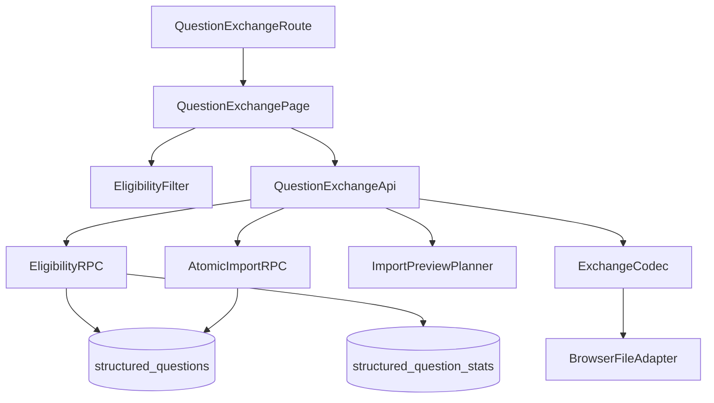
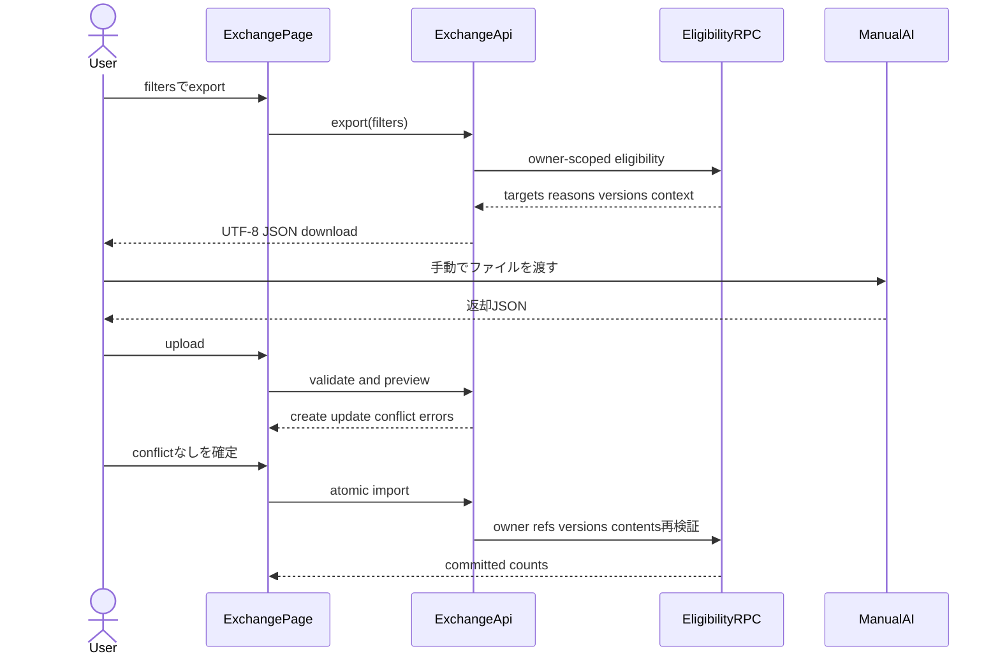
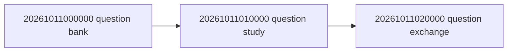

# 技術設計書

## 概要

設問バンクの見直しフラグと設問学習の専用統計から、外部AIへ手動で渡す対象をDB側で集計する。利用者はversioned UTF-8 JSONをdownloadし、PC上でAIを操作した後、返却JSONをuploadする。アプリは全件を検証して新規・更新・競合・エラーをpreviewし、競合のない確認済み内容だけを単一RPCで原子的に取り込む。

### 目標
- 固定eligibility式を所有者境界内で欠落なく評価する
- AIに依存しない安定した交換schemaと差分previewを提供する
- stale version、未知参照、重複、不正内容、owner不一致を保存前とcommit時に拒否する
- 新規追加、既存更新、対応済みflag解除を単一transactionで確定する

### 非目標
- AI API呼出し、プロンプト送信、品質採点、自動化
- question通常CRUD、学習回答、stats/log/SRS更新
- delete、部分import、競合自動上書き、教材zip形式の変更

## 境界コミットメント

### 本仕様が所有するもの
- eligibility filter、DB aggregate/read projection、抽出理由
- exchange schema v1、parse/serialize、import validation、preview plan
- browser JSON download/uploadと`QuestionExchangePage`
- `import_question_exchange`の全件再検証と原子的orchestration（実際の内容変更はbank非公開primitiveへ委譲）、選択的flag解除
- exchange固有のvolume、failure injection、4主体security回帰

### 境界外
- `structured-question-bank`所有の設問テーブル、ID/version lifecycle、通常CRUD、内容規則、flag mutation contract
- `structured-question-study`所有のanswer logs、stats、SRS、記録RPC
- catalog/authoring所有の階層、本文、keyword、ページング
- material-portability所有のzip形式と教材import/export
- app-shell所有の共通dialog、submit guard、route shell

### 許可する依存
- questionsの`StructuredQuestionReadContract`、`QuestionVersionToken`、`QuestionContentPolicy`
- questionsのAPI非公開`QuestionContentMutationPrimitive`（`private` schema、認証主体の最小DB内部権限で同一transaction内だけ利用）と共有conformance fixture
- question-studyの`QuestionStudyStatsReadContract`
- catalogの階層整合性と`src/lib/paged.ts`
- authoringのkeyword UUID、正答表示、本文文脈契約
- identityのsession、RLS方針、`RpcSecurityMatrix`
- app-shellの共通UIとsubmit guard、transferのbrowser download pattern

### 再検証トリガー
- question ID/version/flag/content contract変更時はbankとexchangeを再検証する
- stats定義、attempt/correct/wrong計算変更時はstudyとeligibility境界テストを再検証する
- keyword/階層/本文membership変更時はcatalog/authoringとexport contextを再検証する
- exchange schema変更時はparser、serializer、fixture、将来consumerを再検証する
- 公開RPC、`private` schema公開設定、primitive grant、RLS変更時はidentityの列挙型security matrix、DB catalog適合、直接API到達不能を再実行する

## アーキテクチャ



- 依存方向: upstream types → pure policy/codec → feature API → page/route。
- DB方向: upstream tables → read-only eligibility projection → exchange RPC。exchangeは上流テーブル定義を所有しない。
- 新規外部パッケージは追加しない。

### 技術スタック

| 層 | 選択 | 役割 |
|---|---|---|
| UI | React 19 / TypeScript 5.9 | 条件入力、upload、preview、確定状態 |
| Pure domain | TypeScript strict | schema、validation、preview plan、error path |
| Data access | Supabase JS 2 | eligibility/import RPC gatewayとrow mapping |
| Storage | PostgreSQL 17 | owner付き集計、再検証、原子的import |
| Browser | File/Blob/download API | UTF-8 JSONの読込と保存 |
| Test | Vitest 3 / Playwright 1.56 | schema、DB、security、volume、UI |

## ファイル構造計画

```text
src/features/questionExchange/
├── types.ts                         # filter、schema v1、preview/result/error型
├── eligibility.ts                   # 閾値検証と理由集合の純粋規則
├── eligibility.test.ts              # OR/AND境界、accuracy、重複排除
├── schema.ts                        # JSON parse/serializeと構造検証
├── schema.test.ts                   # version、operation、duplicate、path error
├── preview.ts                       # current snapshotとのpreview plan作成
├── preview.test.ts                  # create/update/stale/error分類
├── api.ts                           # eligibility/import RPC gatewayとmapping
├── file.ts                          # browser download/upload adapter
└── QuestionExchangePage.tsx         # 条件、出力、upload、preview、commit統合
src/features/questionExchange/QuestionExchangeRoute.tsx # feature固有route adapter
src/features/questionExchange/fixtures/
└── question-exchange-v1.export.json # 全field・null・空配列・安定順のgolden fixture
supabase/migrations/
└── 20261011020000_create_question_generation_exchange.sql
e2e/
└── question-generation-exchange.spec.ts
```

`src/features/questions/`、`src/features/questionStudy/`、`src/lib/paged.ts`、`src/lib/submitGuard.ts`、共通UIはconsumerとして利用し、所有ファイルを本仕様から変更しない。
bank所有の`supabase/tests/fixtures/structured_question_mutation_cases.json`は読取専用fixtureとして消費し、本仕様から定義変更しない。

`QuestionExchangeRoute.tsx`は交換pageをapp-shellの`FeatureRouteDescriptor`へ適合させ、認証要否と共通導線metadataだけを提供する。`src/App.tsx`、feature route registry、wide／narrow navigationへの合成、および最終登録は`app-shell-and-responsive-experience` task 6.2が所有する。

## システムフロー



## 要求トレーサビリティ

| 要求 | コンポーネント／契約 |
|---|---|
| 1.1, 1.2, 1.3, 1.4, 1.5, 1.6, 1.7 | EligibilityFilter、EligibilityRPC、Page |
| 2.1, 2.2, 2.3, 2.4, 2.5, 2.6, 2.7 | EligibilityRPC、QuestionExchangeApi、VolumeConformance |
| 3.1〜3.12 | ExchangeCodec、BrowserFileAdapter、EligibilityExportProjection、Page |
| 4.1, 4.2, 4.3, 4.4, 4.5, 4.6, 4.7 | ExchangeCodec、ImportPreviewPlanner、QuestionContentPolicy adapter |
| 5.1, 5.2, 5.3, 5.4, 5.5, 5.6 | ImportPreviewPlanner、QuestionExchangeApi、AtomicImportRPC |
| 6.1, 6.2, 6.3, 6.4, 6.5, 6.6, 6.7, 6.8 | AtomicImportRPC、Page、FailureInjectionConformance |
| 7.1, 7.2, 7.3, 7.4, 7.5, 7.6, 7.7, 7.8, 7.9, 7.10, 7.11 | RLS/grants、bank mutation primitive内部委譲、DB catalog／直接API到達不能、RpcSecurityMatrix、Page、AccessibilityConformance |
| 7.12, 7.13, 7.14 | QuestionExchangeRouteAdapter、app-shell FeatureRouteRegistry引渡し契約 |

## コンポーネントとインターフェース

| コンポーネント | 層 | 責務 | 要求 | 主要依存 |
|---|---|---|---|---|
| EligibilityFilter | Domain | 閾値検証と固定論理式 | 1.1〜1.6 | study stats |
| EligibilityRPC | Data | owner付き大量集計とexport projection | 1.3〜2.6 | questions/stats/keywords |
| ExchangeCodec | Domain | schema v1 serialize/parse/構造検証 | 3.1〜4.7 | question content contract |
| ImportPreviewPlanner | Domain | snapshot照合と分類 | 4.2〜5.6 | version/read contract |
| AtomicImportRPC | Data | 全件再検証、同一transaction内primitive委譲、保存、flag解除 | 5.5, 6.1〜6.7, 7.9〜7.11 | question persistence |
| QuestionExchangeApi | Data | RPC mappingとエラー変換 | 2.1〜7.5 | Supabase |
| BrowserFileAdapter | Platform | JSON download/upload | 3.1, 3.6 | browser API |
| QuestionExchangePage | UI | workflowと表示状態 | 1.2, 3.6〜7.7 | shared UI/guard |
| QuestionExchangeRouteAdapter | Integration | feature-local交換pageとnavigation metadataをapp-shell descriptorへ適合する | 7.12〜7.14 | AppShell route contract |

### Eligibility contract

```typescript
type EligibilityFilter = {
  minimumAttempts: number;
  maximumAccuracy: number;
  maximumQuestionCount: number;
};
type EligibilityReason =
  | 'doubt-flag'
  | 'explanation-request-flag'
  | 'performance-and-count';
type EligibilityTarget = {
  keywordId: string;
  metrics: {
    attempts: number;
    correct: number;
    wrong: number;
    accuracy: number | null;
    questionCount: number;
  };
  reasons: readonly EligibilityReason[];
  flaggedQuestions: readonly {
    questionId: string;
    requestKinds: readonly ('doubt' | 'explanation-request')[];
  }[];
};
function validateEligibilityFilter(input: EligibilityFilter): readonly FieldError[];
```

DB判定は次の式と完全一致する。

```text
doubt_flag
OR explanation_request_flag
OR (
  wrong_count >= 1
  AND attempts >= minimum_attempts
  AND accuracy <= maximum_accuracy
  AND question_count <= maximum_question_count
)
```

常にkeywordごとに1 targetだけを返す。flag branchの各設問は`flaggedQuestions[]`へ`(questionId, requestKinds[])`として入れ、統計branchは同じtargetの`performance-and-count`理由へ統合する。targetは`keyword_id`、nested設問は`question_id`の安定一意順とする。

keyword統計はstudy契約どおり、有効設問だけについて`attempts=sum(asked_count)`、`correct=sum(correct_count)`、`wrong=attempts-correct`、`accuracy=correct/attempts`、`questionCount=count(active question)`とする。無効／削除済み設問を除外し、statsなしは0、attempts 0はaccuracy nullかつ統計branch falseとする。

### Exchange schema v1

```typescript
type ExchangeHeader = {
  schemaVersion: 1;
  exchangeId: string;
  exportedAt: string;
};
type ExportQuestion = {
  questionId: string;
  expectedVersion: number;
  sortOrder: number;
  questionText: string;
  modelAnswer: string;
  choices: readonly string[];
  explanation: string | null;
  doubtNote: string | null; // 利用者の疑義内容。疑義flagなしは常にnull
  doubtReasons: string[]; // 疑義の理由コード（正規順・重複なし、key必須）。疑義flagなしは常に[]
  requestedFlags: readonly ('doubt' | 'explanation-request')[];
};
type QuestionContentDraft = {
  questionText: string;
  modelAnswer: string;
  choices: readonly string[];
  explanation: string | null;
};
type ImportOperation =
  | { kind: 'create'; keywordId: string; question: QuestionContentDraft }
  | {
      kind: 'update';
      keywordId: string;
      questionId: string;
      expectedVersion: number;
      question: QuestionContentDraft;
      sourceRequestedFlags: readonly ('doubt' | 'explanation-request')[];
      resolvedFlags: readonly ('doubt' | 'explanation-request')[];
    };
type QuestionExchangeImportV1 = ExchangeHeader & {
  operations: readonly ImportOperation[];
};
type QuestionExchangeFilterV1 = {
  minimumAttempts: number;
  maximumAccuracy: number;
  maximumQuestionCount: number;
};
type ChapterContextV1 = {
  subject: { id: string; title: string; sortOrder: number };
  material: { id: string; title: string; sortOrder: number };
  chapter: { id: string; title: string; sortOrder: number; bodyMarkdown: string };
};
type QuestionExchangeTargetV1 = {
  keyword: { id: string; displayText: string; modelAnswer: string };
  metrics: {
    attempts: number;
    correct: number;
    wrong: number;
    accuracy: number | null;
    questionCount: number;
  };
  reasons: readonly EligibilityReason[];
  chapterContexts: readonly ChapterContextV1[];
  questions: readonly ExportQuestion[];
  flaggedQuestions: readonly {
    questionId: string;
    requestKinds: readonly ('doubt' | 'explanation-request')[];
  }[];
};
type QuestionExchangeExportV1 = ExchangeHeader & {
  filters: QuestionExchangeFilterV1;
  targets: readonly QuestionExchangeTargetV1[];
};
```

- JSON objectのmember順には意味を持たせない。必須memberはexport envelopeが`schemaVersion: 1`、UUID `exchangeId`、RFC 3339 UTC `exportedAt`、`filters`、`targets`、targetが`keyword`、`metrics`、`reasons`、`chapterContexts`、`questions`、`flaggedQuestions`であり、追加memberはv1 parserで拒否する。
- UUID文字列は各`id`、questionの`expectedVersion`は1以上の整数、各`sortOrder`とmetrics countは0以上の整数、`maximumAccuracy`と非null `accuracy`は0以上1以下とする。nullableは`metrics.accuracy`、`ExportQuestion.explanation`、`ExportQuestion.doubtNote`だけである（`doubtNote` keyは必須）。`ExportQuestion.doubtReasons`は必須の配列で、要素は`answer_guessable`（知識がなくても解ける（問題文や選択肢から推測できる））、`low_value`（問う価値が低い）、`defective`（問題不備（正解・問題文の誤り、正解が一つに決まらない））、`unclear`（問題文が分かりにくい）のコードだけを、この定義順・重複なしで並べる。配列に対象がなければnullでなく`[]`を使う。
- `chapterContexts`の1要素が階層pathと関連chapter本文の最小単位である。同じkeywordが現れる全章を含め、`(subject.sortOrder, subject.id, material.sortOrder, material.id, chapter.sortOrder, chapter.id)`で安定整列する。targetは`keyword.id`、`questions`は`(sortOrder, questionId)`、`flaggedQuestions`は`questionId`で昇順にする。
- 列挙配列は`reasons`を`doubt-flag`、`explanation-request-flag`、`performance-and-count`、flag配列を`doubt`、`explanation-request`の定義順で重複なく整列する。本文は章の保存済みMarkdownを`bodyMarkdown`へ改変せず格納する。
- `EligibilityTarget.keywordId/metrics/reasons/flaggedQuestions`は同一IDの`QuestionExchangeTargetV1.keyword.id/metrics/reasons/flaggedQuestions`へ1対1に写像する。全active既存設問を`questions`へ含め、フラグ対象questionの`ExportQuestion.requestedFlags`は同じIDの`flaggedQuestions.requestKinds`と完全一致し、非対象questionは`[]`とする。
- `create`にquestionId、`update`にID/expectedVersion欠落、delete/unknown kind、同じquestionIdの重複を拒否する。
- operationの`keywordId`が唯一の紐付け値であり、`QuestionContentDraft`はkeywordIdを持たない。内外不一致は型とJSON schema上表現不能にする。
- `sourceRequestedFlags`は対応する`ExportQuestion.requestedFlags`を定義順も含めて変更せず複製した値だけを受け付ける。`resolvedFlags`はその部分集合かつ取込時にも現在立っているflagだけに制限する。統計branch/createはflagを解除しない。

### Route adapter contract

`QuestionExchangeRouteAdapter`はapp-shellで固定されたroute ID `questions.exchange`、path `/question-exchange`、navigation `{ id: 'nav.questions.exchange', label: '設問交換', to: '/question-exchange', placements: ['wide'] }`をそのまま返す。検索parameterは`subjectId`、`materialId`、`chapterId`、`keywordId`（各UUID、すべて任意）と`returnTo`（percent-decode後に`/`、`/subjects/{UUID}`、`/materials/{UUID}/edit`、`/questions`のいずれか）だけを解釈する。複数IDがある場合はcatalogで同一階層か検証する。不正値では抽出・importを開始せずparameter errorを表示し、復帰先は`/questions`とする。正常な終了／取消では検証済み`returnTo`、省略時は`/questions`へ戻る。

### Preview contract

```typescript
type PreviewItem =
  | { kind: 'create'; operationIndex: number; keywordId: string; draft: QuestionContentDraft }
  | { kind: 'update'; operationIndex: number; keywordId: string; before: StructuredQuestion; after: QuestionContentDraft }
  | { kind: 'conflict'; operationIndex: number; current: StructuredQuestion; incoming: ImportOperation }
  | { kind: 'error'; operationIndex: number | null; path: string; message: string };
type ImportPreview = {
  items: readonly PreviewItem[];
  canCommit: boolean;
};
```

previewは書込みを行わない。`canCommit`はerror/conflictが0件かつoperationが1件以上の場合だけtrueとなる。

### DB contracts

```typescript
type AtomicImportResult = {
  createdCount: number;
  updatedCount: number;
  clearedDoubtCount: number;
  clearedExplanationRequestCount: number;
};
function fetchEligibilityExport(filter: EligibilityFilter): Promise<QuestionExchangeExportV1>;
function previewQuestionExchange(file: File): Promise<ImportPreview>;
function commitQuestionExchange(input: QuestionExchangeImportV1): Promise<AtomicImportResult>;
```

- `get_question_exchange_candidates`は`auth.uid()`を起点にDB内集計し、owner入力を受け取らない。
- `import_question_exchange`は全operationを先に検証後、create/update/flag clearを同一transactionで実施する。
- `import_question_exchange`は公開orchestration RPCであり、全operationの検証後にbank所有の非公開`private.apply_structured_question_content`だけを呼ぶ。内容検証・version・flag業務変更を再実装しない。
- 委譲先の正確なsignatureは`private.apply_structured_question_content(uuid, uuid, bigint, jsonb, jsonb)`である。`private`はSupabase/PostgREST exposed schemas外で、authenticatedに限りschema `USAGE`と当該signatureの`EXECUTE`を持つため、`SECURITY INVOKER`のimport RPCから同一transaction内で呼べるがREST/RPCから直接到達できない。
- primitiveは`SECURITY INVOKER`、空search path、完全修飾名を維持し、公開import RPCでの全件事前検証に加えて、各operationの`auth.uid()` owner、keyword、question、期待版、内容、flag不変条件を自身で再検証する。
- question versionはbank primitiveに従って進める。更新とflag解除を同じoperationで反映し、不必要な複数incrementを発生させない。
- 公開RPCは`SECURITY INVOKER`、`search_path = ''`、完全修飾名、authenticatedのみgrantとする。primitiveの最小内部grantは公開RPC grantとは別にbank仕様が所有する。

## データと整合性

- 新しい永続テーブルは持たない。exchange IDはファイル追跡用で、サーバー状態や再送idempotencyを意味しない。
- owner/question/keyword/material整合性は上流制約とRPC内再検証を利用する。
- 関連章はkeyword provenanceではなくchapter bodyのdoc ID出現から取得し、同一keywordを階層ごとに複製しない。
- keyword集計式とinactive/deleted除外は`QuestionStudyStatsReadContract`を唯一の定義とし、exchangeでは式を変更しない。
- 1,000件超はDB aggregate/RPCで処理し、補助読取が必要な場合だけcatalog所有pagingをconsumer利用する。

## エラー処理

- parse/schema errorはJSON pathと修正理由を返す。
- unknownとforeign IDは情報漏えいを避け同じ参照エラーへ正規化する。
- stale versionはpreview conflictとして現在内容を表示するが、自動merge/overwriteは提供しない。
- RPC失敗は操作文脈付き日本語Errorへ変換し、previewと選択fileを保持して再試行可能にする。
- import内部例外はtransaction全体をrollbackする。

## テスト戦略

### Unit
- eligibility式の各flag単独、AND群の全境界、1条件欠落、attempts 0、accuracy境界、理由重複排除。
- schema v1 round trip、unknown version、invalid UTF-8/JSON、create/update形状、delete拒否、duplicate question ID、内容検証。
- export v1の全必須member、追加member拒否、null/空配列、安定順、EligibilityTarget写像、requestedFlags/sourceRequestedFlags一致をgolden fixtureで検証する。
- previewのcreate/update/stale/unknown/error、zero operation、resolvedFlags subset。

### DB integration / E2E
- owner対象だけのexport、穴埋め履歴非混入、active-only集計、statsなし／attempts 0、1,001 keywords/questions/statsで末尾対象と安定順。
- 同じkeywordの複数flag設問が1 targetの`flaggedQuestions[]`へまとまり、設問ごとのrequestKindsと統計理由が同居することを検証する。
- download JSONのschema/context/reasons/versionとupload previewの差分表示。
- preview後更新によるstale拒否、未知/foreign参照非開示、重複、不正選択肢、delete拒否。
- mixed create/update/両flag解除の成功と、transaction途中failure injection時の全rollback。
- eligibility/import RPCを4主体で検証し、service roleはfixture準備・事後確認に限定する。
- importは公開RPCとprimitiveの双方でowner／cross-owner／anon／service-role matrixを検証する。DB catalogで`private`非公開、primitive signature、invoker、search path、ACLを確認し、anon／authenticatedによるREST/RPC直接指定が到達不能であることを確認する。
- narrow/wide、keyboard、focus、alert、二重送信guard。
- `/question-exchange`の直接表示・再読込、任意階層IDの開始文脈、正常終了／取消の`returnTo`復帰、不正UUID・階層不一致・許可外`returnTo`のerrorと`/questions` fallback。

## セキュリティ考慮事項

- file値とclient ownerは信頼せず、RPCが`auth.uid()`とDB参照から所有関係を確定する。
- errorはforeign IDの存在、現在版、内容を漏らさない。
- browserへservice roleを置かず、AIサービスへの通信・資格情報を扱わない。
- identityのRpcSecurityMatrixへ両RPCを列挙し、公開RPC一覧変更を再検証する。
- DB catalogから公開user-data RPCを自動列挙した集合とmatrix fixtureの集合が完全一致することを検証する。

## 性能とスケーラビリティ

- eligibilityはindex可能なowner/keyword/question joinとDB aggregateを用い、client側N+1を作らない。
- index要否は`structured_questions(owner_id, keyword_id)`と`structured_question_stats(owner_id, question_id)`の上流indexを確認し、必要ならexchange migrationで追加indexだけを所有する。
- 1,001件の境界回帰を必須とし、件数上限によるsilent truncationを認めない。
- 巨大JSONのstreaming/worker化は初期範囲外だが、失敗時に不完全fileをdownload/importしない。

## マイグレーション戦略



- `20261011020000_create_question_generation_exchange.sql`にeligibility/import RPCと必要なindex/grantを追加する。
- 上流migrationを変更せず、bankとstudy適用後だけ適用する。
- migration適用後に4主体security、1,001件、failure injection、全関連E2Eを実行する。
- rollbackは新しい後続migrationで行い、適用済み履歴を書き換えない。

## 品質ゲート

- `npm run typecheck`
- `npm test -- --run src/features/questionExchange`
- `npm run spec:coverage`
- `npm run build`
- `npx playwright test e2e/question-generation-exchange.spec.ts`
- upstreamのquestion bank/study統合回帰とidentity RpcSecurityMatrix
