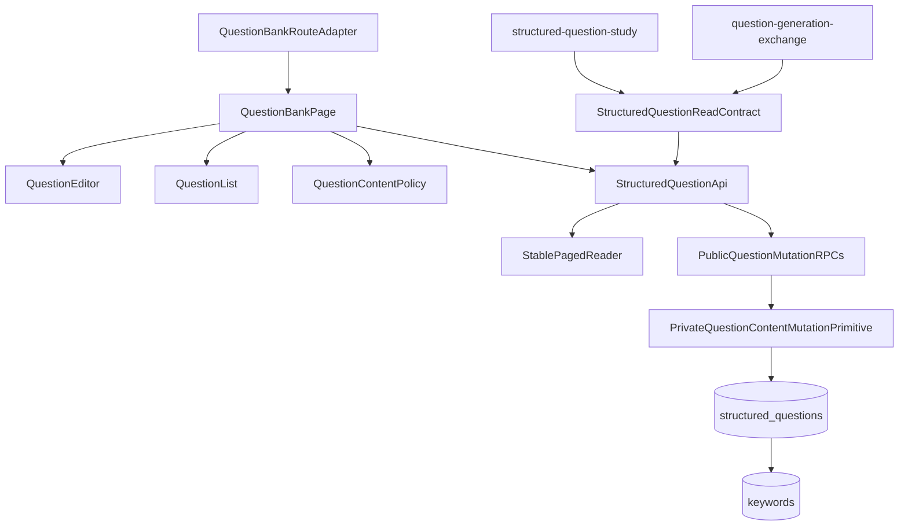
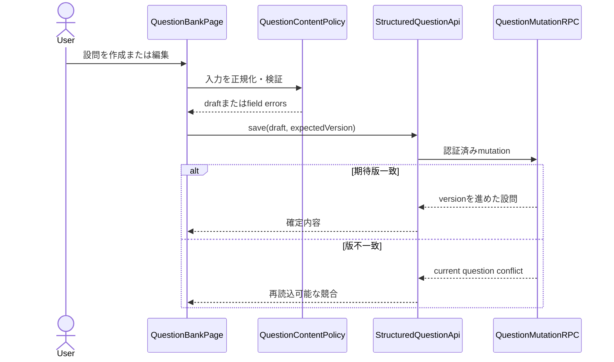
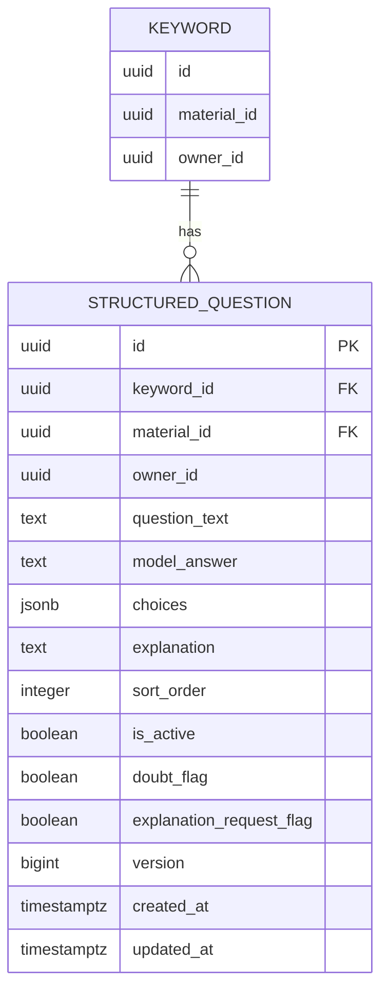
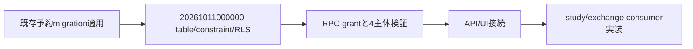

# 技術設計書

## 概要

既存キーワードに1:Nで紐づく構造化設問を、新しい設問aggregateと管理画面として追加する。設問は問題文、模範解答、順序付き選択肢、任意解説、状態、見直しフラグ、安定ID、単調増加版を持つ。個人学習者は教材内のキーワードを選び、設問を作成・編集・並べ替え・無効化・削除できる。

既存のfeature-first構造を維持し、Supabase境界は`src/features/questions/api.ts`へ集約する。DBはowner/keyword/material整合性、RLS、期待版更新を保証する。学習履歴・SRSとAI交換は下流仕様が公開読取型と版tokenを消費し、本仕様のテーブル所有を共有しない。

### 目標
- keyword 1件対設問複数のマスタと通常管理UIを提供する
- 全変更で安定IDと版を維持し、古い更新を拒否する
- owner分離、参照整合性、1,000件超の欠落しない取得をDB・統合テストで保証する
- 学習と交換仕様が利用できる狭い下流契約を固定する

### 非目標
- 設問の出題、採点、履歴、正答率、SRSを実装すること
- AI APIやファイルexport/importを実装すること
- キーワード記法・正答正規化・章所属を再定義すること
- 複数キーワードへの同一設問紐付け、importによる削除を追加すること

## 境界コミットメント

### 本仕様が所有するもの
- `structured_questions`のスキーマ、制約、RLS、version lifecycle
- 設問の入力検証、CRUD、キーワード内順序、有効状態、疑義／解説追加フラグ
- `QuestionBankPage`とfeature固有API・純粋ロジック
- 下流向けの`StructuredQuestion`、`QuestionVersionToken`、全件読取、flag更新契約
- 内容検証・版更新・flag規則を一元化する非公開`QuestionContentMutationPrimitive`
- 本仕様が追加する公開RPC一覧とその業務回帰

### 境界外
- structured-question-studyが所有する出題形式、採点、履歴、SRS、統計
- question-generation-exchangeが所有する抽出条件、schema、preview、公開一括import orchestration RPC
- keyword本体、正答正規化、本文出現と章所属
- 共通dialog、RowActions、submit guard、ページング、ルートシェルの実装所有

### 許可する依存
- identity-and-accessの認証session、owner/RLS方針、`RpcSecurityMatrix`
- learning-content-catalogのkeyword複合整合性と`src/lib/paged.ts`
- markdown-keyword-authoringのkeyword UUID・正答表示契約
- app-shell-and-responsive-experienceの共通UI、route shell、`submitGuard`
- `src/lib/supabase.ts`の共通client

### 再検証トリガー
- 設問フィールド、選択肢配列、ID、version token、flag契約の変更時はstudyとexchangeを再検証する
- keywordの複合キー、owner、material、削除動作の変更時はcatalogと本仕様を再検証する
- 公開RPC、`private` schema公開設定、grant、RLS変更時はidentityのRpcSecurityMatrixとDB catalog／直接API到達不能の適合テストを再実行する
- ページング順序変更時はcatalog契約とstudy/exchangeの全件consumerを再検証する
- 共通route、dialog、submit guard変更時はapp-shellとの統合を再検証する

## アーキテクチャ

### 既存アーキテクチャ分析
- React pageが画面状態を統合し、feature APIがSupabase rowをcamelCase型へ変換する。
- 共通`paged.ts`は安定一意順序で1,000件ずつ全行を取得する。
- keywordは教材内の安定UUIDであり、章所属は本文出現から求める。設問は章ではなくkeyword UUIDだけを学習対象とする。
- 共通dialog、RowActions、submit guard、認証route shellは上流仕様が所有する。

### アーキテクチャパターンと境界図



- 選択パターン: feature-first + 設問単位aggregate + DB enforced optimistic concurrency
- 依存方向: 共有契約／keyword → questions domain/API → UI。下流は公開読取・mutation契約だけを消費する。
- 新規外部ライブラリは追加しない。

### 技術スタック

| 層 | 選択／バージョン | 本機能での役割 | 備考 |
|---|---|---|---|
| UI | React 19、TypeScript 5.9 | 一覧、編集、確認、状態管理 | strict、`any`禁止 |
| Style | Tailwind CSS 4 | 広幅／狭幅、focus、操作領域 | 既存token利用 |
| Data access | Supabase JS 2 | 読取とRPC呼出し | feature APIへ集約 |
| Storage | PostgreSQL 17 | 設問、制約、RLS、版更新 | 単一migration |
| Test | Vitest 3、Playwright 1.56 | validation、DB、UI、volume | E2E直列 |

## ファイル構造計画

```text
src/features/questions/
├── types.ts                 # 公開設問型、version token、draft/result型
├── validation.ts            # 設問文・模範解答・選択肢・解説の純粋検証
├── validation.test.ts       # 正規化、空、重複、順序の単体回帰
├── api.ts                   # row mapping、全件読取、mutation RPC gateway
├── QuestionEditor.tsx       # 作成・編集フォームとfield error
├── QuestionList.tsx         # 安定順一覧、状態・flag表示、行操作
└── QuestionBankPage.tsx     # keyword選択、loading/empty/error/busyの統合
src/features/questions/QuestionBankRoute.tsx # feature固有route adapter
supabase/migrations/
└── 20261011000000_create_structured_questions.sql
supabase/tests/fixtures/
└── structured_question_mutation_cases.json # bank所有の通常編集/import共通適合fixture
e2e/
└── structured-question-bank.spec.ts
```

`src/lib/paged.ts`、`src/lib/submitGuard.ts`、共通dialog／RowActionsは変更せず利用する。本仕様は`QuestionBankRoute.tsx`からapp-shellの`FeatureRouteDescriptor`へ画面と教材文脈の開始・復帰情報を引き渡すだけとし、`src/App.tsx`、feature route registry、共通navigationを変更しない。最終登録は`app-shell-and-responsive-experience` task 6.2が所有する。

| コンポーネント | 実装ファイル |
|---|---|
| QuestionContentPolicy | `src/features/questions/validation.ts` |
| StructuredQuestionReadContract／QuestionVersionToken | `src/features/questions/types.ts` |
| StructuredQuestionApi／QuestionMutationRPC adapter | `src/features/questions/api.ts` |
| QuestionEditor | `src/features/questions/QuestionEditor.tsx` |
| QuestionList | `src/features/questions/QuestionList.tsx` |
| QuestionBankPage | `src/features/questions/QuestionBankPage.tsx` |
| QuestionBankRouteAdapter | `src/features/questions/QuestionBankRoute.tsx` |
| QuestionPersistence／公開RPC／非公開mutation primitive | `supabase/migrations/20261011000000_create_structured_questions.sql` |
| QuestionMutationConformanceFixture | `supabase/tests/fixtures/structured_question_mutation_cases.json` |
| QuestionBankConformance | `e2e/structured-question-bank.spec.ts` |

`QuestionBankRouteAdapter`はfeature-local pageをReact elementとして包み、認証要否と教材文脈の開始・復帰metadataだけを返す。route pathの重複検証、wide／narrow navigationへの合成、`src/App.tsx`接続はapp-shellへ委ねる。

固定descriptorは`{ id: 'questions.bank', path: '/questions', navigation: { id: 'nav.questions.bank', label: '設問', to: '/questions', placements: ['wide', 'narrow'] } }`とする。`subjectId`、`materialId`、`chapterId`、`keywordId`は任意のUUIDで、複数指定時はcatalog上の同一階層でなければならない。`returnTo`はapp-shellが許可する`/`、`/subjects/{UUID}`、`/materials/{UUID}/edit`、`/questions`だけを採用する。直接表示・再読込でも同じ開始文脈を復元し、不正parameterでは変更を開始せずerrorと`/`復帰を表示する。正常な終了／取消は検証済み`returnTo`、省略時は`/`へ戻る。

## システムフロー



並べ替えは対象keywordのordered IDと各期待版をRPCへ送り、全行が一致した場合だけ同一transactionで順序と版を更新する。

## 要求トレーサビリティ

| 要求 | コンポーネント／契約 |
|---|---|
| 1.1, 1.2, 1.3, 1.4, 1.5 | QuestionBankPage、StructuredQuestionApi、QuestionPersistence |
| 2.1, 2.2, 2.3, 2.4, 2.5, 2.6, 2.7 | QuestionEditor、QuestionContentPolicy、QuestionMutationRPC |
| 3.1, 3.2, 3.3, 3.4, 3.5, 3.6, 3.7, 3.8 | QuestionList、QuestionBankPage、StructuredQuestionApi |
| 4.1, 4.2, 4.3, 4.4, 4.5 | FlagMutation contract、QuestionVersionToken |
| 5.1, 5.2, 5.3, 5.4, 5.5, 5.6, 5.7 | QuestionPersistence、QuestionContentMutationPrimitive、QuestionMutationRPC、Conflict result |
| 6.1, 6.2, 6.3, 6.4, 6.5, 6.6, 6.7, 6.8, 6.9, 6.10 | 複合FK、RLS、private schema／primitive grant、RpcSecurityMatrix conformance |
| 7.1, 7.2 | StructuredQuestionApi、StablePagedReader、volume conformance |
| 7.3, 7.4, 7.5, 7.6, 7.7 | QuestionBankPage、QuestionEditor、QuestionList、submit guard |
| 7.8, 7.9, 7.10 | QuestionBankRouteAdapter、固定descriptor、開始・復帰parameter契約 |

## コンポーネントとインターフェース

| コンポーネント | 層 | 責務 | 要求 | 主要依存 | 契約 |
|---|---|---|---|---|---|
| QuestionContentPolicy | Domain | 入力正規化と検証 | 2.1〜2.6 | AnswerNormalization P1 | Service |
| StructuredQuestionApi | Data | read/mutationとrow mapping | 1.1〜1.5, 2.7, 3.2〜3.8, 4.1〜4.5, 7.1〜7.2 | Supabase、Paged P0 | API |
| QuestionContentMutationPrimitive | Data | 内容検証、owner/keyword整合性、版、flag規則の唯一の書込primitive | 2.1, 5.1〜5.7 | PostgreSQL P0 | Internal |
| QuestionMutationRPC | Data | 期待版付き公開commandと並べ替え | 2.1, 3.2〜3.5, 4.1〜4.5, 5.1〜5.7 | PostgreSQL P0 | API |
| QuestionPersistence | Data | 設問、owner/keyword整合性、RLS、private primitive最小権限 | 1.2〜1.4, 6.1〜6.10 | keywords P0 | State |
| QuestionEditor | UI | 作成・編集・field error | 2.1〜2.7, 7.3〜7.5 | Policy、API P0 | State |
| QuestionList | UI | 一覧、状態、flag、順序、削除 | 3.1〜3.8, 7.4〜7.7 | API、共通UI P0 | State |
| QuestionBankPage | UI | keyword contextと画面状態統合 | 1.1, 1.5, 7.3〜7.7 | Catalog、Editor/List P0 | State |
| QuestionBankRouteAdapter | Integration | feature-local pageと教材文脈metadataをapp-shell descriptorへ適合する | 7.8〜7.10 | AppShell route contract P0 | API |
| QuestionBankConformance | Test | DB/UI/volume/security回帰 | 5.1〜7.7 | RpcSecurityMatrix P0 | API |

### Domain contract

```typescript
type QuestionId = string;
type QuestionVersionToken = { id: QuestionId; version: number; updatedAt: string };
type StructuredQuestion = QuestionVersionToken & {
  ownerId: string;
  materialId: string;
  keywordId: string;
  questionText: string;
  modelAnswer: string;
  choices: readonly string[];
  explanation: string | null;
  sortOrder: number;
  isActive: boolean;
  doubtFlag: boolean;
  doubtNote: string | null; // 疑義内容（任意）。doubtFlag=falseなら常にnull
  explanationRequestFlag: boolean;
};
type QuestionContentDraft = Pick<StructuredQuestion,
  'questionText' | 'modelAnswer' | 'choices' | 'explanation'>;
type QuestionDraft = { keywordId: string } & QuestionContentDraft;
type QuestionFieldError = { field: 'questionText' | 'modelAnswer' | 'choices'; message: string };
function normalizeQuestionDraft(input: QuestionContentDraft): QuestionContentDraft;
function validateQuestionDraft(input: QuestionContentDraft): readonly QuestionFieldError[];
```

- 選択肢の重複判定はauthoring所有の正答正規化を利用する。
- 模範解答と同一の選択肢は保存用draftから除くのではなくfield errorとし、利用者に明示して修正させる。

### Data access contract

```typescript
type VersionConflict = { kind: 'version-conflict'; current: StructuredQuestion };
type MutationResult = { kind: 'saved'; question: StructuredQuestion } | VersionConflict;
function listQuestionsByKeyword(keywordId: string): Promise<StructuredQuestion[]>;
function listQuestionsByMaterial(materialId: string): Promise<StructuredQuestion[]>;
function saveQuestion(draft: QuestionDraft, id?: string, expectedVersion?: number): Promise<MutationResult>;
function setQuestionFlags(id: string, expectedVersion: number,
  flags: { doubtFlag?: boolean; doubtNote?: string | null; explanationRequestFlag?: boolean }): Promise<MutationResult>;
// doubtNoteは結果のdoubtFlagがtrueのときだけ許可。doubtFlag=falseで自動消去。内容更新では未patchなら保持。
function setQuestionActive(id: string, expectedVersion: number, active: boolean): Promise<MutationResult>;
function reorderQuestions(keywordId: string,
  ordered: readonly QuestionVersionToken[]): Promise<StructuredQuestion[] | VersionConflict>;
function deleteQuestion(id: string, expectedVersion: number): Promise<'deleted' | VersionConflict>;
```

- keyword一覧は`(sort_order, id)`、教材一覧は`(keyword_id, sort_order, id)`の一意順序でStablePagedReaderを使う。
- not-foundとRLS非表示は内容を漏らさない同じ結果として扱う。
- 下流consumerは`listQuestionsByMaterial`とversion tokenを利用し、テーブルへ独自書込を追加しない。
- 公開user-data RPCは`mutate_structured_question`（`create|update-content|set-flags|set-active|delete` command）と`reorder_structured_questions`の2つだけである。flag／active／deleteを別の未列挙RPCとして追加しない。
- `private.apply_structured_question_content(p_question_id uuid, p_keyword_id uuid, p_expected_version bigint, p_content jsonb, p_flag_patch jsonb)`はDB内部委譲専用primitiveで、内容検証、`auth.uid()`によるowner判定、keyword/question整合性、期待版、単一version increment、未指定flag保持を自身で再検証・一元化する。`private` schemaはSupabase/PostgRESTのexposed schemasから除外し、`authenticated`にはこの内部委譲に必要なschema `USAGE`と当該正確なsignatureへの`EXECUTE`だけをgrantし、`PUBLIC`／`anon`からはrevokeする。したがってブラウザのREST/RPC endpointから直接到達できず、`SECURITY INVOKER`の通常編集公開RPCとexchange所有の公開一括import RPCだけが同一transaction内で呼ぶ。exchangeは同じ業務mutationを再実装しない。

## データモデル



- 複合外部キー`(keyword_id, material_id, owner_id)`が同じkeyword・material・ownerだけを許可する。
- `question_text`と`model_answer`は`btrim(value) <> ''`、`version >= 1`、`sort_order >= 0`をCHECKする。
- choicesは文字列JSON配列であることをRPC入力検証とDB CHECKで保証する。
- indexは`(keyword_id, sort_order, id)`、`(material_id, keyword_id, sort_order, id)`、flag抽出用`(owner_id, doubt_flag, explanation_request_flag)`を持つ。
- keyword削除はcascade、章削除でkeywordが残る場合は無変更とする。
- update triggerが内容、flag、状態、順序の全変更で`version = OLD.version + 1`と`updated_at`を設定する。

## エラー処理

- 入力誤りはfield errorとして保存前に表示する。
- 版不一致は通信障害と分け、現在版の再読込と編集内容の確認を促す。自動上書きしない。
- DB/RPC失敗は操作文脈付き日本語`Error`へ変換し、画面は`role="alert"`と再試行を示す。
- mutation中はsubmit guardで同種操作を抑止し、失敗時はサーバー確定状態へ戻す。
- not-found／権限外はデータの存在を区別せず一覧への導線を出す。

## テスト戦略

### Unit
- trim、必須、空選択肢、正規化重複、模範解答重複、解説null、選択肢順を検証する（2.1〜2.6）。
- DB row mappingと判別unionのversion conflictを検証する（5.1〜5.6）。

### Integration / E2E
- keywordごとの作成、再読込、編集、順序、無効／再有効、削除確認／取消を検証する（1.1〜3.8）。
- 2つのflagを結果画面consumer相当のAPIから独立に設定・解除し、既存解説ありでも追加flagが付くことを検証する（4.1〜4.5）。
- 同じ期待版の二重更新は片方だけ成功し、古い更新で内容が変わらないことを検証する（5.1〜5.6）。
- owner、cross-owner、anon、service role準備限定の4主体でRLS/RPCを検証する（6.1〜6.7）。
- 1keywordおよび1materialに1,001件を用意し、安定順・全件・重複なしを検証する（7.1〜7.2）。
- 広幅／狭幅、キーボード、field label、loading／empty／error、連打防止を検証する（7.3〜7.7）。

### Runtime prerequisites
- Node.js 24、ローカルSupabase、`.env.local`、Playwright Chromiumを使う。
- 共有DBのためE2Eは1 workerで直列実行し、本番DBへ接続しない。

## セキュリティ考慮

- RLSは`owner_id = auth.uid()`を`USING`と`WITH CHECK`の双方へ適用する。
- 公開RPCと非公開primitiveは`SECURITY INVOKER`、`search_path = ''`、完全修飾名を使う。公開RPCは`authenticated`だけへgrantする。
- `private` schemaはSupabase/PostgRESTのexposed schemasに含めない。`authenticated`へは`USAGE ON SCHEMA private`と`EXECUTE ON FUNCTION private.apply_structured_question_content(uuid, uuid, bigint, jsonb, jsonb)`だけをgrantし、`PUBLIC`／`anon`からはschema利用権とfunction実行権をrevokeする。これは公開API権限ではなく、invoker chain内のDB内部委譲権限である。
- `mutate_structured_question`と`reorder_structured_questions`をidentityの列挙RPC一覧へ追加し、owner成功、cross-owner拒否、anon拒否、service roleはfixture準備限定を再検証する。
- DB catalogからpublic user-data RPCを自動列挙した集合とsecurity fixtureの集合が完全一致することを検証する。併せて`private`がexposed schemas外であること、primitiveの`prosecdef=false`、空search path、正確なidentity arguments、`authenticated`だけへの最小`USAGE`／`EXECUTE`、`PUBLIC`／`anon`への非許可をcatalogで検証する。
- Supabase REST/RPC経由でprimitive名を直接要求しても到達不能であることをanon／authenticated双方で確認する。公開RPC経由ではownerのみ成功し、cross-owner／anonを拒否し、service roleはfixture準備・事後確認だけに使う。
- ブラウザへservice roleを渡さない。エラーは他ownerのIDや現在内容を漏らさない。

## 性能と拡張性

- 全件が必要な下流処理は共通ページングまたはDB集計を使い、単一selectへ戻さない。
- UIは大件数でも安定順契約を維持する。初期実装の描画仮想化は要求しないが、取得contractは将来の段階表示を妨げない。
- flag抽出とkeyword/material絞込のindexを実際のquery順に合わせる。

## Migration戦略



- 既存migrationは変更せず追加migrationだけを適用する。
- 新規テーブルのためbackfillは不要である。migration失敗時はUI接続前に停止する。
- 下流migrationは本テーブルと公開版契約の適用後に作成する。
