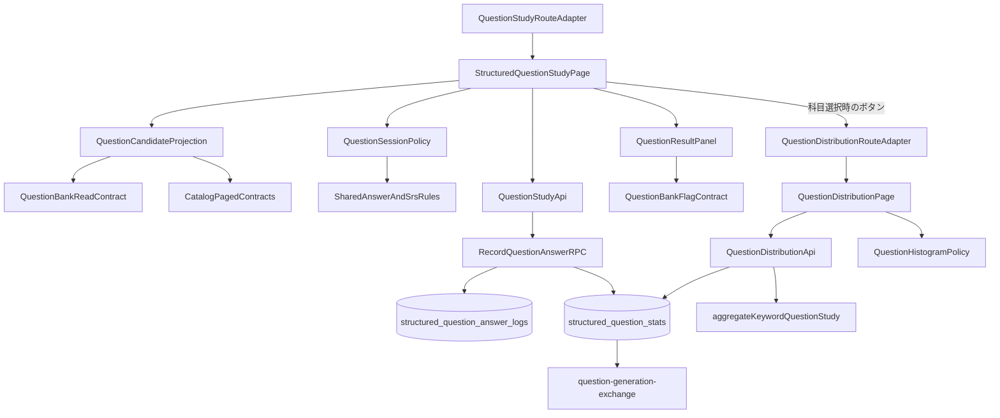
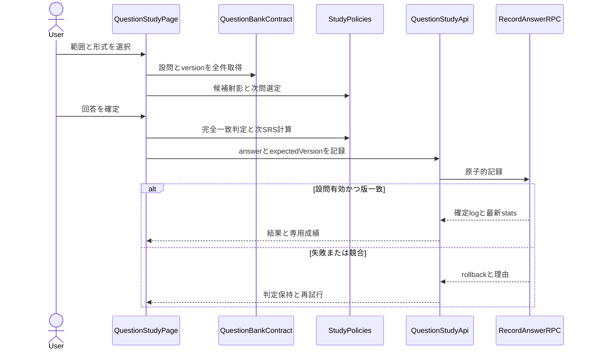
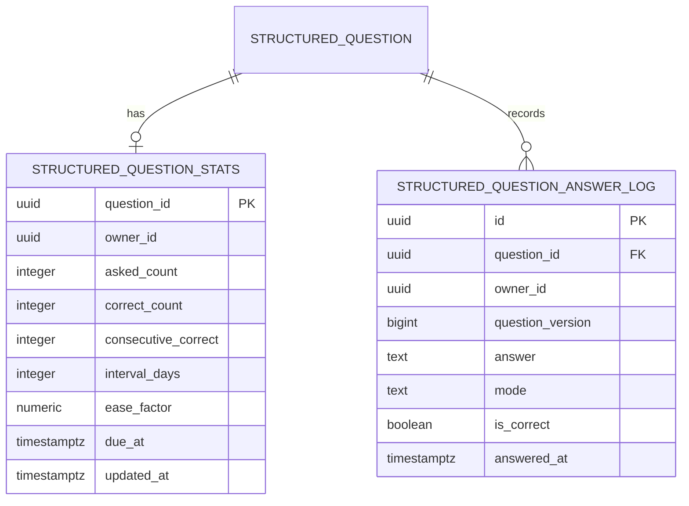
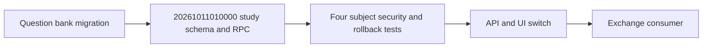

# 技術設計書

## 概要

構造化設問を科目・教材・章・キーワードの範囲で出題し、選択式・記述式・自動切替による回答をquestion専用の履歴・統計・SRSへ記録する。設問マスタは上流の設問バンクから読み、正答正規化・形式決定・SRS計算は既存学習の純粋規則を消費する。

Reactのfeature pageがセッション状態を統合し、question-study APIが候補読取と記録RPCを隠蔽する。記録RPCは設問versionとownerを検査し、回答log追加とstats更新を単一transactionで確定する。穴埋め用テーブルとAPIは変更しない。

### 目標
- 階層範囲から有効設問を欠落なく候補化する
- 既存学習規則に沿う3形式、完全一致判定、即時結果を提供する
- question専用履歴・統計・SRSを原子的に記録する
- 結果画面から設問バンクの2種類のflag契約を利用する
- 科目単位で、設問ごと／キーワードごとの正答率・出題回数の分布をヒストグラムで表示する

### 非目標
- 設問マスタ、version、flag mutationの再定義
- 穴埋め履歴・統計との合算、既存study画面の変更
- AI採点、類似判定、別解登録、AIファイル交換
- learning-insightsへの表示追加
- ヒストグラム階級から該当設問・キーワード一覧への展開、教材・章・キーワード単位の分布
- 分布用のDB集計RPC、新規migration、chart library導入

## 境界コミットメント

### 本仕様が所有するもの
- `structured_question_stats`、`structured_question_answer_logs`のschema、RLS、index、削除関係
- question専用の候補射影、順序、セッション状態、結果表示、統計read model
- question向けの形式adapter、採点adapter、SRS adapter
- `record_structured_question_answer`の原子的業務契約と回帰
- `StructuredQuestionStudyPage`とfeature固有API・純粋ロジック
- 科目単位の成績分布（`histogram.ts`の階級化規則、分布API、`QuestionDistributionPage`、`QuestionDistributionRoute`）

### 境界外
- `structured_questions`の内容、選択肢、解説、version、active、flagの所有
- 共通の正答正規化、SRS数式、共通page shell、dialog、submit guard、ページング実装
- 穴埋め用`keyword_stats`、`answer_logs`、`StudyPage`
- export条件、ファイルschema、preview、import

### 許可する依存
- structured-question-bankの`StructuredQuestionReadContract`、`QuestionVersionToken`、`FlagMutationContract`
- adaptive-study-sessionの形式決定・SRS純粋規則と閾値
- markdown-keyword-authoringの`AnswerNormalization`
- learning-content-catalogの階層、本文出現、`StablePagedReader`
- identity-and-accessのsession、RLS方針、`RpcSecurityMatrix`
- app-shell-and-responsive-experienceのroute shell、共通UI、`submitGuard`

### 再検証トリガー
- 設問ID、version、active、choices、model answer、flag契約の変更時はbank・study・exchangeを再検証する
- 形式閾値、正答正規化、SRS定数または式の変更時は穴埋めstudyと本仕様を再検証する
- stats/logsの列または意味変更時はexchangeの抽出を再検証する
- 公開RPC、grant、RLS変更時はidentityのRpcSecurityMatrixを再実行する
- 階層・章本文出現・ページング順序変更時はcatalogと本仕様の候補回帰を再実行する
- `aggregateKeywordQuestionStudy`の意味変更時は分布のキーワード集計とexchangeの抽出を同時に再検証する
- 分布routeのpath・parameter変更時はapp-shellのroute registry回帰を再実行する

## アーキテクチャ

### 既存アーキテクチャ分析
- 設問バンクは教材全件を`(keyword_id, sort_order, id)`で読み、安定IDとversion tokenを公開する。
- 既存studyの形式・正答・SRSは純粋規則として利用できるが、データはkeyword単位であり共有しない。
- 章範囲のkeyword所属は章本文中のdoc ID出現から求め、`keywords.chapter_id`を使わない。

### アーキテクチャパターンと境界図



- 選択パターン: feature-first + read projection + question単位transaction aggregate
- 依存方向: 上流共有契約 → question-study純粋policy → API → Page。UIはDB行を扱わない。
- 新しい外部依存は追加しない。

### 技術スタック

| 層 | 選択／バージョン | 役割 | 備考 |
|---|---|---|---|
| UI | React 19、TypeScript 5.9 | setup、answering、judged、done状態 | strict、`any`禁止 |
| Data access | Supabase JS 2 | paged read、RPC、row mapping | feature APIへ集約 |
| Storage | PostgreSQL 17 | 専用logs/stats、RLS、transaction | bank migration後に追加 |
| Test | Vitest 3、Playwright 1.56 | policy、DB、UI、volume | E2E直列 |

## ファイル構造計画

```text
src/features/questionStudy/
├── types.ts                         # candidate、専用stats/log、session型
├── candidates.ts                    # 階層範囲の候補射影と重複排除
├── candidates.test.ts               # 範囲、安定順、重複の単体回帰
├── question.ts                      # 上流形式・正答規則へのadapter
├── question.test.ts                 # 3形式、選択肢、完全一致の単体回帰
├── session.ts                       # 次問、画面状態、session集計
├── session.test.ts                  # 順序、直近回避、終了の単体回帰
├── api.ts                           # read model、RPC gateway、row mapping
├── QuestionResultPanel.tsx          # 結果、解説、flag adapter
├── histogram.ts                     # 新規: 正答率13階級・出題回数階級の純粋規則
├── histogram.test.ts                # 新規: 階級境界、件数合計、空入力の単体回帰
├── distributionApi.ts               # 新規: 科目の有効設問とstatsの全件読取、設問／keyword単位への射影
├── distributionApi.test.ts          # 新規: 射影・除外・not-foundの単体回帰
├── QuestionHistogram.tsx            # 新規: 横棒ヒストグラム1枚（階級名・件数を文字で併記）
├── QuestionDistributionPage.tsx     # 新規: 集計単位切替、loading／empty／error、戻る操作
├── QuestionDistributionPage.test.tsx # 新規: 切替、状態表示、a11y名の回帰
├── QuestionDistributionRoute.tsx    # 新規: `/question-study/distribution` route adapter
├── QuestionDistributionRoute.test.tsx # 新規: subjectId検証と復帰導線
└── StructuredQuestionStudyPage.tsx  # setupからdoneまでの統合（変更: 科目選択時の分布ボタン）
src/features/questionStudy/QuestionStudyRoute.tsx # feature固有route adapter
supabase/migrations/
└── 20261011010000_create_structured_question_study.sql
supabase/tests/database/
└── structured_question_study.test.sql
e2e/
└── structured-question-study.spec.ts
```

`src/lib/answer.ts`、`src/lib/paged.ts`、`src/lib/submitGuard.ts`、`src/features/study/srs.ts`と形式規則、`src/features/questions/*`は変更せずconsumerとして利用する。上流契約の実装移動が必要なら上流specを先に更新する。

`QuestionStudyRoute.tsx`は専用学習pageをapp-shellの`FeatureRouteDescriptor`へ適合させ、認証要否と階層文脈の開始・復帰metadataだけを提供する。`src/App.tsx`、feature route registry、wide／narrow navigationへの合成、および最終登録は`app-shell-and-responsive-experience` task 6.2が所有する。

固定descriptorは`{ id: 'questions.study', path: '/question-study', navigation: { id: 'nav.questions.study', label: '設問学習', to: '/question-study', placements: ['wide', 'narrow'] } }`とする。開始文脈は`scope=subject|material|chapter|keyword`とUUID `scopeId`のpair、または両方省略した対象選択である。`returnTo`はapp-shell許可listだけを採用する。直接表示・再読込で同じscopeを復元し、片側欠落、未知scope、不正UUID、許可外復帰先では出題・記録を始めずerrorと`/questions`復帰を表示する。正常終了は検証済み`returnTo`、省略時は`/questions`へ戻る。

| コンポーネント | 実装ファイル |
|---|---|
| QuestionCandidateProjection | `src/features/questionStudy/candidates.ts` |
| QuestionFormatAndJudgmentAdapter | `src/features/questionStudy/question.ts` |
| QuestionSessionPolicy | `src/features/questionStudy/session.ts` |
| QuestionStudyApi | `src/features/questionStudy/api.ts` |
| QuestionStudyPersistence／RecordQuestionAnswerRPC | `supabase/migrations/20261011010000_create_structured_question_study.sql` |
| QuestionResultPanel | `src/features/questionStudy/QuestionResultPanel.tsx` |
| StructuredQuestionStudyPage | `src/features/questionStudy/StructuredQuestionStudyPage.tsx` |
| QuestionStudyRouteAdapter | `src/features/questionStudy/QuestionStudyRoute.tsx` |
| QuestionHistogramPolicy | `src/features/questionStudy/histogram.ts` |
| QuestionDistributionApi | `src/features/questionStudy/distributionApi.ts` |
| QuestionHistogram | `src/features/questionStudy/QuestionHistogram.tsx` |
| QuestionDistributionPage | `src/features/questionStudy/QuestionDistributionPage.tsx` |
| QuestionDistributionRouteAdapter | `src/features/questionStudy/QuestionDistributionRoute.tsx` |
| QuestionStudyConformance | `supabase/tests/database/structured_question_study.test.sql`、`e2e/structured-question-study.spec.ts` |

## システムフロー



## 要求トレーサビリティ

| 要求 | コンポーネント／契約 |
|---|---|
| 1.1, 1.2, 1.3, 1.4, 1.5, 1.6, 1.7 | QuestionCandidateProjection、QuestionStudyApi、Page |
| 2.1, 2.2, 2.3, 2.4, 2.5, 2.6, 2.7 | QuestionCandidateProjection、QuestionSessionPolicy、Page |
| 3.1, 3.2, 3.3, 3.4, 3.5, 3.6, 3.7 | QuestionFormatAndJudgmentAdapter、Page |
| 4.1, 4.2, 4.3, 4.4, 4.5, 4.6, 4.7 | QuestionFormatAndJudgmentAdapter、QuestionResultPanel |
| 5.1, 5.2, 5.3, 5.4, 5.5, 5.6, 5.7, 5.8, 5.9 | QuestionStudyPersistence、RecordQuestionAnswerRPC、QuestionStudyStatsReadContract、QuestionStudyApi |
| 6.1, 6.2, 6.3, 6.4, 6.5, 6.6 | RecordQuestionAnswerRPC、Page、submit guard |
| 7.1, 7.2, 7.3, 7.4, 7.5 | QuestionResultPanel、FlagMutationContract |
| 8.1, 8.2, 8.3, 8.4, 8.5, 8.6, 8.7, 8.8, 8.9 | RLS、Paged contracts、Page、RpcSecurityMatrix、Conformance |
| 8.10, 8.11, 8.12 | QuestionStudyRouteAdapter、固定descriptor、scope・復帰parameter契約 |
| 9.1, 9.2 | StructuredQuestionStudyPage（範囲選択の分布ボタン） |
| 9.3, 9.15 | QuestionDistributionApi（科目の有効設問・statsの全件paged読取、穴埋め統計非参照） |
| 9.4, 9.10 | QuestionDistributionPage（集計単位state、科目維持） |
| 9.5, 9.6 | QuestionDistributionApi、`aggregateKeywordQuestionStudy` |
| 9.7, 9.8, 9.9 | QuestionHistogramPolicy、QuestionHistogram |
| 9.11, 9.12, 9.13, 9.14 | QuestionDistributionPage、QuestionDistributionApi |
| 9.16, 9.19 | QuestionDistributionRouteAdapter、app-shell route registry |
| 9.17, 9.18 | QuestionHistogram、QuestionDistributionPage |

## コンポーネントとインターフェース

| コンポーネント | 層 | 責務 | 要求 | 依存 | 契約 |
|---|---|---|---|---|---|
| QuestionCandidateProjection | Domain | 階層範囲から重複なし候補を作る | 1.1〜1.7, 8.3 | Catalog、Bank P0 | Service |
| QuestionFormatAndJudgmentAdapter | Domain | 形式、選択肢、完全一致を上流規則へ委譲 | 3.1〜4.3, 4.7 | Shared rules P0 | Service |
| QuestionSessionPolicy | Domain | 順序、直近回避、session集計 | 2.1〜2.7 | Stats P0 | Service |
| QuestionStudyApi | Data | stats読取、keyword集計、原子的記録、mapping | 5.1〜6.6, 8.1〜8.3 | Supabase P0 | API |
| QuestionStudyPersistence | Data | 専用logs/statsとowner分離 | 5.1〜5.7, 8.1〜8.2 | Questions P0 | State |
| StructuredQuestionStudyPage | UI | setupからdoneまでの状態統合 | 1.6〜4.6, 6.3〜6.4, 8.4〜8.7 | policies/API P0 | State |
| QuestionResultPanel | UI | 結果、解説、flag更新 | 4.4〜4.6, 7.1〜7.5 | Bank flags P0 | State |
| QuestionStudyRouteAdapter | Integration | feature-local学習pageと階層文脈metadataをapp-shell descriptorへ適合する | 8.10〜8.12 | AppShell route contract P0 | API |
| QuestionHistogramPolicy | Domain | 正答率13階級・出題回数階級への純粋な振分け | 9.7〜9.9 | なし | Service |
| QuestionDistributionApi | Data | 科目の可視性確認、有効設問とstatsの全件取得、設問／keyword単位の点列化 | 9.3, 9.5, 9.6, 9.14, 9.15 | Supabase、statsContract P0 | API |
| QuestionHistogram | UI | 1つの分布を横棒と数値で表示 | 9.9, 9.17, 9.18 | なし | State |
| QuestionDistributionPage | UI | 集計単位切替、状態表示、戻る | 9.4, 9.10〜9.13, 9.16〜9.18 | API、Policy P0 | State |
| QuestionDistributionRouteAdapter | Integration | subjectId検証と分布pageのdescriptor提供 | 9.14, 9.16, 9.19 | AppShell route contract P0 | API |

### Domain contract

```typescript
type QuestionStudyScope =
  | { kind: 'subject'; id: string }
  | { kind: 'material'; id: string }
  | { kind: 'chapter'; id: string }
  | { kind: 'keyword'; id: string };
type RequestedQuestionMode = 'auto' | 'choice' | 'written';
type ResolvedQuestionMode = 'choice' | 'written';
type QuestionStudyStats = {
  questionId: string; askedCount: number; correctCount: number;
  consecutiveCorrect: number; intervalDays: number;
  easeFactor: number; dueAt: string | null; updatedAt: string;
};
type QuestionStudyCandidate = {
  question: StructuredQuestion; stats: QuestionStudyStats | null;
  subjectOrder: number; materialOrder: number; chapterOrder: number | null;
  bodyOccurrenceIndex: number | null; keywordOrder: number; questionOrder: number;
};
function projectQuestionCandidates(scope: QuestionStudyScope,
  hierarchy: CatalogHierarchy, questions: readonly StructuredQuestion[],
  stats: readonly QuestionStudyStats[]): readonly QuestionStudyCandidate[];
function resolveQuestionMode(requested: RequestedQuestionMode,
  stats: QuestionStudyStats | null, choices: readonly string[]): ResolvedQuestionMode;
function judgeQuestionAnswer(answer: string, modelAnswer: string): boolean;
```

- question IDで重複排除する。科目／教材／章scopeの代表位置は、全本文出現の辞書順最小`(subjectOrder, materialOrder, chapterOrder, bodyOccurrenceIndex)`とし、その後にquestion `(sortOrder, id)`をtie-breakerにする。keyword直接scopeは章出現を参照せずquestion `(sortOrder, id)`だけで順序を決める。
- 正答正規化、auto閾値、SRS計算式は上流contractを呼び出し、本仕様で定数を複製しない。

### Data access contract

```typescript
type RecordQuestionAnswerInput = {
  questionId: string; expectedQuestionVersion: number;
  answer: string; mode: ResolvedQuestionMode;
  answeredAt: string;
};
type RecordQuestionAnswerResult =
  | { kind: 'recorded'; logId: string; stats: QuestionStudyStats }
  | { kind: 'question-conflict' }
  | { kind: 'failed'; message: string };
function listQuestionStudyStats(questionIds: readonly string[]): Promise<QuestionStudyStats[]>;
function recordQuestionAnswer(input: RecordQuestionAnswerInput): Promise<RecordQuestionAnswerResult>;
```

```typescript
type KeywordQuestionStudyAggregate = {
  keywordId: string;
  attempts: number;
  correct: number;
  wrong: number;
  accuracy: number | null;
  questionCount: number;
};
function listKeywordQuestionStudyAggregates(): Promise<KeywordQuestionStudyAggregate[]>;
```

- APIはquestion IDsを安定順で分割またはDB read modelへ渡し、1,000件超のstatsを全件取得する。
- keyword集計は有効な設問だけを対象に`attempts = sum(asked_count)`、`correct = sum(correct_count)`、`wrong = attempts - correct`、`accuracy = correct / attempts`、`questionCount = count(active question)`で導出する。無効／削除済み設問を除外し、statsなしは0、`attempts = 0`のaccuracyは`null`とする。
- RPCはサーバー側でowner、active、versionを再確認し、clientの`isCorrect`を信頼せず保存済みmodel answerとの共通正規化で再判定する。
- `answeredAt`は表示用入力とし、監査時刻はDBで確定する。

### Distribution contract (Requirement 9)

```typescript
type DistributionUnit = 'question' | 'keyword';
/** 1件の集計対象。askedCount=0 は未出題。 */
type DistributionPoint = { askedCount: number; correctCount: number };
type HistogramBin = { label: string; count: number };
type SubjectDistributionSource =
  | { kind: 'found'; subjectName: string;
      byQuestion: readonly DistributionPoint[]; byKeyword: readonly DistributionPoint[] }
  | { kind: 'not-found' };

/** 未出題, 0%, 0%超10%未満, 10%以上20%未満 … 90%以上100%未満, 100% の13階級。 */
function binAccuracy(points: readonly DistributionPoint[]): readonly HistogramBin[];
/** 0回〜max(askedCount)回の1回刻み。空入力は空配列。 */
function binAskedCount(points: readonly DistributionPoint[]): readonly HistogramBin[];
function loadSubjectDistribution(subjectId: string): Promise<SubjectDistributionSource>;
```

- 正答率の振分けは `askedCount === 0 → 未出題`、`correctCount === 0 → 0%`、`correctCount === askedCount → 100%`、それ以外は `k = floor(correctCount*10 / askedCount)`（整数演算、0〜9）番目の10%階級とする。整数比較にして浮動小数誤差で境界がずれないようにする。
- 出題回数の階級は0回を含み、存在しない回数の階級も0件で出す（9.8）。各関数の件数合計は入力件数と一致させる（9.9）。
- `loadSubjectDistribution`は、科目行が読めなければ`not-found`を返す（9.14。RLSにより他人の科目も不在扱い）。教材→有効設問（`is_active = true`）→statsを既存の`fetchAll`と`ID_CHUNK_SIZE`分割で全件読む（9.15）。設問単位は設問1件＝1点で、statsなしは`askedCount 0`。キーワード単位は`aggregateKeywordQuestionStudy`の結果1件＝1点とし（`attempts`→`askedCount`、`correct`→`correctCount`）、Requirement 5.8／5.9の意味を共有する。穴埋めの`keyword_stats`／`answer_logs`は読まない（9.3）。
- 1回の読取で両単位を作り、集計単位の切替では再読込しない（9.10）。

### Distribution UI / route

- `StructuredQuestionStudyPage`の範囲選択で、科目が選ばれている間だけ「成績分布」ボタンを有効にし、`/question-study/distribution?subjectId=<uuid>`へ遷移する（9.1, 9.2）。教材・章・キーワードまで絞っていても、対象は選択中の科目とする。
- 分布route descriptorは `{ id: 'questions.study.distribution', path: '/question-study/distribution', requiresAuth: true }` とし、`navigation`を持たない（9.19）。`subjectId`が欠落・複数・不正UUIDなら集計せず、範囲選択への復帰導線を表示する。
- 戻る操作は `/question-study?subjectId=<subjectId>` へ遷移する。`QuestionStudyRoute`は`subjectId`（UUID、`scope`との併用不可）を`initialSubjectId`として渡し、範囲選択は科目一覧に含まれる場合だけその科目を選んだ状態で始める（9.16）。`scope=subject`だと範囲選択を飛ばして設定画面になるため使わない。
- 集計単位はradio group（「設問ごと」「キーワードごと」、初期は設問ごと）とする（9.4, 9.18）。
- `QuestionHistogram`は外部chart libraryを使わず、階級ごとに「階級名・横棒・件数」を1行で並べる。1行が1階級なので、13階級でも最大出題回数が大きくても縦に伸びるだけで、狭い画面で横スクロールを起こさない（9.17）。棒の長さは最大件数に対する比率とし、件数は常に文字で併記して色に依存しない。見出しに総件数を表示し、全体を`role="list"`、各行を`aria-label="<階級名> <件数>件"`で識別させる（9.9, 9.18）。棒はクリック不可とする。
- loading（`aria-busy`と進行表示）、empty（有効設問0件）、error（「成績分布を読み込めませんでした」＋再試行）を区別する（9.11〜9.13）。

## データモデル



- `(question_id, owner_id)`は設問の複合キーへ参照し、question削除時はcascadeする。
- statsは`asked_count >= correct_count >= 0`、interval非負、ease下限をCHECKする。
- logsは不変eventとし、更新・削除をブラウザへgrantしない。
- indexはstatsの`(owner_id, due_at, question_id)`、logsの`(owner_id, question_id, answered_at desc, id)`を持つ。
- 穴埋め用`keyword_stats`／`answer_logs`とのFK、view、unionは作らない。

## エラー処理

- 候補read失敗は操作文脈付き日本語`Error`と再試行を表示する。
- 記録失敗では判定・回答・設問versionを画面に保持し、statsを確定表示しない。
- conflictは通信障害と区別し、再読込後に再回答させる。古い内容を自動記録しない。
- flag更新失敗は記録済み回答を巻き戻さず、flag表示だけをサーバー確定状態へ戻す。

## テスト戦略

### Unit
- 科目／教材／章／keyword範囲、本文出現、重複排除、安定順、空候補を検証する（1.1〜1.7）。
- 自動／選択／記述、選択肢不足、固定「わからない」、完全一致を検証する（3.1〜4.3）。
- 自動順、出現順、直近回避、session集計、終了を検証する（2.1〜2.6）。

### Database / Integration
- 履歴追加とstats/SRS更新の成功、最新状態利用、ログ後・stats途中の失敗注入rollbackを検証する（5.1〜6.6）。
- owner、cross-owner、anon、service role準備限定の4主体でData APIとRPCを検証する（8.1, 8.2, 8.8）。
- 専用回答後も穴埋め`answer_logs`／`keyword_stats`が不変であることを検証する（5.4, 5.5）。
- 同一keywordを複数章の異なる本文位置へ出し、最小tupleの代表位置、keyword直接scopeの`(sortOrder,id)`、1,001件での全件・安定順・重複なしを検証する（2.7, 8.3）。
- 有効設問だけのkeyword集計でsum、差分、比率、active count、statsなし、attempts 0、無効／削除除外を検証する（5.7〜5.9）。

- `histogram.ts`: 未出題／0%／ちょうど10%・90%／1/3・2/3／99/100／100%の境界、0回を含む連番と欠番0件、件数合計＝入力件数、空入力を検証する（9.7〜9.9）。
- `distributionApi`: 無効設問の除外、statsなしの未出題化、keyword単位が`aggregateKeywordQuestionStudy`と一致すること、科目不在で`not-found`を検証する（9.3, 9.5, 9.6, 9.14）。
- 1,001設問fixtureで分布の総件数が全件と一致することをDB統合テストで検証する（9.15）。

### E2E / UI
- 各範囲、3形式、正解／不正解／わからない、解説、次問、完了／中断を検証する。
- 記録失敗の判定保持・明示再試行・1件だけの確定、設問version conflictを検証する。
- 2種類のflagを独立／同時に設定し、既存解説ありでも追加flagを設定できることを検証する。
- 狭幅、キーボード、label、live status、loading／empty／errorを検証する。
- 分布: 科目選択時のみボタンが有効、単位切替で両ヒストグラムが更新され科目が維持される、loading／empty／error／不正subjectId、戻る操作で科目選択が復元される、390px幅で横スクロールなしを検証する（9.1, 9.2, 9.4, 9.10〜9.14, 9.16〜9.19）。

### Quality Gates
- `npm run typecheck`、`npm test`、`npm run spec:coverage`、`npm run build`を実行する。
- ローカルSupabaseでDB適合テストと`e2e/structured-question-study.spec.ts`を1 workerで実行する。

## セキュリティ考慮

- stats/logsは`owner_id = auth.uid()`の`USING`と`WITH CHECK`を適用する。
- `record_structured_question_answer`は`SECURITY INVOKER`、空`search_path`、schema修飾、authenticated限定grant、anon revokeとする。
- identityの列挙型RpcSecurityMatrixへRPCを追加し、owner成功、cross-owner非開示、anon拒否、service roleはfixture準備・事後確認限定を検証する。
- DB catalogから公開user-data RPCを自動列挙し、`record_structured_question_answer`を含む全件がmatrix fixtureと一致することを検証する。
- clientが送るowner、正誤、SRS値を信頼せず、RPCが設問と既存statsから導出する。

## 性能と拡張性

- hierarchyとquestionsは上流の安定paged contractで全件取得し、statsもquestion IDの安定順で全件取得する。
- 1,000件超の合否基準は応答時間ではなく、候補が一度だけ到達して順序が再現可能なこととする。
- exchangeはstats read contractを利用できるが、直接table mutationを追加しない。

## Migration戦略



- `20261011000000_create_structured_questions.sql`適用後に新規migrationを適用する。
- 新規テーブルのためbackfillはない。失敗時はAPI/UI接続前に停止する。
- 既存穴埋めmigrationは変更しない。
- 成績分布（Requirement 9）は既存テーブルの読取だけで実現し、新規migrationを追加しない。
